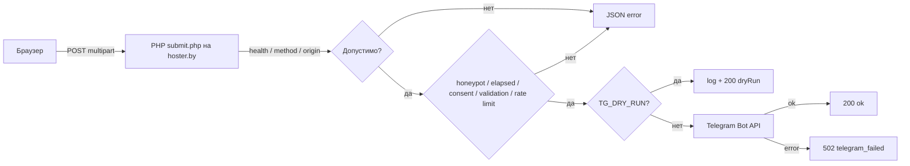

# Форма заявок — архитектура и контракт

> Реализация: [`src/components/blocks/ContactForm.astro`](../src/components/blocks/ContactForm.astro:1),
> [`src/scripts/form.ts`](../src/scripts/form.ts:1), [`public/api/submit.php`](../public/api/submit.php:1).
> Общие модули: [`src/lib/phone.ts`](../src/lib/phone.ts:1),
> [`src/lib/form-timing.ts`](../src/lib/form-timing.ts:1),
> [`src/lib/form-errors.ts`](../src/lib/form-errors.ts:1).
> План рефакторинга: [`plans/refactoring-form-v3.md`](../plans/refactoring-form-v3.md:1).
> Решение по транспорту: [`plans/adr-002-form-transport.md`](../plans/adr-002-form-transport.md:1).

## 1. Схема



- Сайт статический; PHP используется **только** для `/api/submit.php`.
- Node-процесс для формы не нужен.
- Секреты читаются только на сервере через `getenv()`.
- `public/api/submit.php` копируется сборкой в `dist/client/api/submit.php`.

## 2. Запрос

`POST /api/submit.php`, `Content-Type: multipart/form-data`.

| Поле | Обяз. | Правила |
|---|---|---|
| `name` | да | 1–100 символов после `trim`; пробелы схлопываются |
| `phone` | да | нормализуется до `375XXXXXXXXX`, ровно 12 цифр; принимаются `29…`, `80…`, `+375 …` |
| `message` | нет | ≤ 1000 символов |
| `consent-pd` | да | значение `on` (также `1`/`true`) |
| `marketing-consent` | нет | значение `on`; переименовано из `consent-marketing` |
| `website` | — | honeypot, должен быть пустым |
| `elapsed` | нет | мс от первого ввода; допустимо `3000…86400000` |
| `ts` | нет | legacy unix-секунды; проверяется только при отсутствии `elapsed` |
| `page` | нет | pathname страницы, заполняется JS |
| `form-id` | нет | id формы для страниц с несколькими формами |

Требования к источнику:

- `Origin` **или** `Referer` обязателен и должен совпадать с одним из `ALLOWED_ORIGINS`.
- Health-check (`GET ?health=1`) проверку origin не требует.
- POST без `Origin`/`Referer` или с чужим origin → `403 forbidden_origin`.

## 3. Ответы

| HTTP | `code` | Когда |
|---|---|---|
| 200 | — | успех; `{ok:true}` или `{ok:true, dryRun:true}` |
| 200 | — | honeypot / слишком быстрая отправка — тихо, без Telegram |
| 200 | — | `?health=1` → `{ok:true, configured:bool, dryRun:bool}` |
| 405 | `method_not_allowed` | не POST (кроме health); заголовок `Allow: POST` |
| 403 | `forbidden_origin` | `Origin`/`Referer` не из `ALLOWED_ORIGINS` |
| 422 | `consent_required` | нет `consent-pd`; `field: "consent-pd"` |
| 422 | `validation` | неверное поле; `field` указывает на поле |
| 429 | `rate_limited` | превышен лимит по IP или телефону |
| 502 | `telegram_failed` | Telegram вернул ошибку или недоступен |
| 503 | `not_configured` | нет `TG_BOT_TOKEN`/`TG_CHAT_ID` и не dry-run |
| 500 | `server_error` | непредвиденная ошибка |

Формат ошибки:

```json
{
  "ok": false,
  "error": {
    "code": "validation",
    "field": "phone",
    "message": "Укажите корректный номер телефона."
  }
}
```

Заголовки всех ответов:

```http
Content-Type: application/json; charset=utf-8
Cache-Control: no-store
X-Content-Type-Options: nosniff
```

## 4. Переменные окружения

| Переменная | Обяз. | По умолчанию | Назначение |
|---|---|---|---|
| `TG_BOT_TOKEN` | prod | — | токен бота |
| `TG_CHAT_ID` | prod | — | чат/группа для заявок |
| `TG_DRY_RUN` | нет | `0` | `1` — не отправлять в Telegram |
| `ALLOWED_ORIGINS` | нет | `https://kiberstol.by` | список origin через запятую |
| `TRUSTED_PROXIES` | нет | — | IP/CIDR прокси для `X-Forwarded-For` |
| `FORM_CONSENT_VERSION` | нет | `1` | версия согласия в заявке |
| `LEADS_LOG_PATH` | нет | — | опциональный лог заявок вне webroot (содержит ПД) |
| `RATE_LIMIT_DIR` | нет | `sys_get_temp_dir()` | каталог счётчиков rate limit |
| `TG_API_BASE` | нет | `https://api.telegram.org` | только для тестов/диагностики |

Правила:

- Ни одна переменная не имеет префикс `PUBLIC_`.
- Ни одна переменная не читается в клиентском коде.
- `.env` и `.env.*` — в `.gitignore`; в репозитории только `.env.example`.
- Токен не логируется и не выводится в ответах.
- `TG_API_BASE` в production оставляйте пустым/дефолтным.

## 5. Поведение сервера

Порядок обработки:

1. Заголовки ответа.
2. `GET ?health=1` (исключение из method/origin).
3. Проверка метода (`POST`), иначе `405` + `Allow: POST`.
4. Проверка `Origin`/`Referer` по `ALLOWED_ORIGINS`.
5. Honeypot `website` → `200 {ok:true}` без Telegram.
6. Тайминг:
   - `elapsed` — целое число мс. `< 3000` → тихий `200`; `> 86400000` игнорируется (заявка принимается);
   - если `elapsed` отсутствует/нечисловой — legacy `ts`: `time() - ts < 3` → тихий `200`;
   - если нет ни `elapsed`, ни `ts` — заявка принимается (совместимость).
7. Обязательное `consent-pd`, иначе `422 consent_required`.
8. Валидация и нормализация `name`, `phone`, `message`, `page`, `form-id`.
9. Проверка creds: если не dry-run и нет `TG_*` → `503 not_configured`.
10. Rate limit (см. ниже), иначе `429`.
11. Dry-run: запись в `error_log`/`LEADS_LOG_PATH` без Telegram → `200 {ok:true,dryRun:true}`.
12. Отправка в Telegram → `200 {ok:true}` или `502 telegram_failed`.

### 5.1. Rate limit

- Окно — 10 минут.
- Лимит по IP — 5 заявок; по телефону — 3 заявки.
- Для телефона хранится только `sha256`-хеш, без ПД.
- Счётчики — файлы в `RATE_LIMIT_DIR`, доступ через `flock`, старые файлы периодически удаляются.
- IP берётся из `REMOTE_ADDR`; `X-Forwarded-For` учитывается только если `REMOTE_ADDR` входит в `TRUSTED_PROXIES`.
- При ошибке файловой системы лимит не блокирует приём (fail-open).

### 5.2. Telegram

- `cURL`, при его отсутствии — `file_get_contents` с `ignore_errors`.
- Таймаут 10 с (connect 5 с).
- Ответ парсится по `ok`; иначе `502 telegram_failed`.
- Текст отправляется с `parse_mode=HTML`; пользовательские данные экранируются.
- В `error_log` попадают только код события и краткая причина без ПД и токена.

Шаблон сообщения:

```
Новая заявка с сайта Kiberstol.by

Имя: ...
Телефон: +375 XX XXX-XX-XX
Сообщение: ...
Страница: /products/meta-w
Согласие ПД: да (1)
Согласие на рекламу: да/нет
Дата: 23.10.2026 15:00:00
```

### 5.3. Логи

- `error_log`: `dry_run accepted lead page=… marketing=…`, `rate_limited`, `telegram_failed <reason>`, `unhandled <Class>`.
- Имя, телефон, сообщение и IP в `error_log` не пишутся.
- `LEADS_LOG_PATH` (если задан) — JSONL с данными заявки; файл должен быть вне webroot.

## 6. Health-check

```http
GET /api/submit.php?health=1
```

```json
{ "ok": true, "configured": true, "dryRun": false }
```

Значения секретов не раскрываются. Используется в smoke-проверке после деплоя.

## 7. Клиент

[`ContactForm.astro`](../src/components/blocks/ContactForm.astro:1):

- уникальный `id` через проп (по умолчанию `order-form`); несколько форм поддерживаются через `data-form`;
- honeypot `website` — off-screen (не `display:none`);
- `<noscript>` с телефоном;
- `maxlength`, `pattern`, `inputmode="tel"`;
- статус `[data-form-status]` с `role="status"` и `aria-live="polite"`;
- ссылка на политику — вне `label`, чтобы клик не переключал чекбокс;
- `marketing-consent` (вместо `consent-marketing`);
- скрытые `elapsed`, `ts`, `page`.

[`form.ts`](../src/scripts/form.ts:1):

- маска через `formatPhone` (общий модуль);
- `elapsed` — от первого ввода в текстовое поле; чекбоксы и hidden не считаются;
- `resetForm` сбрасывает таймер, `elapsed`, ошибки и обновляет `ts`/`page`;
- `AbortController` с таймаутом 15 с;
- парсинг JSON-ошибок, `aria-invalid`, `aria-describedby`, фокус на первом невалидном поле;
- кнопка: `disabled`, `aria-busy`, текст «Отправка…»;
- защита от двойного связывания: `form.dataset.bound`;
- после `200`: `generate_lead` в GA4/Метрике при согласии `analytics`,
  рекламная цель `lead` при согласии `marketing`.

## 8. Безопасность

- Honeypot `website` — off-screen, не `display:none`.
- Тайминг `elapsed` — не зависит от часов клиента.
- Rate limit: IP + хеш телефона, `flock`, очистка старых файлов.
- `Origin`/`Referer` — только из `ALLOWED_ORIGINS`.
- Экранирование пользовательских данных перед Telegram (`parse_mode=HTML`).
- Ограничение длины полей.
- `Cache-Control: no-store`, `X-Content-Type-Options: nosniff`.
- Секрет-скан `dist/client` и `src` в CI.

## 9. Локальная проверка

```bash
npm run build
npm run serve:php -- --dry-run
```

`serve:php` загружает `.env`, поднимает `php -S` над `dist/client` и с `--dry-run`
включает `TG_DRY_RUN=1` — creds не нужны. `astro preview` PHP **не исполняет**.

Проверки:

```bash
php -l public/api/submit.php   # синтаксис
npm run check:secrets          # секреты в dist/client и src
npm run test:api               # контракт API (реальный PHP + фейковый Telegram)
```

Ручные запросы:

```bash
curl "http://127.0.0.1:8080/api/submit.php?health=1"
curl -X POST "http://127.0.0.1:8080/api/submit.php" \
  -H "Origin: http://127.0.0.1:8080" \
  -F "name=Тест" -F "phone=+375 (29) 637-76-63" \
  -F "consent-pd=on" -F "elapsed=5000"
```

## 10. Матрица тестов

| Сценарий | Unit | E2E | API |
|---|---|---|---|
| Маска `296377663` | да | да | — |
| Маска `80296377663` | да | да | — |
| Нормализация `+375 (29) 637-76-63` | да | — | да |
| Нет `consent-pd` | — | да | да |
| `marketing-consent` в заявке | — | да | да |
| Honeypot | — | да | да |
| `elapsed < 3000` | да | да | да |
| `elapsed` отсутствует | да | — | да |
| Повторная отправка | — | да | — |
| Rate limit IP | — | да | да |
| Rate limit телефон | — | — | да |
| 405 / 403 | — | — | да |
| 503 без creds | — | да | да |
| 502 от Telegram | — | да | да |
| Dry-run | — | да | да |
| Health | — | — | да |
| No-JS | — | да | — |
| XSS в имени | — | да | да |
| a11y ошибок | — | да | — |
| Секреты в `dist/client` | — | — | CI |

## 11. Диагностика

| Симптом | Причина / решение |
|---|---|
| `503 not_configured` | не заданы `TG_BOT_TOKEN`/`TG_CHAT_ID`; проверьте env хостинга |
| `502 telegram_failed` | неверный токен, бот не в чате, нет прав администратора |
| `429 rate_limited` | превышен лимит; проверьте `TRUSTED_PROXIES` за прокси |
| Заявка «отправлена», но не пришла | сработал honeypot/тайминг; смотрите `error_log` |
| `403 forbidden_origin` | домен не в `ALLOWED_ORIGINS` (staging) |
| PHP отдаёт исходник | хостинг не исполняет PHP для `/api/submit.php` |

## 12. Смежный риск: Keystatic

Форма не зависит от Node. Админка Keystatic — зависит: `/keystatic` и `/api/keystatic`
требуют Node-процесс. На hoster.by доступность Node проверяется отдельно; решение
фиксируется отдельным ADR. Форма реализуется независимо от этого решения.
