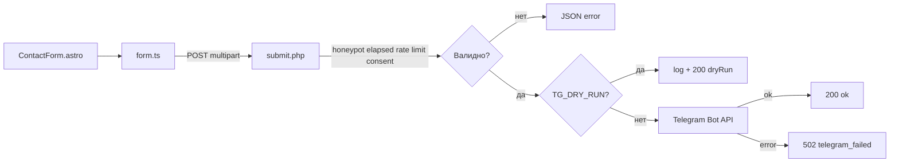

# Архитектурный план разработки — Kiberstol.by

> Детальный план поэтапной реализации интернет-магазина игровых столов на базе типового проекта FastPage.
> Источник требований: [`requirements/kiberstol-tz.md`](../requirements/kiberstol-tz.md).
> Прогресс отслеживается в [`plans/progress.md`](progress.md) — обновляется после каждого шага.

---

## 0. Сводка зафиксированных решений

| Вопрос | Решение |
|---|---|
| Фреймворк | **Astro 7** (SSG, `output: 'static'`), Content Layer API (`loader: glob()`) |
| CMS | **Keystatic** (git-based, GitHub OAuth, `fields.blocks`) — вместо Sveltia из FastPage |
| Стилизация | **Tailwind CSS v4** (`@tailwindcss/vite`) + CSS-переменные |
| Тема | **Одна фиксированная cyberpunk** (без свитчера), адаптирована под бренд |
| Интерактив | Vanilla JS/TS, без сторонних библиотек |
| Форма | Статика + PHP-модуль `POST /api/submit.php` → Telegram Bot API; creds только в env хостинга; dry-run для тестов |
| Защита форм | Honeypot + `elapsed`-тайминг + rate limit IP/телефон + проверка Origin |
| SEO | Сквозной слой: `SEO.astro` + JSON-LD + `@astrojs/sitemap` + семантика |
| Деплой | hoster.by (PHP), домен `.BY`; статика + PHP-модуль формы |
| CMS runtime | Keystatic требует Node для `/keystatic`; доступность Node на hoster.by — отдельный трек |

---

## 1. Технологический стек и зависимости

### 1.1. Зависимости (`package.json`)

| Пакет | Назначение |
|---|---|
| `astro` (^7) | Фреймворк SSG |
| `@astrojs/sitemap` | Автогенерация `sitemap.xml` |
| `@tailwindcss/vite` + `tailwindcss` (^4) | Стилизация (CSS-first) |
| `@tailwindcss/typography` | Стили rich-text (WYSIWYG) |
| `@fontsource-variable/*` | Self-host шрифты (OFL, кириллица) |
| `@keystatic/core` | Ядро CMS |
| `@keystatic/astro` | Интеграция Keystatic с Astro |
| `@astrojs/react` | React-рендерер для UI Keystatic |
| `@astrojs/node` | Node-адаптер — только для серверных маршрутов Keystatic (`/keystatic`, `/api/keystatic`) |
| `react` + `react-dom` | Peer-зависимости Keystatic (UI админки) |
| `marked` + `sanitize-html` | Рендер markdown для `richText`-блоков (см. §3) |
| `sharp` | Оптимизация изображений на этапе сборки (WebP/AVIF, ресайз) |
| `typescript` + `@astrojs/check` | Проверка типов (`npm run check`) |

> **Отличие от FastPage:** `@sveltia/cms` заменяется на `@keystatic/core` + `@keystatic/astro` + `react`/`react-dom`.

> **Почему `@astrojs/node` при `output: 'static'`:** Keystatic нужен на проде, поэтому node-адаптер обслуживает только серверные маршруты `/keystatic` и `/api/keystatic`. Все контентные страницы остаются статичными (SSG).
>
> **hoster.by:** PHP подтверждён и используется для формы. Node.js на дешёвом тарифе может быть недоступен или ограничен — это влияет только на админку Keystatic, не на форму. Схема CMS фиксируется отдельным ADR.

### 1.2. Скрипты

```json
{
  "scripts": {
    "dev": "astro dev",
    "build": "astro build",
    "check": "astro check",
    "preview": "astro preview",
    "astro": "astro"
  }
}
```

> `npm run check` (`astro check`) — обязательная проверка типов перед коммитом.
> `npm run build` — статическая сборка; `sharp` собирает responsive-изображения.

---

## 2. Структура проекта

```text
/
├── public/
│   ├── assets/                    # Статические ресурсы (og-default.png, hero-видео)
│   │   └── uploads/               # legacy-заглушка (не используется CMS, см. README)
│   ├── api/
│   │   └── submit.php             # Приём заявок → Telegram
│   ├── favicon.svg
│   └── robots.txt
├── src/
│   ├── content.config.ts          # Zod-схемы всех коллекций
│   ├── assets/
│   │   └── uploads/               # Актуальный медиа-слой Keystatic (фото товаров)
│   ├── content/
│   │   ├── products/              # Модели столов (.md)
│   │   ├── lines/                 # Линейки столов (.md)
│   │   ├── site/                  # settings.yaml — реквизиты, nav, аналитика
│   │   ├── legal/                 # privacy, cookie-policy, terms, returns, complaints, care
│   │   └── sections/              # Тексты секций главной (FAQ — в variant секции)
│   ├── components/
│   │   ├── layout/                # Header, Nav, Footer, LegalBlock
│   │   ├── blocks/                # Гибкие блоки контента + ContentBlocks.astro
│   │   ├── ui/                    # Logo, ProductCard (карусель/лайтбокс — в scripts)
│   │   └── seo/                   # SEO.astro + jsonld/*
│   ├── layouts/
│   │   └── BaseLayout.astro
│   ├── lib/
│   │   ├── phone.ts               # Нормализация и маска телефона
│   │   ├── form-timing.ts         # elapsed-тайминг формы
│   │   └── form-errors.ts         # Коды и тексты ошибок формы
│   ├── styles/
│   │   ├── global.css
│   │   ├── fonts.css
│   │   └── themes/cyberpunk.css   # Единственная тема
│   ├── scripts/
│   │   ├── app.ts                 # Bootstrap (astro:page-load)
│   │   ├── consent.ts             # Модель согласия
│   │   ├── cookie-consent.ts      # UI баннера
│   │   ├── analytics.ts           # GA4 + Яндекс.Метрика (gated)
│   │   ├── advertising.ts         # Google Ads + Яндекс.Директ (gated)
│   │   ├── form.ts                # Honeypot + маска + отправка
│   │   ├── carousel.ts            # Слайдер
│   │   ├── lightbox.ts            # Лайтбокс
│   │   ├── faq.ts                 # Аккордеон
│   │   ├── reveal.ts              # Reveal-on-scroll
│   │   └── menu.ts                # Мобильное меню
│   └── pages/
│       ├── index.astro            # Главная
│       ├── products/
│       │   ├── index.astro        # /products — каталог
│       │   └── [slug].astro       # /products/[slug] — карточка
│       ├── lines/
│       │   └── [slug].astro       # /lines/[slug] — линейка
│       ├── privacy.astro
│       ├── cookie-policy.astro
│       ├── terms.astro
│       ├── returns.astro
│       ├── complaints.astro
│       ├── care.astro
│       └── 404.astro
├── keystatic.config.ts            # Конфиг Keystatic
├── astro.config.mjs               # output: static, sitemap, Tailwind, Keystatic
└── package.json
```

> **Маршруты Keystatic:** отдельного файла `src/pages/keystatic/[...params].astro`
> нет. Интеграция `@keystatic/astro` сама инжектит маршруты `/keystatic` и
> `/api/keystatic` при сборке (см. `astro.config.mjs`).
>
> **Медиа:** актуальные загрузки — `src/assets/uploads/**`; `public/assets/uploads`
> сохранён как legacy-заглушка для старых ссылок и не используется CMS.

---

## 3. Контентная модель (коллекции)

Полные Zod-схемы — в [`requirements/kiberstol-tz.md`](../requirements/kiberstol-tz.md) §6. Кратко:

| Коллекция | Назначение | Ключевые поля |
|---|---|---|
| `products` | Модели столов | `title`, `line` (relationship → `lines`), `price`, юр. поля (manufacturer, supplier, countryOfOrigin, warranty, used), `specs`, `image`, `gallery`, `badge`, `ctaText`, `content` (blocks), `seo` |
| `lines` | Линейки столов | `title`, `description`, `image`, `features`, `content` (blocks), `seo` |
| `site` | Реквизиты ИП (единый источник правды) | `brand`, `tagline`, `fullName`, `unp`, `registrationDate`, `tradeRegistryNumber/Date`, `phone`, `email`, `viber`, `instagram`, `address`, `workHours`, `authorizedBody`, `authorizedBodyPhone`, `labels`, `nav`, `analytics`, `advertising`, `seo` |
| `legal` | Юр. документы | `title`, `updatedAt`, `seo` |
| `sections` | Тексты секций главной | `heading`, `body`, `content` (blocks), `variant` (утверждено: hero/advantages/catalog/delivery/faq/contact; `order` — зарезервирован), `order` |

> **Исключено из FastPage:** `blog`, `showcase`, `testimonials`, `instagram`, `integrations`, `products` (услуги). Добавлено: `lines`.
>
> **`site` — singleton `settings.yaml`:** реквизиты, навигация, аналитика/реклама,
> подписи интерфейса (`labels`) и глобальный SEO хранятся в
> [`src/content/site/settings.yaml`](../src/content/site/settings.yaml). Поля
> `brandColors`, `paymentMethods`, `deliveryMethods` из `site` удалены: цвета
> задаются только в CSS, а способы оплаты/доставки — в
> [`sections/delivery.md`](../src/content/sections/delivery.md) (`variant.delivery`).
>
> **`products.line` — relationship:** в Keystatic поле `line` — это
> `fields.relationship({ collection: 'lines' })`, а в Zod — строка (id линейки).
> Свободный текст линейки больше не используется.
>
> **Коллекции `faq` нет:** вопросы-ответы редактируются в секции `faq`
> (`sections/faq.md`, `variant.discriminant === 'faq'`).

### Гибкие блоки контента (`contentBlocks`)

Блоки: `hero`, `richText`, `image`, `imageCarousel`, `video`, `videoGif`, `gallery`, `cta`, `faq`, `specs`, `banner`, `columns`, `quote`, `divider`. Каждый — отдельный Astro-компонент в `src/components/blocks/`, рендерятся через `ContentBlocks.astro`.

> **Формат сериализации `fields.blocks`:**
> Keystatic сериализует `fields.blocks` как `{ discriminant, value }`, где
> `discriminant` — ключ блока, а `value` — его поля. Zod-схема:
> `z.discriminatedUnion('discriminant', ...)`. Поле `type` внутри `value` —
> legacy: оно может присутствовать в старом контенте, но не участвует в
> рендере и отбрасывается Zod. См. [`plans/adr-001-content-blocks.md`](adr-001-content-blocks.md).

> **Разделение markdown-рендера (два разных слоя, не дублирование):**
> - Контентные поля документа (`description`, `body`, `answer`) — `fields.mdx` (нативный Keystatic), рендер через `astro:content` `render()`/`Content`.
> - Блочный `richText` внутри `contentBlocks` — `fields.text` + `marked`/`sanitize-html` (см. `src/lib/markdown.ts`), рендер через `RichText.astro`.
> `fields.mdx` несовместим с вложенными `fields.blocks`, поэтому `richText`-блоки используют `marked`.

### Разделение слоёв: контент / движок / UI

Архитектурный принцип проекта — строгое разделение трёх слоёв, чтобы контент настраивался **только в CMS**, а внешний вид — **только в CSS**. Движок (Astro-компоненты и логика) не содержит ни контента, ни стилей.

| Слой | Что содержит | Где настраивается | Пример |
|---|---|---|---|
| **Контент** | Тексты, изображения, цены, реквизиты, блоки, FAQ, SEO-поля | **Только Keystatic CMS** (`src/content/*`) | `site/settings.yaml`, `sections/*.md`, `lines`, `products`, `legal` |
| **Движок** | Структура, логика, рендер, маршруты, скрипты | **Только код** (`src/components`, `src/layouts`, `src/pages`, `src/scripts`) | `BaseLayout`, `ContentBlocks`, `form.ts` |
| **UI** | Цвета, шрифты, отступы, анимации, адаптивность | **Только CSS** (`src/styles/*`) | `cyberpunk.css`, Tailwind-утилиты |

**Правила:**

- **Контент не хардкодится** в компонентах: все видимые тексты, цены, реквизиты, изображения и блоки берутся из CMS-коллекций. Изменение контента в CMS не требует правки кода.
- **UI не задаётся в контенте:** CMS не управляет цветами, шрифтами, отступами и анимациями. Визуальное оформление определяется только CSS-темой и Tailwind-классами в компонентах.
- **Движок не содержит стилей и контента:** Astro-компоненты описывают структуру и логику, но не встраивают inline-стили и не дублируют тексты.
- **Единый источник правды:** реквизиты, навигация, аналитика/реклама и глобальный SEO — в `site/settings.yaml`; тексты секций — в `sections`; товары/линейки — в `products`/`lines`.
- **Смена темы = смена CSS:** ребрендинг (цвета, шрифты) выполняется правкой CSS-темы без изменения контента и движка.

> **Реализовано на старте:** [`index.astro`](../src/pages/index.astro) не содержит захардкоженных текстов — заголовок, описание и SEO-мета берутся из [`site/settings.yaml`](../src/content/site/settings.yaml) и [`sections/*.md`](../src/content/sections) через `getEntry`/`getCollection`.

### Утвержденный состав секций главной (эталон)

Текущий контент главной страницы зафиксирован как эталон. В рамках
рефакторинга v2 состав, порядок и содержимое секций **не изменяются**.

| # | Секция (`variant.discriminant`) | Файл | Якорь |
|---|---|---|---|
| 1 | `hero` | [`sections/hero.md`](../src/content/sections/hero.md) | — |
| 2 | `advantages` | [`sections/advantages.md`](../src/content/sections/advantages.md) | `#advantages` |
| 3 | `catalog` | [`sections/catalog.md`](../src/content/sections/catalog.md) | `#catalog` |
| 4 | `delivery` | [`sections/delivery.md`](../src/content/sections/delivery.md) | `#delivery` |
| 5 | `faq` | [`sections/faq.md`](../src/content/sections/faq.md) | `#faq` |
| 6 | `contact` | [`sections/contacts.md`](../src/content/sections/contacts.md) | `#contacts` |

**Зафиксированные решения:**

- **Каталог на главной показывает только линейки** (баннеры → `/lines/[slug]`).
  Модели выводятся на странице линейки и в `/products`. Это утвержденное
  решение, а не временное ограничение.
- **Секции `order` и `banners` не входят в эталон.** Схема допускает
  `order` для обратной совместимости, но на главной он не используется.
- **Модели на главной не выводятся.** Требования о вложенном каталоге
  «линейки → модели» на главной относятся к будущему развитию.
- **Навигация и якоря** задаются в [`site/settings.yaml`](../src/content/site/settings.yaml)
  (`nav`) и соответствуют перечисленным секциям.

### Фактическое состояние реализации (после рефакторинга v2)

Сводка расхождений, устранённых в документации:

| Область | Фактическое состояние |
|---|---|
| Настройки сайта | Единственный источник — `src/content/site/settings.yaml` (singleton `site`). `settings.md` отсутствует. |
| Медиа | Актуальные загрузки — `src/assets/uploads/**`; `public/assets/uploads` — legacy-заглушка. |
| Маршруты Keystatic | Отдельного `src/pages/keystatic/[...params].astro` нет; маршруты инжектит `@keystatic/astro`. |
| FAQ | Отдельной коллекции `faq` нет; вопросы-ответы — в `sections/faq.md` (`variant.discriminant === 'faq'`). |
| Формат блоков | `{ discriminant, value }`; поле `type` внутри `value` — legacy и отбрасывается Zod. |
| `brandColors` | Удалено из схемы, CMS и контента; цвета — только в CSS-теме. |
| Оплата/доставка | Не в `site`, а в `sections/delivery.md` (`variant.delivery.paymentMethods/deliveryMethods`). |
| Главная | Утверждённый эталон: hero → advantages → catalog → delivery → faq → contact. |
| `order`/`banners`/модели на главной | Вне рефакторинга v2 (будущее развитие); на главной не используются. |

---

## 4. Поэтапный план реализации

### Фаза 0 — Инициализация проекта и репозитория

| # | Шаг | Результат |
|---|---|---|
| 0.1 | Создать git-репозиторий `kiberstol` (локально + remote) | `.git/`, remote `origin` |
| 0.2 | Инициализировать Astro-проект (на базе FastPage, без Sveltia) | `package.json`, `astro.config.mjs`, `tsconfig.json` |
| 0.3 | Установить зависимости (Astro, Tailwind, sitemap, Keystatic, React, шрифты) | `node_modules/`, `package-lock.json` |
| 0.4 | Настроить `astro.config.mjs` (`site`, `output: 'static'`, Tailwind, sitemap, Keystatic) | рабочий `astro dev` |
| 0.5 | Создать `.gitignore`, `.env.example` | базовые файлы |
| 0.6 | Коммит + пуш | зафиксированная точка старта |

### Фаза 1 — Контентная модель

| # | Шаг | Результат |
|---|---|---|
| 1.1 | `src/content.config.ts` — схемы `products`, `lines`, `site`, `legal`, `sections` + `contentBlocks` + `seoSchema` | валидация контента |
| 1.2 | Создать структуру `src/content/*` с плейсхолдер-файлами | коллекции читаются |
| 1.3 | Коммит + пуш | — |

### Фаза 2 — Базовая разметка и переиспользуемые компоненты

| # | Шаг | Результат |
|---|---|---|
| 2.1 | `BaseLayout.astro` (html/head/body, ClientRouter, слоты) | единый layout |
| 2.2 | `Header.astro` + `Nav.astro` (логотип, бренд, телефон, меню) | шапка |
| 2.3 | `Footer.astro` + `LegalBlock.astro` (обязательные сведения ИП) | футер с юр. блоком |
| 2.4 | `SEO.astro` + JSON-LD компоненты (`Organization`, `Product`, `ItemList`, `BreadcrumbList`, `FAQPage`) | SEO-слой |
| 2.5 | Коммит + пуш | — |

### Фаза 3 — Гибкие блоки контента

| # | Шаг | Результат |
|---|---|---|
| 3.1 | `ContentBlocks.astro` (маппинг типа блока → компонент) | рендер массива блоков |
| 3.2 | Компоненты блоков: `hero`, `richText`, `image`, `imageCarousel`, `video`, `videoGif`, `gallery`, `cta`, `faq`, `specs`, `banner`, `columns`, `quote`, `divider` | все блоки |
| 3.3 | Коммит + пуш | — |

### Фаза 4 — Страницы

| # | Шаг | Результат |
|---|---|---|
| 4.1 | `index.astro` — главная (секции в порядке §4.1 ТЗ) | главная |
| 4.2 | `products/index.astro` — каталог (линейки → модели) | `/products` |
| 4.3 | `lines/[slug].astro` — страница линейки (generic, `getStaticPaths`) | `/lines/[slug]` |
| 4.4 | `products/[slug].astro` — карточка модели (юр. поля + блоки) | `/products/[slug]` |
| 4.5 | 5 юридических страниц (`privacy`, `cookie-policy`, `terms`, `returns`, `complaints`) | юр. страницы |
| 4.6 | Коммит + пуш | — |

### Фаза 5 — Функциональные модули (vanilla TS)

| # | Шаг | Результат |
|---|---|---|
| 5.1 | `form.ts` + `public/api/submit.php` (honeypot, маска, Telegram) — детальный план: [`refactoring-form-v3.md`](refactoring-form-v3.md) | заявки |
| 5.2 | `consent.ts` + `cookie-consent.ts` (гранулярное согласие) | cookie-баннер |
| 5.3 | `analytics.ts` + `advertising.ts` (gated) | аналитика/реклама |
| 5.4 | `carousel.ts` + `lightbox.ts` | галерея |
| 5.5 | `faq.ts`, `reveal.ts`, `menu.ts`, `app.ts` | интерактив |
| 5.6 | Коммит + пуш | — |

### Фаза 6 — Keystatic CMS

| # | Шаг | Результат |
|---|---|---|
| 6.1 | `keystatic.config.ts` (коллекции, `fields.blocks`, медиа) | конфиг CMS |
| 6.2 | Маршруты `/keystatic` и `/api/keystatic` инжектятся интеграцией `@keystatic/astro` (отдельный page-файл не нужен) | маршрут `/keystatic` |
| 6.3 | Настройка медиа-слоя (`src/assets/uploads`, WebP ≤2000px через `astro:assets`) | загрузка медиа |
| 6.4 | Коммит + пуш | — |

### Фаза 7 — Тема cyberpunk

| # | Шаг | Результат |
|---|---|---|
| 7.1 | `cyberpunk.css` — адаптация под бренд (голубой/фиолетовый/белый) | тема |
| 7.2 | `global.css` + `fonts.css` (self-host шрифты) | стили |
| 7.3 | Удалить свитчер тем (одна фиксированная тема) | без переключателя |
| 7.4 | Коммит + пуш | — |

### Фаза 8 — SEO

| # | Шаг | Результат |
|---|---|---|
| 8.1 | JSON-LD `Product + Offer` (BYN), `Organization`, `ItemList`, `BreadcrumbList`, `FAQPage` | разметка |
| 8.2 | `@astrojs/sitemap` (исключить `/keystatic`, юр. страницы) + `robots.txt` | sitemap/robots |
| 8.3 | Семантика: один `h1`, `alt` у фото | семантика |
| 8.4 | Коммит + пуш | — |

### Фаза 9 — Юридический контент

| # | Шаг | Результат |
|---|---|---|
| 9.1 | `legal/privacy.md`, `cookie-policy.md`, `terms.md`, `returns.md`, `complaints.md`, `care.md` | юр. тексты |
| 9.2 | `site/settings.yaml` — реквизиты ИП, реестр; оплата/доставка — в `sections/delivery.md` | реквизиты |
| 9.3 | Коммит + пуш | — |

### Фаза 10 — Плейсхолдеры контента

| # | Шаг | Результат |
|---|---|---|
| 10.1 | `lines/*.md` (4 линейки) + `products/*.md` (модели) с плейсхолдерами | каталог |
| 10.2 | `sections/*.md` (FAQ — в `sections/faq.md`) | тексты главной |
| 10.3 | Коммит + пуш | — |

### Фаза 11 — Сборка и приёмка

| # | Шаг | Результат |
|---|---|---|
| 11.1 | `astro build` без ошибок | статическая сборка |
| 11.2 | Проверка критериев приёмки (§13 ТЗ) | готовность |
| 11.3 | Финальный коммит + пуш | — |

---

## 5. Ключевые отличия от FastPage

| Аспект | FastPage | Kiberstol |
|---|---|---|
| CMS | Sveltia (`@sveltia/cms`) | Keystatic (`@keystatic/core` + `@keystatic/astro`) |
| Темы | 3 темы + свитчер | 1 фиксированная cyberpunk |
| Товары | Услуги (`priceFrom`) | Физические товары (`price` + юр. поля) |
| Коллекции | blog, showcase, testimonials, instagram, integrations | + `lines`, − blog/showcase/testimonials/instagram/integrations |
| Страницы | oferta/privacy/cookie-policy | privacy/cookie-policy/terms/returns/complaints |
| Каталог | `/products/[slug]` | `/products` + `/lines/[slug]` + `/products/[slug]` |
| Гибкие блоки | нет | `fields.blocks` + `ContentBlocks.astro` |

---

## 6. Архитектура формы заявок (финализировано)

### 6.1. Принцип

- Сайт остаётся статическим (`output: 'static'`).
- Приём заявок — PHP-модуль [`public/api/submit.php`](../public/api/submit.php:1) на hoster.by.
- Node-процесс для формы не используется.
- Секреты — только `getenv()` в PHP; в клиент, `dist/client`, HTML и `data-*` не попадают.

### 6.2. Поток



### 6.3. Контракт

Полный контракт — [`docs/forms.md`](../docs/forms.md:1). Кратко:

- поля: `name`, `phone`, `message`, `consent-pd`, `marketing-consent`, `website`, `elapsed`, `ts`, `page`, `form-id`;
- ответы: `200`, `403`, `405`, `422`, `429`, `502`, `503`, `500`;
- ошибки: `{ok:false, error:{code, message, field?}}`;
- health: `GET /api/submit.php?health=1`.

### 6.4. Секреты

| Переменная | Где задаётся | Куда попадает |
|---|---|---|
| `TG_BOT_TOKEN` | env хостинга | только `getenv()` в PHP |
| `TG_CHAT_ID` | env хостинга | только `getenv()` в PHP |
| `TG_DRY_RUN` | env хостинга / локально | только PHP |

Запрещено: `PUBLIC_TG_*`, `import.meta.env.TG_*`, `data-tg-*`, инлайн-скрипты с токеном.
CI-скрипт `scripts/check-no-secrets.mjs` проверяет `dist/client` и `src`.

### 6.5. Тестирование без creds

- `TG_DRY_RUN=1` — полный прогон без Telegram.
- Playwright поднимает `php -S -t dist/client` с `TG_DRY_RUN=1`.
- API-тесты проверяют коды и health.
- После получения creds — тестовая заявка в тестовый чат, затем в боевой.

### 6.6. Смежный риск Keystatic

`/keystatic` и `/api/keystatic` требуют Node-процесс. На hoster.by доступность Node
проверяется отдельно. Варианты: Node на hoster.by, отдельный Node-хостинг для админки,
локальный Keystatic + git, другая CMS. Решение — отдельным ADR; форма не блокируется.
