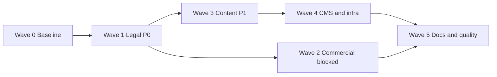

# Подзадачи по аудиту 2026-10-23

> Назначение: разбить backlog [`audit-2026-10-23.md`](audit-2026-10-23.md) на автономные запуски промптов.
> Модель: `deepseek flash` — маленькое контекстное окно, поэтому один запуск = одна карточка `SUB-XX`.
> Входные данные: [`audit-inputs.md`](audit-inputs.md).
> Журнал запусков: [`audit-2026-10-23-runs.md`](audit-2026-10-23-runs.md).

---

## 1. Как пользоваться

1. Открой нужную карточку `SUB-XX`.
2. Скопируй блок **Промпт** целиком — только карточку, не весь этот файл.
3. Запусти в режиме **Code**.
4. После выполнения допиши одну строку в [`audit-2026-10-23-runs.md`](audit-2026-10-23-runs.md).
5. Запускай карточки последовательно: даже разные файлы конфликтуют через `dist/` и общий build.

---

## 2. Правила дробления

- Один запуск — один домен: legal, products, lines, config, CMS, docs.
- Не более 8 файлов для чтения за запуск; массовые однострочные правки (slug, frontmatter) — скриптом, без чтения каждого файла.
- Не читать [`audit-2026-10-23.md`](audit-2026-10-23.md) целиком: в промпте уже есть нужный контекст.
- Проверки — только релевантные карточке, не весь набор из раздела 7 аудита.
- Если все входные значения `pending` — **стоп**, отчёт `blocked`. Если pending только часть полей — отчёт `partial`, остальное применять.
- Не менять файлы вне списка карточки.
- Отчёт — не более 15 строк: что изменено, что пропущено, результаты проверок.

---

## 3. Волны и зависимости



| Волна | Смысл | Карточки |
|---|---|---|
| 0 | Базовая линия и гигиена входных данных | SUB-01 |
| 1 | P0: юридика, контакты, адреса | SUB-02 … SUB-05 |
| 2 | P0: коммерция и smoke — заблокированы | SUB-06 … SUB-08 |
| 3 | P1: SEO и контент | SUB-09 … SUB-15 |
| 4 | P1: sitemap, CMS, деплой | SUB-16 … SUB-19 |
| 5 | P2: CI, документация, housekeeping | SUB-20 … SUB-23 |
| — | Заблокированы до данных клиента | SUB-24, SUB-25 |

---

## 4. Сводная таблица

| ID | Волна | Приоритет | Задача | Файлы | Вход | Статус |
|---|---|---|---|---|---|---|
| SUB-01 | 0 | — | Baseline и гигиена входных данных | `plans/*` | — | ready |
| SUB-02 | 1 | P0 | Settings: юр. и контактные поля | `settings.yaml`, `content-schemas.ts`, `keystatic.config.ts` | `legal.*` | ready |
| SUB-03 | 1 | P0 | `complaints.md` + `returns.md` | 2–3 legal md | `legal.*` | ready |
| SUB-04 | 1 | P0 | `privacy.md` | `privacy.md`, `docs/deployment.md`, `.env.example` | `legal.*` | ready, draft |
| SUB-05 | 1 | P0 | UI: LegalBlock, Footer, sameAs, nav | 3 astro + `settings.yaml` | `legal.*`, `content.telegram_link` | depends SUB-02 |
| SUB-06 | 2 | P0 | Цены | `product-overrides.json`, `products/*.md` | `commercial.prices` | blocked |
| SUB-07 | 2 | P1 | Тарифы доставки/сборки | `delivery.md`, `terms.md` | `commercial.delivery_tariffs` | blocked |
| SUB-08 | 2 | P0 | Финальный smoke формы | `docs/deployment.md`, `progress.md` | `ops.*`, secrets | blocked |
| SUB-09 | 3 | P1 | SEO линеек Teco и Tower | `lines/teco.md`, `lines/tower.md` | — | ready |
| SUB-10 | 3 | P1 | Уникальные описания: Meta | 4 products | `content.product_descriptions` | ready |
| SUB-11 | 3 | P1 | Уникальные описания: Teco | 4 products | то же | ready |
| SUB-12 | 3 | P1 | Уникальные описания: Tower | 6 products | то же | ready |
| SUB-13 | 3 | P1 | Уникальные описания: Addons | 6 products | то же | ready |
| SUB-14 | 3 | P1 | Описания линеек | 4 lines | `content.line_descriptions` | ready |
| SUB-15 | 3 | P1 | Копирайт главной | 3 sections | `content.advantages_wording` | ready |
| SUB-16 | 4 | P1 | Sitemap `/care` + 404 | `astro.config.mjs`, `404.astro` | — | ready |
| SUB-17 | 4 | P1 | CMS slug: legal + sections | `keystatic.config.ts`, 12 md | — | ready |
| SUB-18 | 4 | P1 | CMS slug: products + lines | `keystatic.config.ts`, 24 md | — | ready |
| SUB-19 | 4 | P1 | CMS runtime + deploy | `ci.yml`, `docs/deployment.md` | `ops.*` | ready |
| SUB-20 | 5 | P2 | CI quality: a11y + lighthouse | `ci.yml` | — | ready |
| SUB-21 | 5 | P2 | Docs sync: plans + docs | 3 md | — | after content |
| SUB-22 | 5 | P2 | Docs sync: requirements + решения | 4 md | `content.imba`, `content.filters`, `content.extra_accessories`, `legal.belgie`, `ops.*` | after content |
| SUB-23 | 5 | P2 | Housekeeping: `.tmp` + availability | scripts, schema, JSON-LD | — | ready |
| SUB-24 | — | P1 | Аналитика: ID | `settings.yaml` | `analytics.*` | blocked |
| SUB-25 | — | P2 | Фото Tower W/WB, Ms/M13* | `uploads`, products | `content.*_photos` | blocked |

---

## 5. Карточки подзадач

### SUB-01 — Baseline и гигиена входных данных

**Волна:** 0 · **Приоритет:** — · **Зависит от:** —

**Цель:** зафиксировать актуальную базовую линию и убрать технические ошибки в `audit-inputs.md`, чтобы следующие запуски не спотыкались.

**Файлы:**
- [`plans/audit-inputs.md`](audit-inputs.md)
- [`plans/progress.md`](progress.md)
- [`plans/audit-2026-10-23-runs.md`](audit-2026-10-23-runs.md) — создать

**Шаги:**
1. Запусти `npm run check`, `npm run validate:content`, `npm run build`, `npm run test:unit`.
2. Запиши результаты в `plans/progress.md` в раздел «Аудит 2026-10-23» (дата, числа, статус).
3. В `plans/audit-inputs.md` исправь `status: penansweredding` → `status: answered` у `commercial.old_price_badges`.
4. Заполни `meta.updated: "2026-10-24"`.
5. Создай `plans/audit-2026-10-23-runs.md` с таблицей: `Дата | SUB | Результат | Проверки | Примечание`.
6. Перечисли в отчёте все ключи со `status: pending`.

**Готово когда:** baseline записан, опечатка исправлена, журнал создан, список pending есть в отчёте.

**Проверки:** `npm run check`, `npm run validate:content`, `npm run build`, `npm run test:unit`.

**Промпт:**
```text
Режим: Code. Репозиторий Kiberstol.
Не читай plans/audit-2026-10-23.md целиком. Работай только по карточке SUB-01.
Не меняй файлы вне списка. Не выдумывай данные.

Файлы: plans/audit-inputs.md, plans/progress.md, plans/audit-2026-10-23-runs.md.

1. Запусти: npm run check, npm run validate:content, npm run build, npm run test:unit.
2. Запиши результаты в plans/progress.md в раздел "Аудит 2026-10-23".
3. В plans/audit-inputs.md исправь status: penansweredding -> answered у commercial.old_price_badges.
4. Поставь meta.updated: "2026-10-24".
5. Создай plans/audit-2026-10-23-runs.md с таблицей: Дата | SUB | Результат | Проверки | Примечание.
6. В отчёте перечисли все ключи со status: pending.

Отчёт: до 15 строк. Не читай секреты.
```

---

### SUB-02 — Settings: юридические и контактные поля

**Волна:** 1 · **Приоритет:** P0 · **Зависит от:** SUB-01

**Цель:** добавить в `site/settings.yaml` отдельные поля для юр. адреса, адреса книги замечаний, пункта выдачи, БелГИЭ и Telegram, чтобы убрать заглушки и не смешивать адреса.

**Файлы:**
- [`src/content/site/settings.yaml`](../src/content/site/settings.yaml)
- [`src/lib/content-schemas.ts`](../src/lib/content-schemas.ts) — блок `siteSettings`
- [`keystatic.config.ts`](../keystatic.config.ts) — singleton `site`

**Вход:**
- `legal.executive_committee_phone` = `+375 (212) 64-34-04`
- `legal.complaints_book_address` = `г. Минск, ул. Грушевская 17-14`
- `legal.pickup_address` = `нет` → пустое значение, отдельного пункта выдачи нет
- `legal.belgie` = `не требуется` → поле-справка, в UI не выводить
- `legal.legal_address` = `нужен адрес регистрации (витебск)` → **не выдумывать**; если в карточках явно указан юр. адрес ИП `Витебск, пр-т Строителей 18к3-252`, использовать его, иначе оставить пустым и `TODO`
- `content.telegram_link` = `+375 29 637-76-63` → это телефон, не ссылка; поле добавить, значение не заполнять до уточнения

**Шаги:**
1. В Zod-схему `siteSettings` добавь опциональные поля: `legalAddress`, `complaintsBookAddress`, `pickupAddress`, `belgieRegistration`, `telegram`.
2. В Keystatic singleton `site` добавь те же поля с понятными подписями.
3. В `settings.yaml`:
   - замени `authorizedBodyPhone` на `+375 (212) 64-34-04`, удали `TODO`;
   - заполни `complaintsBookAddress`;
   - `pickupAddress: ""`;
   - `belgieRegistration: "не требуется"`;
   - `legalAddress` — по правилу выше;
   - `telegram: ""` + комментарий `# TODO: нужна ссылка t.me`.
4. Не удаляй существующее поле `address` — оно ещё используется.

**Готово когда:** поля есть в схеме, CMS и YAML; телефона `XX-XX` и `TODO` по телефону нет; `npm run check` и `npm run build` проходят.

**Проверки:** `npm run check`, `npm run validate:content`, `npm run build`.

**Промпт:**
```text
Режим: Code. Репозиторий Kiberstol.
Не читай plans/audit-2026-10-23.md целиком. Работай только по карточке SUB-02.
Не меняй файлы вне списка. Не выдумывай данные: если значения нет — оставь TODO и напиши blocked в отчёте.

Файлы: src/content/site/settings.yaml, src/lib/content-schemas.ts (блок siteSettings), keystatic.config.ts (singleton site).

Добавь опциональные поля: legalAddress, complaintsBookAddress, pickupAddress, belgieRegistration, telegram.
Значения:
- authorizedBodyPhone: +375 (212) 64-34-04, TODO удалить;
- complaintsBookAddress: г. Минск, ул. Грушевская 17-14;
- pickupAddress: "" (отдельного пункта выдачи нет);
- belgieRegistration: "не требуется" (в UI не выводить);
- legalAddress: если в карточках явно указан юр. адрес ИП Витебск, пр-т Строителей 18к3-252 — использовать, иначе пусто + TODO;
- telegram: "" + TODO, потому что входное значение — телефон, а не ссылка.

Проверки: npm run check, npm run validate:content, npm run build.
Отчёт: до 15 строк.
```

---

### SUB-03 — `complaints.md` + `returns.md`

**Волна:** 1 · **Приоритет:** P0 · **Зависит от:** SUB-01

**Цель:** убрать заглушку телефона и развести адреса в обращениях; привести возвраты к одной формулировке.

**Файлы:**
- [`src/content/legal/complaints.md`](../src/content/legal/complaints.md)
- [`src/content/legal/returns.md`](../src/content/legal/returns.md)
- [`src/content/legal/terms.md`](../src/content/legal/terms.md) — только если есть противоречие по возвратам

**Вход:**
- `legal.executive_committee_phone` = `+375 (212) 64-34-04` → раздел 4.1
- `legal.complaints_book_address` = `г. Минск, ул. Грушевская 17-14` → раздел 3.1
- `legal.returns_policy` = `no_return_for_good_quality`

**Шаги:**
1. В `complaints.md` замени телефон в 4.1 и адрес книги замечаний в 3.1.
2. В `returns.md` оставь одну формулировку: товар надлежащего качества возврату не подлежит; убери противоречащие «14 дней» и спорное обоснование через «мебельные гарнитуры», если оно есть.
3. Проверь `terms.md` на противоречие; если есть — приведи к той же формулировке.
4. В отчёте отдельно напиши: «формулировка возвратов применена по решению клиента, юридическая проверка всё ещё рекомендована».

**Готово когда:** нет `XX-XX`, адрес книги замечаний один и тот же, возвраты без взаимоисключающих формулировок.

**Проверки:** `npm run validate:content`, `npm run build`.

**Промпт:**
```text
Режим: Code. Репозиторий Kiberstol.
Не читай plans/audit-2026-10-23.md целиком. Работай только по карточке SUB-03.
Не меняй файлы вне списка. Не выдумывай данные.

Файлы: src/content/legal/complaints.md, src/content/legal/returns.md, src/content/legal/terms.md (только при противоречии).

1. complaints.md: в разделе 4.1 телефон +375 (212) 64-34-04; в разделе 3.1 адрес книги замечаний: г. Минск, ул. Грушевская 17-14.
2. returns.md: одна формулировка — товар надлежащего качества возврату не подлежит. Убери "14 дней" и спорное обоснование через мебельные гарнитуры, если есть.
3. terms.md: если противоречит returns.md — приведи к той же формулировке.
4. В отчёте укажи, что юридическая проверка возвратов всё ещё рекомендована.

Проверки: npm run validate:content, npm run build.
Отчёт: до 15 строк.
```

---

### SUB-04 — `privacy.md`

**Волна:** 1 · **Приоритет:** P0 · **Зависит от:** SUB-01

**Цель:** убрать ложное «не передаёт третьим лицам», описать Telegram Bot API, трансграничную передачу, аналитику и срок хранения 12 месяцев.

**Файлы:**
- [`src/content/legal/privacy.md`](../src/content/legal/privacy.md)
- [`docs/deployment.md`](../docs/deployment.md) — раздел про хранение и consent
- [`.env.example`](../.env.example) — `FORM_CONSENT_VERSION`

**Вход:**
- `legal.privacy_telegram_wording` = «нужно обязательно описать, что данные передаются через официальное апи телеги»
- `legal.data_retention` = `12 месяцев`
- `legal.consent_version` = `1`
- `legal.privacy_policy` = `pending` → текст считать черновиком до заключения юриста

**Шаги:**
1. Перепиши `privacy.md` по разделам: оператор, какие данные, цели, основание, передача в Telegram через официальный Bot API, трансграничная передача, аналитика и cookie, срок хранения 12 месяцев, права субъекта, контакты, изменения.
2. Удали утверждение «Оператор не передаёт персональные данные третьим лицам».
3. Укажи, что GA4/Яндекс.Метрика включаются только после согласия; ID пока не указаны.
4. В `docs/deployment.md` зафиксируй срок хранения 12 месяцев и `FORM_CONSENT_VERSION=1`.
5. В отчёте пометь: «черновик, требует проверки юристом; при смене редакции поднять consent_version».

**Готово когда:** в политике есть Telegram, трансграничная передача, аналитика, срок 12 месяцев; нет ложного тезиса.

**Проверки:** `npm run validate:content`, `npm run build`.

**Промпт:**
```text
Режим: Code. Репозиторий Kiberstol.
Не читай plans/audit-2026-10-23.md целиком. Работай только по карточке SUB-04.
Не меняй файлы вне списка. Не выдумывай данные.

Файлы: src/content/legal/privacy.md, docs/deployment.md, .env.example.

Перепиши privacy.md: оператор, данные, цели, основание, передача в Telegram через официальный Bot API, трансграничная передача, аналитика и cookie, хранение 12 месяцев, права, контакты, изменения.
Удали тезис "Оператор не передаёт персональные данные третьим лицам".
Укажи, что GA4/Метрика включаются только после согласия, ID пока не заданы.
В docs/deployment.md зафиксируй хранение 12 месяцев и FORM_CONSENT_VERSION=1.
В отчёте: черновик, требует проверки юристом; при смене редакции поднять consent_version.

Проверки: npm run validate:content, npm run build.
Отчёт: до 15 строк.
```

---

### SUB-05 — UI: LegalBlock, Footer, sameAs, nav

**Волна:** 1 · **Приоритет:** P0 · **Зависит от:** SUB-02

**Цель:** вывести новые юридические поля, убрать хардкод названий документов, добавить Telegram в реквизиты и `sameAs`, перевести пункт «Доставка и оплата» на якорь.

**Файлы:**
- [`src/components/layout/LegalBlock.astro`](../src/components/layout/LegalBlock.astro)
- [`src/components/layout/Footer.astro`](../src/components/layout/Footer.astro)
- [`src/pages/index.astro`](../src/pages/index.astro) — `Organization.sameAs`
- [`src/content/site/settings.yaml`](../src/content/site/settings.yaml) — `labels`, `nav`

**Вход:**
- поля из SUB-02
- `content.telegram_link` — пока пусто/телефон; ссылку не подставлять, оставить TODO
- `ops.security_headers` = `hoster_panel` — в этой карточке не трогать

**Шаги:**
1. `LegalBlock`: выведи `legalAddress`, `complaintsBookAddress`, `pickupAddress` (только если не пусто), `authorizedBodyPhone`; подписи — из `site.labels`.
2. `Footer`: названия документов и блоков — из `site.labels`; контакты — из `settings` (phone, email, viber, instagram, telegram если ссылка валидна).
3. `index.astro`: `sameAs` собирай из viber, instagram, telegram; пустые и не-URL значения пропускай.
4. `settings.yaml`: `nav` пункт «Доставка и оплата» → `/#delivery`; `/terms` оставь в футере.
5. Добавь в `labels` недостающие подписи документов (privacy, cookie-policy, terms, returns, complaints, care).

**Готово когда:** новые поля видны в футере, нет хардкода названий документов, `sameAs` не содержит пустых значений, nav ведёт на `/#delivery`.

**Проверки:** `npm run check`, `npm run build`, `npm run test:e2e -- tests/e2e/catalog.spec.ts`, `npm run audit:a11y`.

**Промпт:**
```text
Режим: Code. Репозиторий Kiberstol.
Не читай plans/audit-2026-10-23.md целиком. Работай только по карточке SUB-05.
Не меняй файлы вне списка. Не выдумывай данные.

Файлы: src/components/layout/LegalBlock.astro, src/components/layout/Footer.astro, src/pages/index.astro, src/content/site/settings.yaml.

1. LegalBlock: выведи legalAddress, complaintsBookAddress, pickupAddress (если не пусто), authorizedBodyPhone; подписи из site.labels.
2. Footer: названия документов и блоков из site.labels; контакты из settings.
3. index.astro: sameAs из viber, instagram, telegram; пустые и не-URL пропускай.
4. settings.yaml: nav "Доставка и оплата" -> /#delivery; /terms оставь в футере.
5. Добавь в labels подписи legal-документов.

Проверки: npm run check, npm run build, npm run test:e2e -- tests/e2e/catalog.spec.ts, npm run audit:a11y.
Отчёт: до 15 строк.
```

---

### SUB-06 — Цены

**Волна:** 2 · **Приоритет:** P0 · **Зависит от:** данных клиента · **Статус:** blocked

**Цель:** заменить временные цены реальными или согласовать механизм «цена по запросу».

**Файлы:**
- [`scripts/data/product-overrides.json`](../scripts/data/product-overrides.json)
- [`src/content/products/*.md`](../src/content/products)
- [`src/lib/content-schemas.ts`](../src/lib/content-schemas.ts)
- [`src/components/seo/jsonld/Product.astro`](../src/components/seo/jsonld/Product.astro)
- [`src/pages/products/[slug].astro`](../src/pages/products/[slug].astro)

**Вход:** `commercial.prices` — `pending`, все `price: null`.

**Шаги:**
1. Если все цены `null` — **стоп**, отчёт `blocked`, ничего не менять.
2. Если цены заполнены — обнови `product-overrides.json`, примени импорт/обновление по [`docs/import-products.md`](../docs/import-products.md), проверь 20 карточек.
3. Проверь JSON-LD `Product`: `price`, `priceCurrency: BYN`, `oldPrice` только там, где задан.
4. Если клиент выбирает «цена по запросу» — не реализуй молча: опиши в отчёте два варианта (скрыть `offers` или оставить `offers` с `priceSpecification`) и запроси решение.

**Готово когда:** либо все 20 цен реальные и JSON-LD корректен, либо зафиксировано решение «цена по запросу» и схема обновлена.

**Проверки:** `npm run validate:content`, `npm run build`, `npm run test:unit`.

**Промпт:**
```text
Режим: Code. Репозиторий Kiberstol.
Не читай plans/audit-2026-10-23.md целиком. Работай только по карточке SUB-06.
Не меняй файлы вне списка. Не выдумывай цены.

Файлы: scripts/data/product-overrides.json, src/content/products/*.md, src/lib/content-schemas.ts, src/components/seo/jsonld/Product.astro, src/pages/products/[slug].astro.

Вход: commercial.prices = pending, все price: null.
Если все цены null — СТОП, отчёт blocked, ничего не менять.
Если цены заполнены — обнови overrides, примени импорт по docs/import-products.md, проверь 20 карточек и JSON-LD Product (price, priceCurrency BYN, oldPrice только где задан).
Если выбран вариант "цена по запросу" — не реализуй молча, опиши два варианта и запроси решение.

Проверки: npm run validate:content, npm run build, npm run test:unit.
Отчёт: до 15 строк.
```

---

### SUB-07 — Тарифы доставки и сборки

**Волна:** 2 · **Приоритет:** P1 · **Зависит от:** данных клиента · **Статус:** blocked

**Цель:** заменить «за доплату» на конкретные суммы/правила.

**Файлы:**
- [`src/content/sections/delivery.md`](../src/content/sections/delivery.md)
- [`src/content/legal/terms.md`](../src/content/legal/terms.md)

**Вход:** `commercial.delivery_tariffs` — `pending`, все значения пустые.

**Шаги:**
1. Если все значения пустые — **стоп**, отчёт `blocked`.
2. Если заполнены — обнови `delivery.md` и `terms.md`: Минск в пределах МКАД, за МКАД, Белпочта, доплата Tower, сборка.
3. Не придумывай суммы и не оставляй «за доплату» без числа.

**Готово когда:** в обеих страницах одинаковые суммы/правила.

**Проверки:** `npm run validate:content`, `npm run build`.

**Промпт:**
```text
Режим: Code. Репозиторий Kiberstol.
Не читай plans/audit-2026-10-23.md целиком. Работай только по карточке SUB-07.
Не меняй файлы вне списка. Не выдумывай суммы.

Файлы: src/content/sections/delivery.md, src/content/legal/terms.md.

Вход: commercial.delivery_tariffs = pending, все значения пустые.
Если все пустые — СТОП, отчёт blocked.
Если заполнены — обнови delivery.md и terms.md: Минск в пределах МКАД, за МКАД, Белпочта, доплата Tower, сборка. Суммы и правила должны совпадать.

Проверки: npm run validate:content, npm run build.
Отчёт: до 15 строк.
```

---

### SUB-08 — Финальный smoke формы

**Волна:** 2 · **Приоритет:** P0 · **Зависит от:** секретов и домена · **Статус:** blocked

**Цель:** закрыть фазу staging/production smoke: health, dry-run, реальная заявка, 403/429.

**Файлы:**
- [`docs/deployment.md`](../docs/deployment.md)
- [`plans/progress.md`](progress.md)
- [`.env.example`](../.env.example)

**Вход:** `ops.allowed_origins` = `https://kiberstol.by`; `staging_domain` = `no staging`; секреты только в `.env`/панели.

**Шаги:**
1. Проверь `GET /api/submit.php?health=1`.
2. Прогони dry-run заявку.
3. Отправь тестовую заявку в тестовый чат, затем в боевой.
4. Проверь 403 при чужом Origin и 429 при превышении rate limit.
5. Запиши результаты в `progress.md` и `docs/deployment.md`.
6. Секреты не читай и не записывай.

**Готово когда:** все пять проверок отмечены, журнал обновлён.

**Проверки:** `curl` health, dry-run, реальная заявка, 403, 429.

**Промпт:**
```text
Режим: Code. Репозиторий Kiberstol.
Не читай plans/audit-2026-10-23.md целиком. Работай только по карточке SUB-08.
Не меняй файлы вне списка. Секреты не читай и не записывай.

Файлы: docs/deployment.md, plans/progress.md, .env.example.

Проверь: GET /api/submit.php?health=1; dry-run заявку; тестовую заявку в тестовый и боевой чат; 403 при чужом Origin; 429 при превышении rate limit.
Запиши результаты в progress.md и docs/deployment.md.
Если секретов нет — отчёт blocked, ничего не выдумывать.

Отчёт: до 15 строк.
```

---

### SUB-09 — SEO линеек Teco и Tower

**Волна:** 3 · **Приоритет:** P1 · **Зависит от:** SUB-01

**Цель:** убрать copy-paste про Imba у Teco и ложное «1380×900» у Tower.

**Файлы:**
- [`src/content/lines/teco.md`](../src/content/lines/teco.md)
- [`src/content/lines/tower.md`](../src/content/lines/tower.md)

**Шаги:**
1. `teco.md`: title и description — про Teco; убери «Линейка Imba», 1020×1380, RGB, коврик.
2. `tower.md`: description «столы 1380×900» → формулировка, покрывающая 1380×900 и 1200×830 (4 из 6 моделей — 1200×830).
3. Тело линеек не трогай — это SUB-14.

**Готово когда:** в Teco нет Imba, в Tower нет утверждения только про 1380×900.

**Проверки:** `npm run validate:content`, `npm run build`.

**Промпт:**
```text
Режим: Code. Репозиторий Kiberstol.
Не читай plans/audit-2026-10-23.md целиком. Работай только по карточке SUB-09.
Не меняй файлы вне списка.

Файлы: src/content/lines/teco.md, src/content/lines/tower.md.

1. teco.md: title и description про Teco; убери "Линейка Imba", 1020x1380, RGB, коврик.
2. tower.md: description "столы 1380x900" замени на формулировку, покрывающую 1380x900 и 1200x830 (4 из 6 моделей — 1200x830).
3. Тело линеек не трогай.

Проверки: npm run validate:content, npm run build.
Отчёт: до 15 строк.
```

---

### SUB-10 — Уникальные описания: Meta

**Волна:** 3 · **Приоритет:** P1 · **Зависит от:** SUB-01

**Цель:** сделать первый абзац уникальным у 4 карточек Meta.

**Файлы:**
- [`src/content/products/meta-wb.md`](../src/content/products/meta-wb.md)
- [`src/content/products/meta-w.md`](../src/content/products/meta-w.md)
- [`src/content/products/meta-ob.md`](../src/content/products/meta-ob.md)
- [`src/content/products/meta-s.md`](../src/content/products/meta-s.md)

**Вход:** `content.product_descriptions` = `generate`; `content.load_capacity` = `убрать`.

**Шаги:**
1. Перепиши первый абзац каждой карточки: уникальный, 2–4 предложения, только факты из specs.
2. Убери тезисы про нагрузку в кг.
3. Не меняй `seo.title`/`seo.description`, цену, галерею и характеристики.
4. Не копируй абзацы между карточками.

**Готово когда:** 4 первых абзаца уникальны, нет нагрузки в кг.

**Проверки:** `npm run validate:content`, `npm run build`.

**Промпт:**
```text
Режим: Code. Репозиторий Kiberstol.
Не читай plans/audit-2026-10-23.md целиком. Работай только по карточке SUB-10.
Не меняй файлы вне списка. Не выдумывай характеристики.

Файлы: src/content/products/meta-wb.md, meta-w.md, meta-ob.md, meta-s.md.

1. Перепиши первый абзац каждой карточки: уникальный, 2-4 предложения, только факты из specs.
2. Убери тезисы про нагрузку в кг.
3. Не меняй seo.title, seo.description, цену, галерею, характеристики.
4. Абзацы не должны повторяться между карточками.

Проверки: npm run validate:content, npm run build.
Отчёт: до 15 строк.
```

---

### SUB-11 — Уникальные описания: Teco

**Волна:** 3 · **Приоритет:** P1 · **Зависит от:** SUB-01

**Цель:** сделать первый абзац уникальным у 4 карточек Teco.

**Файлы:**
- [`src/content/products/teco-wb.md`](../src/content/products/teco-wb.md)
- [`src/content/products/teco-w.md`](../src/content/products/teco-w.md)
- [`src/content/products/teco-ob.md`](../src/content/products/teco-ob.md)
- [`src/content/products/teco-s.md`](../src/content/products/teco-s.md)

**Шаги:** те же, что SUB-10.

**Готово когда:** 4 первых абзаца уникальны, нет нагрузки в кг.

**Проверки:** `npm run validate:content`, `npm run build`.

**Промпт:**
```text
Режим: Code. Репозиторий Kiberstol.
Не читай plans/audit-2026-10-23.md целиком. Работай только по карточке SUB-11.
Не меняй файлы вне списка. Не выдумывай характеристики.

Файлы: src/content/products/teco-wb.md, teco-w.md, teco-ob.md, teco-s.md.

1. Перепиши первый абзац каждой карточки: уникальный, 2-4 предложения, только факты из specs.
2. Убери тезисы про нагрузку в кг.
3. Не меняй seo.title, seo.description, цену, галерею, характеристики.
4. Абзацы не должны повторяться между карточками.

Проверки: npm run validate:content, npm run build.
Отчёт: до 15 строк.
```

---

### SUB-12 — Уникальные описания: Tower

**Волна:** 3 · **Приоритет:** P1 · **Зависит от:** SUB-01

**Цель:** уникальные первые абзацы у 6 карточек Tower и устранение противоречия по цвету Tower 13W.

**Файлы:**
- [`src/content/products/tower-wb.md`](../src/content/products/tower-wb.md)
- [`src/content/products/tower-w.md`](../src/content/products/tower-w.md)
- [`src/content/products/tower-ob.md`](../src/content/products/tower-ob.md)
- [`src/content/products/tower-s.md`](../src/content/products/tower-s.md)
- [`src/content/products/tower-13wb.md`](../src/content/products/tower-13wb.md)
- [`src/content/products/tower-13w.md`](../src/content/products/tower-13w.md)

**Шаги:**
1. Перепиши первый абзац каждой карточки: уникальный, только факты из specs.
2. Убери тезисы про нагрузку в кг.
3. `tower-13w.md`: приведи description/title/краткое описание к specs. Если specs — «Белый матовый», убери «Муар чёрный матовый RAL 9005». Если specs противоречивы — не угадывай, отметь в отчёте.
4. Не меняй цену и галерею.

**Готово когда:** 6 абзацев уникальны, у Tower 13W нет противоречия с specs.

**Проверки:** `npm run validate:content`, `npm run build`.

**Промпт:**
```text
Режим: Code. Репозиторий Kiberstol.
Не читай plans/audit-2026-10-23.md целиком. Работай только по карточке SUB-12.
Не меняй файлы вне списка. Не выдумывай характеристики.

Файлы: src/content/products/tower-wb.md, tower-w.md, tower-ob.md, tower-s.md, tower-13wb.md, tower-13w.md.

1. Перепиши первый абзац каждой карточки: уникальный, только факты из specs.
2. Убери тезисы про нагрузку в кг.
3. tower-13w.md: приведи description/title/краткое описание к specs. Если specs "Белый матовый" — убери "Муар чёрный матовый RAL 9005". Если specs противоречивы — отметь в отчёте, не угадывай.
4. Не меняй цену и галерею.

Проверки: npm run validate:content, npm run build.
Отчёт: до 15 строк.
```

---

### SUB-13 — Уникальные описания: Addons

**Волна:** 3 · **Приоритет:** P1 · **Зависит от:** SUB-01

**Цель:** уникальные первые абзацы у 6 карточек допов.

**Файлы:**
- [`src/content/products/mwb.md`](../src/content/products/mwb.md)
- [`src/content/products/mw.md`](../src/content/products/mw.md)
- [`src/content/products/mob.md`](../src/content/products/mob.md)
- [`src/content/products/ms.md`](../src/content/products/ms.md)
- [`src/content/products/m13wb.md`](../src/content/products/m13wb.md)
- [`src/content/products/m13w.md`](../src/content/products/m13w.md)

**Шаги:** те же, что SUB-10; подчёркивай назначение аксессуара, а не повторяй описание стола.

**Готово когда:** 6 первых абзацев уникальны, нет нагрузки в кг.

**Проверки:** `npm run validate:content`, `npm run build`.

**Промпт:**
```text
Режим: Code. Репозиторий Kiberstol.
Не читай plans/audit-2026-10-23.md целиком. Работай только по карточке SUB-13.
Не меняй файлы вне списка. Не выдумывай характеристики.

Файлы: src/content/products/mwb.md, mw.md, mob.md, ms.md, m13wb.md, m13w.md.

1. Перепиши первый абзац каждой карточки: уникальный, 2-4 предложения, только факты из specs.
2. Подчёркивай назначение аксессуара, не повторяй описание стола.
3. Убери тезисы про нагрузку в кг.
4. Не меняй seo.title, seo.description, цену, галерею, характеристики.

Проверки: npm run validate:content, npm run build.
Отчёт: до 15 строк.
```

---

### SUB-14 — Описания линеек

**Волна:** 3 · **Приоритет:** P1 · **Зависит от:** SUB-09

**Цель:** наполнить тела 4 линеек, включая пустой `addons`.

**Файлы:**
- [`src/content/lines/meta.md`](../src/content/lines/meta.md)
- [`src/content/lines/teco.md`](../src/content/lines/teco.md)
- [`src/content/lines/tower.md`](../src/content/lines/tower.md)
- [`src/content/lines/addons.md`](../src/content/lines/addons.md)

**Вход:** `content.line_descriptions` = `generate`; `content.load_capacity` = `убрать`.

**Шаги:**
1. Добавь в каждую линейку 2–4 абзаца: позиционирование, материалы/декор, размеры, сценарии использования, уход.
2. `addons.md` — тело не должно быть пустым.
3. Не перезаписывай `seo.title`/`seo.description` у Teco и Tower — их правил SUB-09.
4. Не выдумывай размеры и материалы: бери из карточек товаров этой линейки.
5. Убери тезисы про нагрузку в кг.

**Готово когда:** у всех 4 линеек есть содержательное тело, `addons` не пустой.

**Проверки:** `npm run validate:content`, `npm run build`.

**Промпт:**
```text
Режим: Code. Репозиторий Kiberstol.
Не читай plans/audit-2026-10-23.md целиком. Работай только по карточке SUB-14.
Не меняй файлы вне списка. Не выдумывай размеры и материалы.

Файлы: src/content/lines/meta.md, teco.md, tower.md, addons.md.

1. Добавь в каждую линейку 2-4 абзаца: позиционирование, материалы/декор, размеры, сценарии, уход.
2. addons.md — тело не должно быть пустым.
3. Не перезаписывай seo.title и seo.description у Teco и Tower.
4. Факты бери из карточек товаров этой линейки.
5. Убери тезисы про нагрузку в кг.

Проверки: npm run validate:content, npm run build.
Отчёт: до 15 строк.
```

---

### SUB-15 — Копирайт главной

**Волна:** 3 · **Приоритет:** P1 · **Зависит от:** SUB-01

**Цель:** убрать устаревшее «три линейки», ложное «все комплектующие белорусские» и служебный `FAQ description`.

**Файлы:**
- [`src/content/sections/catalog.md`](../src/content/sections/catalog.md)
- [`src/content/sections/advantages.md`](../src/content/sections/advantages.md)
- [`src/content/sections/faq.md`](../src/content/sections/faq.md)

**Вход:** `content.advantages_wording` = «исправить на Беларусь, КНР».

**Шаги:**
1. `catalog.md`: «Три линейки» → «Четыре линейки: Meta, Teco, Tower и аксессуары».
2. `advantages.md`: «все комплектующие белорусские» → аккуратная формулировка «Беларусь, КНР» без ложного 100% локала.
3. `faq.md`: удали тело `FAQ description`.
4. Не меняй структуру блоков и порядок секций.

**Готово когда:** нет «три линейки», нет ложного тезиса, нет `FAQ description`.

**Проверки:** `npm run validate:content`, `npm run build`.

**Промпт:**
```text
Режим: Code. Репозиторий Kiberstol.
Не читай plans/audit-2026-10-23.md целиком. Работай только по карточке SUB-15.
Не меняй файлы вне списка.

Файлы: src/content/sections/catalog.md, advantages.md, faq.md.

1. catalog.md: "Три линейки" -> "Четыре линейки: Meta, Teco, Tower и аксессуары".
2. advantages.md: "все комплектующие белорусские" -> аккуратная формулировка "Беларусь, КНР" без ложного 100% локала.
3. faq.md: удали тело "FAQ description".
4. Не меняй структуру блоков и порядок секций.

Проверки: npm run validate:content, npm run build.
Отчёт: до 15 строк.
```

---

### SUB-16 — Sitemap `/care` + 404

**Волна:** 4 · **Приоритет:** P1/P2 · **Зависит от:** SUB-01

**Цель:** исключить noindex-страницу `/care` из sitemap и добавить брендированную 404.

**Файлы:**
- [`astro.config.mjs`](../astro.config.mjs)
- [`src/pages/404.astro`](../src/pages/404.astro) — создать

**Шаги:**
1. В `sitemap.filter` добавь исключение `/care` (или строй список из коллекции `legal`).
2. Создай `404.astro` на `BaseLayout`: заголовок, короткий текст, ссылки на `/` и `/products`, `noindex`.
3. Проверь, что `dist/client/sitemap-0.xml` не содержит `/care`, а `dist/client/404.html` существует.

**Готово когда:** `/care` нет в sitemap, 404 собирается.

**Проверки:** `npm run check`, `npm run build`, проверка `dist/client/sitemap-0.xml`.

**Промпт:**
```text
Режим: Code. Репозиторий Kiberstol.
Не читай plans/audit-2026-10-23.md целиком. Работай только по карточке SUB-16.
Не меняй файлы вне списка.

Файлы: astro.config.mjs, src/pages/404.astro (создать).

1. В sitemap.filter добавь исключение /care (или строй список из коллекции legal).
2. Создай 404.astro на BaseLayout: заголовок, короткий текст, ссылки на / и /products, noindex.
3. Проверь: dist/client/sitemap-0.xml без /care; dist/client/404.html существует.

Проверки: npm run check, npm run build.
Отчёт: до 15 строк.
```

---

### SUB-17 — CMS slug: legal + sections

**Волна:** 4 · **Приоритет:** P1 · **Зависит от:** SUB-01

**Цель:** сделать id юридических документов и секций неизменяемыми, чтобы переименование в CMS не ломало `getEntry('legal', 'privacy')` и `getEntry('sections', 'delivery')`.

**Файлы:**
- [`keystatic.config.ts`](../keystatic.config.ts) — коллекции `legal`, `sections`
- [`scripts/validate-content.ts`](../scripts/validate-content.ts)
- [`src/content/legal/*.md`](../src/content/legal) — 6 файлов
- [`src/content/sections/*.md`](../src/content/sections) — 6 файлов

**Шаги:**
1. Добавь в схемы `legal` и `sections` поле `slug` и переключи `slugField` на `slug`.
2. Скриптом (не вручную) проставь `slug` во frontmatter всех 12 файлов по имени файла.
3. В `validate-content.ts` добавь проверку: ожидаемые slug для legal (`privacy`, `cookie-policy`, `terms`, `returns`, `complaints`, `care`) и sections (`hero`, `advantages`, `catalog`, `delivery`, `faq`, `contacts`) существуют и уникальны.
4. Убедись, что страницы и `LegalBlock` по-прежнему находят записи.

**Готово когда:** `slugField: 'slug'`, все 12 файлов со `slug`, валидация падает при пропаже/дубле.

**Проверки:** `npm run check`, `npm run validate:content`, `npm run build`.

**Промпт:**
```text
Режим: Code. Репозиторий Kiberstol.
Не читай plans/audit-2026-10-23.md целиком. Работай только по карточке SUB-17.
Не меняй файлы вне списка.

Файлы: keystatic.config.ts (коллекции legal и sections), scripts/validate-content.ts, src/content/legal/*.md (6), src/content/sections/*.md (6).

1. Добавь поле slug в схемы legal и sections, переключи slugField на slug.
2. Скриптом проставь slug во frontmatter 12 файлов по имени файла. Не читай каждый файл вручную.
3. В validate-content.ts добавь проверку ожидаемых slug: legal — privacy, cookie-policy, terms, returns, complaints, care; sections — hero, advantages, catalog, delivery, faq, contacts. Проверяй наличие и уникальность.
4. Убедись, что страницы и LegalBlock находят записи.

Проверки: npm run check, npm run validate:content, npm run build.
Отчёт: до 15 строк.
```

---

### SUB-18 — CMS slug: products + lines

**Волна:** 4 · **Приоритет:** P1 · **Зависит от:** SUB-17

**Цель:** зафиксировать slug товаров и линеек, не меняя публичные URL.

**Файлы:**
- [`keystatic.config.ts`](../keystatic.config.ts) — коллекции `products`, `lines`
- [`scripts/validate-content.ts`](../scripts/validate-content.ts)
- [`src/content/products/*.md`](../src/content/products) — 20 файлов
- [`src/content/lines/*.md`](../src/content/lines) — 4 файла

**Шаги:**
1. Добавь поле `slug` и `slugField: 'slug'` для products и lines.
2. Скриптом проставь `slug` по имени файла; текущие URL не меняй.
3. В `validate-content.ts` проверь уникальность slug и совпадение с именем файла.
4. Прогони e2e каталога, чтобы убедиться, что маршруты не сломались.

**Готово когда:** 24 файла со `slug`, URL прежние, валидация ловит дубли.

**Проверки:** `npm run check`, `npm run validate:content`, `npm run build`, `npm run test:e2e -- tests/e2e/catalog.spec.ts`.

**Промпт:**
```text
Режим: Code. Репозиторий Kiberstol.
Не читай plans/audit-2026-10-23.md целиком. Работай только по карточке SUB-18.
Не меняй файлы вне списка.

Файлы: keystatic.config.ts (products, lines), scripts/validate-content.ts, src/content/products/*.md (20), src/content/lines/*.md (4).

1. Добавь поле slug и slugField: 'slug' для products и lines.
2. Скриптом проставь slug по имени файла. Текущие URL не меняй.
3. В validate-content.ts проверь уникальность slug и совпадение с именем файла.
4. Прогони e2e каталога.

Проверки: npm run check, npm run validate:content, npm run build, npm run test:e2e -- tests/e2e/catalog.spec.ts.
Отчёт: до 15 строк.
```

---

### SUB-19 — CMS runtime + deploy

**Волна:** 4 · **Приоритет:** P1 · **Зависит от:** SUB-17, SUB-18

**Цель:** зафиксировать решение `node_on_hoster` + `github_actions_ftp` и добавить deploy-job.

**Файлы:**
- [`docs/deployment.md`](../docs/deployment.md)
- [`.github/workflows/ci.yml`](../.github/workflows/ci.yml)
- [`.env.example`](../.env.example)

**Вход:** `ops.keystatic_runtime` = `node_on_hoster`; `ops.deploy_method` = `github_actions_ftp`; `ops.allowed_origins` = `https://kiberstol.by`; `ops.rate_limit_dir` = `pending`; `ops.leads_log_path` = `no need`.

**Шаги:**
1. В `docs/deployment.md` опиши два артефакта: статика `dist/client` в webroot и Node-процесс для `/keystatic` и `/api/keystatic`; перечисли env.
2. В `ci.yml` добавь job `deploy` после `quality`, `e2e`, `api`, только для `main`; FTP-действие, `local-dir: ./dist/client/`, секреты `FTP_SERVER`, `FTP_USERNAME`, `FTP_PASSWORD`.
3. В `.env.example` отрази `ALLOWED_ORIGINS`, `RATE_LIMIT_DIR` (TODO), `LEADS_LOG_PATH` (пусто), `FORM_CONSENT_VERSION`.
4. Если секретов нет — job оставь, но с условием/комментарием, что до их добавления деплой не запускается.

**Готово когда:** решение описано, deploy-job есть, env синхронизированы.

**Проверки:** `npm run build`, визуальная проверка YAML.

**Промпт:**
```text
Режим: Code. Репозиторий Kiberstol.
Не читай plans/audit-2026-10-23.md целиком. Работай только по карточке SUB-19.
Не меняй файлы вне списка. Секреты не записывай.

Файлы: docs/deployment.md, .github/workflows/ci.yml, .env.example.

Вход: keystatic_runtime = node_on_hoster; deploy_method = github_actions_ftp; allowed_origins = https://kiberstol.by; rate_limit_dir = pending; leads_log_path = no need.

1. docs/deployment.md: опиши два артефакта — статика dist/client в webroot и Node-процесс для /keystatic и /api/keystatic; перечисли env.
2. ci.yml: job deploy после quality, e2e, api, только для main; FTP-действие, local-dir ./dist/client/, секреты FTP_SERVER, FTP_USERNAME, FTP_PASSWORD.
3. .env.example: ALLOWED_ORIGINS, RATE_LIMIT_DIR (TODO), LEADS_LOG_PATH (пусто), FORM_CONSENT_VERSION.
4. Если секретов нет — job оставь с комментарием, что деплой не запускается до их добавления.

Проверки: npm run build, визуальная проверка YAML.
Отчёт: до 15 строк.
```

---

### SUB-20 — CI quality: a11y + lighthouse

**Волна:** 5 · **Приоритет:** P2 · **Зависит от:** SUB-19

**Цель:** добавить в CI доступность и Lighthouse, которых сейчас нет.

**Файлы:**
- [`.github/workflows/ci.yml`](../.github/workflows/ci.yml)
- [`package.json`](../package.json) — только если нужны новые скрипты

**Шаги:**
1. Добавь job `a11y`: build + `npm run audit:a11y`.
2. Добавь job `lighthouse`: build, запуск preview на отдельном порту, `npm run audit:lighthouse`, артефакт отчёта.
3. Порог: performance/accessibility не ниже текущего baseline (84/89), иначе job падает.
4. Link check — опционально; если добавляешь, не ломай сборку без сети.

**Готово когда:** a11y и lighthouse выполняются в CI, отчёт сохраняется артефактом.

**Проверки:** `npm run audit:a11y`, `npm run audit:lighthouse`, визуальная проверка YAML.

**Промпт:**
```text
Режим: Code. Репозиторий Kiberstol.
Не читай plans/audit-2026-10-23.md целиком. Работай только по карточке SUB-20.
Не меняй файлы вне списка.

Файлы: .github/workflows/ci.yml, package.json (только при необходимости).

1. Добавь job a11y: build + npm run audit:a11y.
2. Добавь job lighthouse: build, preview на отдельном порту, npm run audit:lighthouse, артефакт отчёта.
3. Порог performance/accessibility не ниже baseline 84/89.
4. Link check опционально, не ломай сборку без сети.

Проверки: npm run audit:a11y, npm run audit:lighthouse, визуальная проверка YAML.
Отчёт: до 15 строк.
```

---

### SUB-21 — Docs sync: plans + docs

**Волна:** 5 · **Приоритет:** P2 · **Зависит от:** SUB-09 … SUB-15

**Цель:** убрать исторические цифры и расхождения в планах и docs.

**Файлы:**
- [`plans/progress.md`](progress.md)
- [`plans/architecture.md`](architecture.md)
- [`docs/cms.md`](../docs/cms.md)

**Шаги:**
1. `progress.md`: обнови baseline — 20 товаров, 4 линейки, 6 legal, 81 unit, 29 e2e, 22 API; отметь закрытые пункты аудита.
2. `architecture.md`: «старт — 3 линейки» → 4 линейки.
3. `docs/cms.md`: гарантия 24 → 12 месяцев; добавь `care` в список legal.
4. Не переписывай исторические записи журнала — только актуальные разделы.

**Готово когда:** нет устаревших цифр в актуальных разделах.

**Проверки:** поиск по `24 месяц`, `3 линейки`, `25 unit`, `14 e2e`.

**Промпт:**
```text
Режим: Code. Репозиторий Kiberstol.
Не читай plans/audit-2026-10-23.md целиком. Работай только по карточке SUB-21.
Не меняй файлы вне списка.

Файлы: plans/progress.md, plans/architecture.md, docs/cms.md.

1. progress.md: baseline — 20 товаров, 4 линейки, 6 legal, 81 unit, 29 e2e, 22 API; отметь закрытые пункты аудита.
2. architecture.md: "старт — 3 линейки" -> 4 линейки.
3. docs/cms.md: гарантия 24 -> 12 месяцев; добавь care в список legal.
4. Исторические записи журнала не переписывай.

Проверки: поиск по "24 месяц", "3 линейки", "25 unit", "14 e2e".
Отчёт: до 15 строк.
```

---

### SUB-22 — Docs sync: requirements + решения

**Волна:** 5 · **Приоритет:** P2 · **Зависит от:** SUB-15, SUB-19

**Цель:** синхронизировать ТЗ и зафиксировать решения по Imba, фильтрам, аксессуарам, БелГИЭ, мониторингу и заголовкам.

**Файлы:**
- [`requirements/kiberstol-tz.md`](../requirements/kiberstol-tz.md)
- [`requirements/client-materials-analysis.md`](../requirements/client-materials-analysis.md)
- [`src/lib/content-schemas.ts`](../src/lib/content-schemas.ts) — комментарий про legal
- [`docs/deployment.md`](../docs/deployment.md)
- [`plans/adr-003-scope-decisions.md`](adr-003-scope-decisions.md) — создать

**Вход:**
- `content.imba` = удалить, линейки не будет
- `content.filters` = `not_required`
- `content.extra_accessories` = `skip`
- `legal.belgie` = `не требуется`
- `ops.monitoring` = `no`
- `ops.security_headers` = `hoster_panel`
- `staging_domain` = `no staging`

**Шаги:**
1. `kiberstol-tz.md`: добавь `importer` в схему products.
2. `content-schemas.ts`: комментарий «5 legal-файлов» → 6.
3. `client-materials-analysis.md`: пометь Imba, фильтры, S/K/U как «вне текущего объёма»; БелГИЭ — «не требуется».
4. `docs/deployment.md`: retention 12 месяцев, consent version, security headers через панель хостера, monitoring — решение «нет», staging отсутствует.
5. Создай `adr-003-scope-decisions.md` с таблицей решений и датой.

**Готово когда:** ТЗ и docs не обещают Imba/фильтры/аксессуары; решения зафиксированы.

**Проверки:** `npm run check`, поиск по `Imba`, `фильтр`, `БелГИЭ`, `24 месяц`.

**Промпт:**
```text
Режим: Code. Репозиторий Kiberstol.
Не читай plans/audit-2026-10-23.md целиком. Работай только по карточке SUB-22.
Не меняй файлы вне списка.

Файлы: requirements/kiberstol-tz.md, requirements/client-materials-analysis.md, src/lib/content-schemas.ts (комментарий), docs/deployment.md, plans/adr-003-scope-decisions.md (создать).

Вход: imba = удалить; filters = not_required; extra_accessories = skip; belgie = не требуется; monitoring = no; security_headers = hoster_panel; staging = no staging.

1. kiberstol-tz.md: добавь importer в схему products.
2. content-schemas.ts: комментарий "5 legal-файлов" -> 6.
3. client-materials-analysis.md: Imba, фильтры, S/K/U — вне текущего объёма; БелГИЭ — не требуется.
4. docs/deployment.md: retention 12 месяцев, consent version, security headers через панель, monitoring нет, staging отсутствует.
5. Создай adr-003-scope-decisions.md с таблицей решений и датой.

Проверки: npm run check, поиск по Imba, фильтр, БелГИЭ, 24 месяц.
Отчёт: до 15 строк.
```

---

### SUB-23 — Housekeeping: `.tmp` + availability

**Волна:** 5 · **Приоритет:** P2 · **Зависит от:** SUB-01

**Цель:** версионировать скрипты обработки фото и добавить поле наличия товара.

**Файлы:**
- [`.tmp/*.py`](../.tmp) → `scripts/photo/`
- [`scripts/photo/README.md`](../scripts/photo/README.md) — создать
- [`.gitignore`](../.gitignore)
- [`src/lib/content-schemas.ts`](../src/lib/content-schemas.ts)
- [`keystatic.config.ts`](../keystatic.config.ts)
- [`src/components/seo/jsonld/Product.astro`](../src/components/seo/jsonld/Product.astro)
- [`src/pages/products/[slug].astro`](../src/pages/products/[slug].astro)

**Шаги:**
1. Перенеси `.tmp/*.py` в `scripts/photo/`, добавь README с назначением и порядком запуска.
2. `.tmp/` оставь в `.gitignore`.
3. Добавь `availability: z.enum(['in_stock','out_of_stock','preorder']).default('in_stock')` в схему products и select в Keystatic.
4. В JSON-LD `Product` маппинг: `in_stock` → `InStock`, `out_of_stock` → `OutOfStock`, `preorder` → `PreOrder`.
5. На карточке товара покажи бейдж, если статус не `in_stock`.

**Готово когда:** скрипты в `scripts/photo/`, поле работает, JSON-LD не всегда `InStock`.

**Проверки:** `npm run check`, `npm run validate:content`, `npm run build`.

**Промпт:**
```text
Режим: Code. Репозиторий Kiberstol.
Не читай plans/audit-2026-10-23.md целиком. Работай только по карточке SUB-23.
Не меняй файлы вне списка.

Файлы: .tmp/*.py -> scripts/photo/, scripts/photo/README.md (создать), .gitignore, src/lib/content-schemas.ts, keystatic.config.ts, src/components/seo/jsonld/Product.astro, src/pages/products/[slug].astro.

1. Перенеси .tmp/*.py в scripts/photo/, добавь README с назначением и порядком запуска.
2. .tmp/ оставь в .gitignore.
3. Добавь availability: z.enum(['in_stock','out_of_stock','preorder']).default('in_stock') в схему products и select в Keystatic.
4. JSON-LD Product: in_stock -> InStock, out_of_stock -> OutOfStock, preorder -> PreOrder.
5. На карточке товара покажи бейдж, если статус не in_stock.

Проверки: npm run check, npm run validate:content, npm run build.
Отчёт: до 15 строк.
```

---

### SUB-24 — Аналитика: ID

**Волна:** — · **Приоритет:** P1 · **Зависит от:** данных клиента · **Статус:** blocked

**Цель:** заполнить GA4/Метрику/Ads/Direct и проверить consent-gating.

**Файлы:**
- [`src/content/site/settings.yaml`](../src/content/site/settings.yaml)
- [`docs/client-instructions-analytics-telegram.md`](../docs/client-instructions-analytics-telegram.md)

**Вход:** `analytics.ga4_id`, `analytics.yandex_metrika_id`, `analytics.google_ads_id`, `analytics.yandex_direct_id` — все `pending`.

**Шаги:**
1. Если ID пустые — **стоп**, отчёт `blocked`; можно только проверить, что consent-gating работает.
2. Если ID заполнены — внеси в `settings.yaml`, проверь, что скрипты не грузятся до согласия, а `generate_lead` уходит после.
3. Обнови инструкцию для клиента.

**Готово когда:** ID заполнены и consent работает; либо зафиксирован blocked.

**Проверки:** `npm run build`, `npm run test:e2e -- tests/e2e/consent.spec.ts`.

**Промпт:**
```text
Режим: Code. Репозиторий Kiberstol.
Не читай plans/audit-2026-10-23.md целиком. Работай только по карточке SUB-24.
Не меняй файлы вне списка. Не выдумывай ID.

Файлы: src/content/site/settings.yaml, docs/client-instructions-analytics-telegram.md.

Вход: ga4_id, yandex_metrika_id, google_ads_id, yandex_direct_id — все pending.
Если ID пустые — СТОП, отчёт blocked; можно только проверить consent-gating.
Если заполнены — внеси в settings.yaml, проверь загрузку только после согласия и generate_lead после согласия.
Обнови инструкцию для клиента.

Проверки: npm run build, npm run test:e2e -- tests/e2e/consent.spec.ts.
Отчёт: до 15 строк.
```

---

### SUB-25 — Фото Tower W/WB, Ms/M13*

**Волна:** — · **Приоритет:** P2 · **Зависит от:** файлов клиента · **Статус:** blocked

**Цель:** заменить заимствованные/контекстные фото на собственные.

**Файлы:**
- [`src/assets/uploads/tower-w/`](../src/assets/uploads/tower-w)
- [`src/assets/uploads/tower-wb/`](../src/assets/uploads/tower-wb)
- [`src/assets/uploads/ms/`](../src/assets/uploads/ms)
- [`src/assets/uploads/m13w/`](../src/assets/uploads/m13w)
- [`src/assets/uploads/m13wb/`](../src/assets/uploads/m13wb)
- соответствующие `src/content/products/*.md`

**Вход:** `content.tower_w_wb_photos` = `provide_own`; `content.ms_m13_photos` = `provide_own`.

**Шаги:**
1. Если файлов нет — **стоп**, отчёт `blocked`.
2. Если файлы есть — замени `image.jpg` и галереи, обнови frontmatter, проверь размеры/alt.
3. Прогони `validate:content` и `build`.

**Готово когда:** фото заменены, битых путей нет.

**Проверки:** `npm run validate:content`, `npm run build`.

**Промпт:**
```text
Режим: Code. Репозиторий Kiberstol.
Не читай plans/audit-2026-10-23.md целиком. Работай только по карточке SUB-25.
Не меняй файлы вне списка.

Файлы: src/assets/uploads/tower-w/, tower-wb/, ms/, m13w/, m13wb/ и соответствующие src/content/products/*.md.

Вход: tower_w_wb_photos = provide_own; ms_m13_photos = provide_own.
Если файлов нет — СТОП, отчёт blocked.
Если файлы есть — замени image.jpg и галереи, обнови frontmatter, проверь alt и размеры.

Проверки: npm run validate:content, npm run build.
Отчёт: до 15 строк.
```

---

## 6. Проблемы во входных данных

Их нужно закрыть до соответствующих карточек, иначе запуск уйдёт в `blocked`.

| # | Ключ | Проблема | Что делать |
|---|---|---|---|
| 1 | `commercial.old_price_badges.status` | `penansweredding` — опечатка | SUB-01: исправить на `answered` |
| 2 | `legal.legal_address` | Значение «нужен адрес регистрации (витебск)» — не адрес | SUB-02: взять из карточек, если там явно юр. адрес ИП, иначе пусто + TODO |
| 3 | `content.telegram_link` | Значение — телефон, а не ссылка | SUB-02/05: поле добавить, значение не заполнять до `t.me`-ссылки |
| 4 | `legal.pickup_address` | «нет» — не адрес | SUB-02: трактовать как пустое значение |
| 5 | `legal.belgie` | «не требуется» — не номер/дата | SUB-02/22: поле-справка, в UI не выводить; требование убрать из docs |
| 6 | `legal.privacy_policy` | `pending`, хотя `privacy_telegram_wording` answered | SUB-04: текст считать черновиком до юриста |
| 7 | `commercial.prices` | `pending`, все `null` | SUB-06: blocked |
| 8 | `commercial.delivery_tariffs` | `pending`, все пустые | SUB-07: blocked |
| 9 | `analytics.*` | Все ID `pending` | SUB-24: blocked |
| 10 | `ops.rate_limit_dir` | `pending` | SUB-19: TODO в docs/env |
| 11 | `content.tower_w_wb_photos`, `content.ms_m13_photos` | `provide_own` | SUB-25: blocked до файлов |
| 12 | `content.imba` | «удалить», но линейки Imba в контенте нет | SUB-22: убрать упоминания из docs/requirements, не удалять контент |
| 13 | `content.load_capacity` | «убрать» | SUB-10 … SUB-14: убрать тезисы про кг |
| 14 | `legal.consent_version` | `1` | SUB-04: при смене редакции политики поднять версию |
| 15 | `staging_domain` | `no staging` | SUB-08: smoke только на production |
| 16 | `ops.security_headers` | `hoster_panel` | SUB-22: описать настройку в панели, `.htaccess` не создавать |
| 17 | `ops.monitoring` | `no` | SUB-22: зафиксировать решение, не реализовывать |
| 18 | `commercial.warranty` | `12 месяцев`, а `docs/cms.md` говорит 24 | SUB-21: синхронизировать |

---

## 7. Журнал запусков

Файл: [`audit-2026-10-23-runs.md`](audit-2026-10-23-runs.md).

Шаблон строки:

```text
| 2026-10-24 | SUB-XX | done / blocked / partial | check, build | что изменено, что осталось |
```

Правила:
- одна строка на запуск;
- `blocked` — обязательно причина и какой ключ входных данных нужен;
- `partial` — что именно не сделано и почему.
