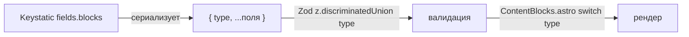

# План: единый движок управления и трансформации контент-блоков

> **СТАТУС: УСТАРЕЛ / НЕ ВЫПОЛНЯТЬ.**
> Предпосылка этого плана о том, что `fields.blocks` сериализует блоки как
> `{ type, ...поля }`, неверна для установленной версии `@keystatic/core`.
> Фактический формат — `{ discriminant, value }` (см.
> [`plans/adr-001-content-blocks.md`](adr-001-content-blocks.md)).
> Выполнение плана сломает существующий контент и `ContentBlocks.astro`.
> Документ сохранён только как история.

> Цель — устранить расхождение форматов сериализации между Keystatic, Zod-схемой
> и Astro-компонентами, чтобы блоки контента (`content`) работали динамически
> на каждой странице и в каждой секции без ручных трансформаций.

---

## 1. Диагноз

В проекте сосуществуют **три несовместимых формата** для одних и тех же блоков:

| Источник | Формат | Дискриминатор |
|---|---|---|
| Keystatic `fields.blocks` | `{ type, ...поля }` (плоский) | `type` |
| Zod `z.discriminatedUnion('discriminant', ...)` | `{ discriminant, value: { ... } }` | `discriminant` |
| Файлы `hero.md` / `advantages.md` | `{ discriminant, value: { type, ... } }` (гибрид) | оба |

`fields.blocks` в Keystatic **всегда** сериализует блоки как `{ type, ...поля }`.
Формат `{ discriminant, value }` генерирует только `fields.conditional` (используется
для `variant` секций). Поэтому `content`-блоки и `variant` — это два разных механизма,
и их нельзя смешивать.

**Следствие:** `hero.md` и `advantages.md` содержат гибридный формат, который не
проходит валидацию `z.discriminatedUnion('discriminant', ...)` → блоки не рендерятся.

---

## 2. Решение (Вариант A — нативный формат Keystatic)

Принять канонический формат **`{ type, ...поля }`** (нативный для `fields.blocks`).
Это минимизирует трансформации: Keystatic пишет → Zod валидирует → компоненты читают
без промежуточных преобразований.

`variant` секций остаётся на `{ discriminant, value }` (это `fields.conditional`,
отдельный механизм, уже согласован).

---

## 3. Перечень правок

### 3.1. Zod-схема — [`src/content.config.ts`](src/content.config.ts:32)

Переписать `contentBlocks` с `z.discriminatedUnion('discriminant', ...)` на
`z.discriminatedUnion('type', ...)`, убрав вложенность `value`:

- Каждый вариант: `z.object({ type: z.literal('...'), ...поля })` (плоский).
- `columns` — вложенный `content` остаётся `z.lazy(() => contentBlocks)`.
- Убрать `value`-обёртку во всех 14 блоках.

### 3.2. Рендер блоков — [`src/components/blocks/ContentBlocks.astro`](src/components/blocks/ContentBlocks.astro:27)

- Тип `Block` → `{ type: string; [key: string]: unknown }`.
- `switch (block.discriminant)` → `switch (block.type)`.
- Читать поля напрямую (`block.heading`, `block.content`, ...) вместо `block.value.*`.
- Обновить `case 'columns'`: `v.columns` → `block.columns`.

### 3.3. Вложенные блоки — [`src/components/blocks/Columns.astro`](src/components/blocks/Columns.astro:11)

- Тип `Block` → `{ type: string; [key: string]: unknown }`.
- `col.content` передаётся в `ContentBlocks` без изменений (уже массив блоков).

### 3.4. Секционные компоненты (тип `Block`)

Обновить локальный `type Block` в каждом секционном компоненте с
`{ discriminant; value }` на `{ type: string; [key: string]: unknown }`:

- [`HeroSection.astro`](src/components/sections/HeroSection.astro:11)
- [`AdvantagesSection.astro`](src/components/sections/AdvantagesSection.astro:9)
- [`CatalogSection.astro`](src/components/sections/CatalogSection.astro:11)
- [`DeliverySection.astro`](src/components/sections/DeliverySection.astro:9)
- [`OrderSection.astro`](src/components/sections/OrderSection.astro:10)
- [`FaqSection.astro`](src/components/sections/FaqSection.astro:9)
- [`ContactSection.astro`](src/components/sections/ContactSection.astro:10)

### 3.5. Рендерер секций — [`src/components/sections/HomeSections.astro`](src/components/sections/HomeSections.astro:20)

- Тип `Block` → `{ type: string; [key: string]: unknown }`.
- `Section.data.content` — тип `Block[]` (без изменений в логике маппинга).

### 3.6. Контентные файлы (привести к плоскому формату)

- [`src/content/sections/hero.md`](src/content/sections/hero.md:4) — убрать `discriminant`/`value`/`type`, оставить `type` + поля.
- [`src/content/sections/advantages.md`](src/content/sections/advantages.md:4) — то же.
- Остальные секции (`catalog`, `delivery`, `order`, `faq`, `contact`) — `content` отсутствует, правок не требуют.
- `lines/*.md` и `products/*.md` — `content: []`, правок не требуют.

### 3.7. Документация

- Обновить [`plans/architecture.md`](plans/architecture.md:142) §3: зафиксировать
  два формата — `fields.blocks` → `{ type }`, `fields.conditional` → `{ discriminant, value }`.
- Обновить комментарии в [`keystatic.config.ts`](keystatic.config.ts:13) и
  [`content.config.ts`](src/content.config.ts:26), убрав упоминание `discriminant` для блоков.

---

## 4. Критерии приёмки

- [ ] `astro build` проходит без ошибок.
- [ ] Блоки `content` в `hero` и `advantages` рендерятся (divider, richText, cta).
- [ ] `variant` секций продолжает работать (hero/catalog/...).
- [ ] `columns` с вложенными блоками рендерится корректно.
- [ ] Нет гибридного формата `{ discriminant, value: { type } }` ни в одном `.md`.
- [ ] Документация отражает два канонических формата.