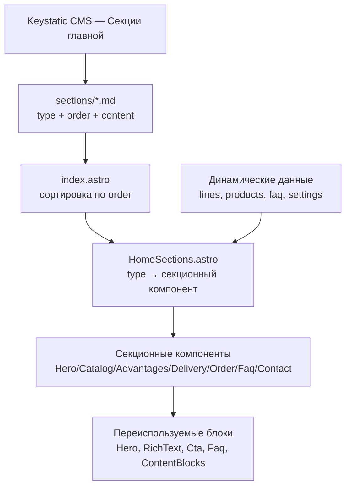

# План: управление блоками главной страницы (Вариант A)

## Цель

Сделать секции главной страницы управляемыми из CMS: добавлять, удалять,
переставлять секции и наполнять их контентом без правки кода. При рефакторинге
максимально переиспользовать существующие UI-компоненты из `src/components/blocks/`.

## Подтверждённые решения

1. **Преимущества** — через `contentBlocks` (`columns`/`banner`/`richText`),
   без отдельного массива `items`.
2. **Все 7 секций** — типы (`hero`, `catalog`, `advantages`, `delivery`,
   `order`, `faq`, `contact`), все переставляются из CMS.
3. **Хранение** — коллекция `sections` (файл на секцию) + поле `order`.

## Анализ дублирования в index.astro

| Секция | Сейчас (inline) | Заменить на |
|--------|-----------------|-------------|
| Hero body | `<p>{hero.body}</p>` | `RichText.astro` |
| Catalog | кастомная сетка линеек/моделей | остаётся кастомной |
| Delivery body | `<p>{delivery.body}</p>` | `RichText.astro` |
| Delivery cards | карточки из `settings` | остаётся (данные из `settings`) |
| Order body | `<p>{order.body}</p>` | `RichText.astro` |
| Order CTA | inline `<a>` | `Cta.astro` |
| Advantages | heading + body | `ContentBlocks.astro` |
| FAQ | inline аккордеон (дубль) | `Faq.astro` |
| Contact body | `<p>{contact.body}</p>` | `RichText.astro` |
| Contact form | кастомная форма | `ContactForm.astro` (новый) |

### Найденные проблемы (чинятся рефакторингом)

- **FAQ-аккордеон на главной не работает**: [`faq.ts`](src/scripts/faq.ts:9) ищет
  `.faq-item`/`.faq-question`/`.faq-answer`/`.faq-icon`, а inline-разметка в
  [`index.astro`](src/pages/index.astro:241) использует другие классы. Замена на
  [`Faq.astro`](src/components/blocks/Faq.astro:1) чинит аккордеон.
- **`body` не рендерится как markdown**: поля `body` — `fields.mdx`, но выводятся
  сырым текстом. [`RichText.astro`](src/components/blocks/RichText.astro:1) рендерит
  через [`renderMarkdown`](src/lib/markdown.ts:13).

## Целевая архитектура



## Изменения по файлам

### 1. `src/content.config.ts` — схема `sections`

```ts
const sections = defineCollection({
  loader: glob({ pattern: '**/*.md', base: './src/content/sections' }),
  schema: z.object({
    title: z.string(),
    type: z.enum(['hero', 'catalog', 'advantages', 'delivery', 'order', 'faq', 'contact']),
    heading: z.string().optional(),
    subheading: z.string().optional(),
    // body — markdown-вводный текст (contentField)
    ctaText: z.string().optional(),
    ctaHref: z.string().optional(),
    video: z.boolean().default(false),
    content: contentBlocks.optional(),
    order: z.number().default(0),
  }),
});
```

Поля по типам:

| type | используемые поля |
|------|-------------------|
| `hero` | heading, subheading, ctaText, ctaHref, video |
| `catalog` | heading (данные из `lines`/`products`) |
| `advantages` | heading, content (contentBlocks) |
| `delivery` | heading, body (методы из `settings`) |
| `order` | heading, body, ctaText, ctaHref |
| `faq` | heading (данные из коллекции `faq`) |
| `contact` | heading, body (форма) |

### 2. `keystatic.config.ts` — коллекция `sections`

- `type` — `fields.select` с 7 вариантами.
- `content` — переиспользовать `contentBlocks` (`fields.blocks`).
- `video` — `fields.checkbox`.
- `columns: ['title', 'type', 'order']`.

### 3. Секционные компоненты — `src/components/sections/`

Каждый компонент максимально переиспользует блоки из `src/components/blocks/`:

- `HeroSection.astro` — [`Hero.astro`](src/components/blocks/Hero.astro:1) (heading,
  subheading, ctaText, ctaHref, video) + [`RichText.astro`](src/components/blocks/RichText.astro:1) для body.
- `CatalogSection.astro` — кастомная сетка (линейки → модели), данные `lines`/`products`.
- `AdvantagesSection.astro` — heading + [`ContentBlocks.astro`](src/components/blocks/ContentBlocks.astro:1).
- `DeliverySection.astro` — heading + [`RichText.astro`](src/components/blocks/RichText.astro:1) + карточки методов из `settings`.
- `OrderSection.astro` — heading + [`RichText.astro`](src/components/blocks/RichText.astro:1) + [`Cta.astro`](src/components/blocks/Cta.astro:1).
- `FaqSection.astro` — heading + [`Faq.astro`](src/components/blocks/Faq.astro:1) (items из коллекции `faq`).
- `ContactSection.astro` — heading + [`RichText.astro`](src/components/blocks/RichText.astro:1) + [`ContactForm.astro`](src/components/blocks/ContactForm.astro:1).

### 3a. Новый компонент `src/components/blocks/ContactForm.astro`

Вынести форму заказа из [`index.astro`](src/pages/index.astro:273) в отдельный компонент:

- `id="order-form"`, `action="/api/submit.php"`, `method="POST"`.
- Honeypot-поле `website` (скрытое) и time-honeypot `ts`.
- Поля `name` (имя) и `phone` (телефон).
- Чекбоксы согласия `consent-pd` (обязательный) и `consent-marketing`.
- Кнопка отправки.

Компонент не входит в `contentBlocks` (это функциональный элемент, а не контент-блок),
используется только секцией `contact`.

### 4. Рендерер `src/components/sections/HomeSections.astro`

Принимает массив секций + динамические данные (`lines`, `products`, `faq`, `settings`)
и маппит `type` → секционный компонент через `switch`.

### 5. `src/pages/index.astro` — рефакторинг

- Сортировать `sections` по `order`.
- Заменить хардкод-секции на `<HomeSections sections={...} ... />`.
- Передать динамические данные в рендерер.
- Сохранить JSON-LD и SEO-логику без изменений.

### 6. Миграция контента

- `hero.md` → `type: hero`, `video: true`.
- `advantages.md` → `type: advantages`, `content` (columns/banner/richText).
- `delivery.md` → `type: delivery`.
- `order.md` → `type: order`.
- `contact.md` → `type: contact`.
- Добавить `catalog.md` (`type: catalog`) и `faq.md` (`type: faq`).
- Проставить `order` в нужной последовательности.

## Решения и риски

- **Hero с видео**: блок `hero` в `contentBlocks` не поддерживает видео, поэтому
  `hero` — отдельный тип секции с флагом `video`.
- **Динамические секции** (`catalog`, `faq`, `contact`): данные из коллекций, поэтому
  отдельные типы, а не `contentBlocks`.
- **Согласованность схем**: Zod-схема и Keystatic-схема должны совпадать.
- **`body` остаётся** markdown-вводным текстом; рендерится через `RichText.astro`.
- **Плоская схема** (enum + опциональные поля) вместо discriminated union — проще для
  коллекции «файл на секцию».