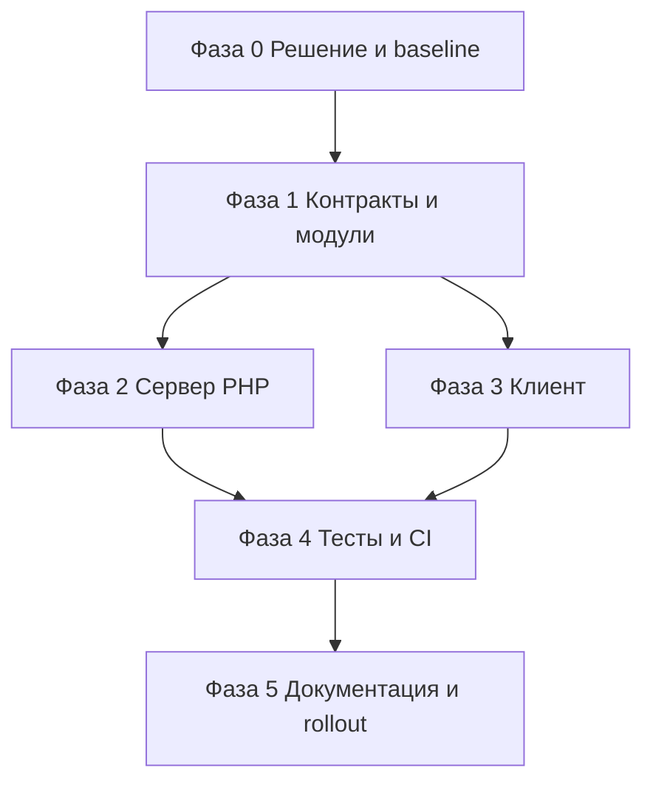

# План рефакторинга формы заявок v3 — Kiberstol.by

> Заменяет формулировки о форме из [`plans/refactoring-v2.md`](refactoring-v2.md) (фаза 4).
> Составлен по результатам аудита формы. Цель — production-ready форма, которую можно
> тестировать **до** получения Telegram-реквизитов, с секретами только в env хостинга.

---

## 0. Контекст и ограничения

- Telegram-реквизиты появятся позже. До этого форма должна работать в **dry-run**.
- `TG_BOT_TOKEN` и `TG_CHAT_ID` хранятся **только** в переменных окружения хостинга.
- Запрещено: попадание секретов в git, в `dist/client`, в HTML/JS, в `data-*`, в `PUBLIC_*`.
- Хостинг — hoster.by, PHP подтверждён: статическая сборка + PHP-модуль для приёма формы.
- Статика сохраняется; PHP используется только для `/api/submit.php`, creds — в env хостинга.
- Решение зафиксировано в [`plans/adr-002-form-transport.md`](adr-002-form-transport.md).
- Форма остаётся на главной (`#contacts`); карточки товаров ведут на `/#contacts`.

## 1. Цели

1. Убрать потерю заявок из-за time-honeypot и `reset()`.
2. Сделать сервер устойчивым к shared-хостингу: env, cURL, mbstring, прокси, rate limit.
3. Не допустить утечку секретов в клиент и репозиторий.
4. Дать полноценный контур тестирования без боевого Telegram.
5. Закрыть P0/P1 из аудита и обновить документацию.

## 2. Non-goals

- Редизайн формы и смена полей (имя, телефон, сообщение, согласия).
- CRM, email-уведомления, онлайн-оплата.
- CAPTCHA (только если появится реальный спам).
- Переход на Astro API route — вне рамок: hoster.by PHP подтверждён.

## 3. Решения (ADR-002)

| ID | Решение | Обоснование |
|---|---|---|
| D1 | Транспорт — PHP `public/api/submit.php` | Подтверждено на hoster.by: статика + PHP-модуль; Node-адаптер остаётся только для Keystatic |
| D2 | Секреты — только `getenv()` в PHP | Не попадают в клиентский бандл и `dist/client` |
| D3 | `TG_DRY_RUN=1` — валидация + лог + `200`, без Telegram | Позволяет тестировать до получения creds |
| D4 | Тайминг — `elapsed` (мс от первого ввода), `ts` — legacy | Убирает зависимость от часов клиента |
| D5 | Ошибки — `{ok:false, error:{code, message, field?}}` | Клиент показывает причину, тесты проверяют код |
| D6 | Rate limit — IP + хеш телефона, `flock`, очистка | Защита от распределённого спама и гонок |
| D7 | Согласия — `consent-pd` обязателен, `marketing-consent` фиксируется в заявке | Требование 99-З |
| D8 | Конверсия — `generate_lead` / `reachGoal` после `200`, с учётом согласия | Цели в GA4/Метрике |
| D9 | No-JS — `<noscript>` с телефоном; HTML-редирект — опционально | Прогрессивное улучшение |
| D10 | Тесты — unit + e2e + API на реальном PHP с `TG_DRY_RUN=1` | Проверяется контракт, а не мок |
| D11 | Наблюдаемость — `error_log` без ПД, health-check | Диагностика на хостинге |
| D12 | Секрет-скан `dist/client` в CI | Гарантия отсутствия утечки |

## 4. Контракт API

### 4.1. Запрос (`multipart/form-data`, POST)

| Поле | Обяз. | Правила |
|---|---|---|
| `name` | да | 1–100 символов после `trim` |
| `phone` | да | нормализуется до `375XXXXXXXXX`, ровно 12 цифр |
| `message` | нет | ≤ 1000 символов |
| `consent-pd` | да | значение `on` |
| `marketing-consent` | нет | значение `on`; переименовано из `consent-marketing` |
| `website` | — | honeypot, должен быть пустым |
| `elapsed` | нет | мс от первого ввода; 3000…86400000 |
| `ts` | нет | legacy unix-секунды; проверяется только при отсутствии `elapsed` |
| `page` | нет | pathname страницы, заполняется JS |
| `form-id` | нет | id формы для страниц с несколькими формами |

### 4.2. Ответы

| HTTP | `code` | Когда |
|---|---|---|
| 200 | — | успех; `{ok:true}` или `{ok:true, dryRun:true}` |
| 200 | — | honeypot / слишком быстрая отправка — тихо, без Telegram |
| 200 | — | `?health=1` → `{ok:true, configured:bool, dryRun:bool}` |
| 405 | `method_not_allowed` | не POST (кроме health) |
| 403 | `forbidden_origin` | `Origin`/`Referer` не из `ALLOWED_ORIGINS` |
| 422 | `consent_required` | нет `consent-pd` |
| 422 | `validation` | неверное поле; `field` указывает на поле |
| 429 | `rate_limited` | превышен лимит по IP или телефону |
| 502 | `telegram_failed` | Telegram вернул ошибку или недоступен |
| 503 | `not_configured` | нет `TG_BOT_TOKEN`/`TG_CHAT_ID` и не dry-run |
| 500 | `server_error` | непредвиденная ошибка |

### 4.3. Сообщение в Telegram

```
Новая заявка с сайта Kiberstol.by

Имя: ...
Телефон: +375 XX XXX-XX-XX
Сообщение: ...
Страница: /products/meta-w
Согласие ПД: да (v1)
Согласие на рекламу: да/нет
Дата: 23.10.2026 15:00:00
```

## 5. Переменные окружения

| Переменная | Обяз. | По умолчанию | Назначение |
|---|---|---|---|
| `TG_BOT_TOKEN` | prod | — | токен бота |
| `TG_CHAT_ID` | prod | — | чат/группа для заявок |
| `TG_DRY_RUN` | нет | `0` | `1` — не отправлять в Telegram |
| `ALLOWED_ORIGINS` | нет | `https://kiberstol.by` | список origin через запятую |
| `TRUSTED_PROXIES` | нет | — | CIDR/IP прокси для `X-Forwarded-For` |
| `FORM_CONSENT_VERSION` | нет | `1` | версия согласия в заявке |
| `LEADS_LOG_PATH` | нет | — | опциональный лог заявок вне webroot |
| `RATE_LIMIT_DIR` | нет | `sys_get_temp_dir()` | каталог счётчиков |

> Ни одна из переменных не должна иметь префикс `PUBLIC_` и не должна читаться в клиентском коде.

## 6. Фазы и задачи

### Фаза 0 — Решение и базовая линия

| ID | Задача | Результат |
|---|---|---|
| F0-01 | Подтверждён PHP на hoster.by: статика + PHP-модуль | зафиксировано в ADR-002 |
| F0-02 | Подтвердить имена env-переменных и способ их задания | раздел в `docs/deployment.md` |
| F0-03 | Зафиксировать baseline: `check`, `build`, `test:unit`, `test:e2e` | точка отсчёта |
| F0-04 | Создать [`plans/adr-002-form-transport.md`](adr-002-form-transport.md) | решение D1–D12 |
| F0-05 | Проверить Node.js на hoster.by и зафиксировать схему Keystatic (отдельный трек) | решение по CMS, не блокирует форму |

**Критерий:** решение по транспорту и секретам зафиксировано, baseline зелёный.

### Фаза 1 — Контракты и общая логика

| ID | Задача | Файлы |
|---|---|---|
| F1-01 | Вынести `normalizePhone`, `formatPhone`, `isValidByPhone` | `src/lib/phone.ts` |
| F1-02 | Вынести `MIN_FILL_MS`, `MAX_FILL_MS`, `computeElapsed` | `src/lib/form-timing.ts` |
| F1-03 | Вынести коды ошибок и RU-сообщения | `src/lib/form-errors.ts` |
| F1-04 | Зафиксировать контракт API | `docs/forms.md` |
| F1-05 | Unit-тесты для трёх модулей | `tests/unit/phone.test.ts`, `form-timing.test.ts`, `form-errors.test.ts` |
| F1-06 | Перевести `form.ts` на модули без изменения поведения | [`form.ts`](../src/scripts/form.ts:1) |

**Критерий:** модули покрыты тестами, `form.ts` использует их, поведение не изменилось.

### Фаза 2 — Усиление сервера

| ID | Задача | Файлы |
|---|---|---|
| F2-01 | Переписать структуру: заголовки, `no-store`, `nosniff`, method, health | [`submit.php`](../public/api/submit.php:1) |
| F2-02 | Проверка `Origin`/`Referer` по `ALLOWED_ORIGINS` | `submit.php` |
| F2-03 | Тайминг: `elapsed` с допуском, `ts` как fallback | `submit.php` |
| F2-04 | Согласия: `consent-pd`, `marketing-consent`, `page`, версия | `submit.php` |
| F2-05 | Валидация и нормализация полей | `submit.php` |
| F2-06 | Rate limit IP + телефон, `flock`, очистка, proxy-aware IP | `submit.php` |
| F2-07 | Telegram: cURL с fallback, парсинг `ok`, таймаут, без токена в логах | `submit.php` |
| F2-08 | Dry-run и `503 not_configured` | `submit.php` |
| F2-09 | Структурированные ошибки и `error_log` без ПД | `submit.php` |
| F2-10 | Скрипт локального запуска с загрузкой `.env` | `scripts/serve-php.mjs` |
| F2-11 | Секрет-скан `dist/client` и `src` | `scripts/check-no-secrets.mjs` |
| F2-12 | Обновить `.env.example` и `.gitignore` | `.env.example`, `.gitignore` |
| F2-13 | `php -l` в CI | [`.github/workflows/ci.yml`](../.github/workflows/ci.yml:1) |

**Критерий:** API проходит curl-сценарии, dry-run работает без creds, секретов в `dist/client` нет.

### Фаза 3 — Усиление клиента

| ID | Задача | Файлы |
|---|---|---|
| F3-01 | Статус в разметке, `<noscript>`, `maxlength`, `pattern`, off-screen honeypot, ссылка вне `label`, `marketing-consent`, уникальный `id`, hidden `page` | [`ContactForm.astro`](../src/components/blocks/ContactForm.astro:1) |
| F3-02 | `elapsed`, `AbortController`, парсинг ошибок, `aria-invalid`, фокус, состояние кнопки, защита от двойного связывания | [`form.ts`](../src/scripts/form.ts:1) |
| F3-03 | `generate_lead` и `reachGoal` после успеха с учётом согласия | `form.ts`, [`analytics.ts`](../src/scripts/analytics.ts:1), [`advertising.ts`](../src/scripts/advertising.ts:1) |
| F3-04 | HTML-редирект для no-JS (опционально) | `submit.php`, `form.ts` |
| F3-05 | Передача `id` формы из секции | [`ContactSection.astro`](../src/components/sections/ContactSection.astro:1) |

**Критерий:** все P1 закрыты, ошибки понятны пользователю, a11y не хуже baseline.

### Фаза 4 — Тесты и CI

| ID | Задача | Файлы |
|---|---|---|
| F4-01 | Unit-тесты: телефон, тайминг, ошибки | `tests/unit/*` |
| F4-02 | Playwright `webServer` → `php -S -t dist/client` с `TG_DRY_RUN=1` | [`playwright.config.ts`](../playwright.config.ts:1) |
| F4-03 | E2E: happy, маска, `80`, согласия, honeypot, быстро, повтор, 429, 500, 502, no-JS, a11y | [`form.spec.ts`](../tests/e2e/form.spec.ts:1) |
| F4-04 | API-тесты: 405/403/422/429/503/502/health/dry-run | `tests/api/form.api.spec.ts` |
| F4-05 | CI: PHP, `php -l`, `test:api`, секрет-скан | [`ci.yml`](../.github/workflows/ci.yml:1) |
| F4-06 | Скрипты `test:api`, `check:secrets` | [`package.json`](../package.json:8) |

**Критерий:** CI зелёный, реальный PHP-контракт покрыт тестами.

### Фаза 5 — Документация и rollout

| ID | Задача | Файлы |
|---|---|---|
| F5-01 | Дописать `docs/forms.md`: архитектура, контракт, env, dry-run, troubleshooting | `docs/forms.md` |
| F5-02 | `docs/deployment.md`: PHP, env, health, секреты, проверка | [`deployment.md`](../docs/deployment.md:1) |
| F5-03 | `docs/quality.md`: новые тесты и команды | [`quality.md`](../docs/quality.md:1) |
| F5-04 | Журнал прогресса | [`progress.md`](progress.md) |
| F5-05 | Staging: dry-run, проверка логов и health | staging |
| F5-06 | Staging: реальные creds → тестовый чат | staging |
| F5-07 | Production: боевой чат, одна тестовая заявка | production |
| F5-08 | Production-чек-лист | `docs/deployment.md` |

**Критерий:** документация соответствует реализации, staging и production проверены.

## 7. Матрица тестов

| Сценарий | Unit | E2E | API |
|---|---|---|---|
| Маска `296377663` | да | да | — |
| Маска `80296377663` | да | да | — |
| Нормализация `+375 (29) 637-76-63` | да | — | да |
| Нет `consent-pd` | — | да | да |
| `marketing-consent` в заявке | — | да | да |
| Honeypot | — | да | да |
| `elapsed < 3000` | да | да | да |
| `elapsed` отсутствует | да | — | да |
| Повторная отправка | — | да | — |
| Rate limit IP | — | да | да |
| Rate limit телефон | — | — | да |
| 405 / 403 | — | — | да |
| 503 без creds | — | да | да |
| 502 от Telegram | — | да | да |
| Dry-run | — | да | да |
| Health | — | — | да |
| No-JS | — | да | — |
| XSS в имени | — | да | да |
| a11y ошибок | — | да | — |
| Секреты в `dist/client` | — | — | CI |

## 8. Риски и меры

| Риск | Мера |
|---|---|
| Смена хостинга на Node-only | Контракт API сохраняется; замена PHP на Astro route — отдельный ADR |
| Env не доходят до PHP | Документировать `SetEnv`/pool/панель; health-check в smoke |
| `allow_url_fopen=Off` | cURL с fallback |
| Нет `mbstring` | `function_exists` + fallback |
| Прокси скрывает IP | `TRUSTED_PROXIES`, иначе лимит по IP отключить |
| Утечка секретов | Секрет-скан в CI, запрет `PUBLIC_TG_*` |
| Смена имени `consent-marketing` | Обновить форму, тесты, документацию |
| E2E с PHP в CI | `shivammathur/setup-php`; при недоступности — API-тесты отдельным job |
| Потеря заявок при сбое Telegram | Логирование, опциональный `LEADS_LOG_PATH`, алерт |

## 9. Критерии приёмки

- [ ] Форма работает end-to-end с `TG_DRY_RUN=1` без creds.
- [ ] С реальными creds заявка приходит в Telegram.
- [ ] `TG_*` отсутствуют в git, `dist/client`, HTML и JS.
- [ ] P0 и P1 из аудита закрыты.
- [ ] Unit, e2e и API-тесты зелёные в CI.
- [ ] `php -l` и секрет-скан в CI.
- [ ] Документация обновлена.
- [ ] Staging и production прошли smoke.

## 10. Rollout

1. Ветка `refactor/form-v3`.
2. Один PR на фазу; каждая фаза завершается `check` + `build` + тесты.
3. Staging: сначала `TG_DRY_RUN=1`, затем тестовый чат.
4. Production: боевой чат, одна тестовая заявка, проверка логов.
5. После приёмки — merge в `main`.

## 11. Граф зависимостей



## 12. Смежный риск: Keystatic на hoster.by

Форма от Node не зависит, но production-админка Keystatic — зависит: `@keystatic/astro`
инжектит серверные маршруты `/keystatic` и `/api/keystatic`, которым нужен Node-процесс.
На дешёвом тарифе hoster.by Node.js может быть недоступен или ограничен по ресурсам.

| Вариант | Плюсы | Минусы |
|---|---|---|
| Node-процесс на hoster.by | один хостинг, простая схема | тариф, ресурсы, поддержка Node |
| Админка на отдельном Node-хостинге + статика на hoster.by | не зависит от тарифа hoster.by | два деплоя, GitHub OAuth, синхронизация |
| Keystatic только локально, контент — через git/GitHub | минимум инфраструктуры | неудобно заказчику без разработчика |
| Другая CMS со статической админкой | работает без Node | миграция контента и схем |

**Правило:** форма не блокируется решением по Keystatic. Реализация формы идёт
параллельно; вопрос CMS фиксируется отдельным ADR после проверки Node на hoster.by.
