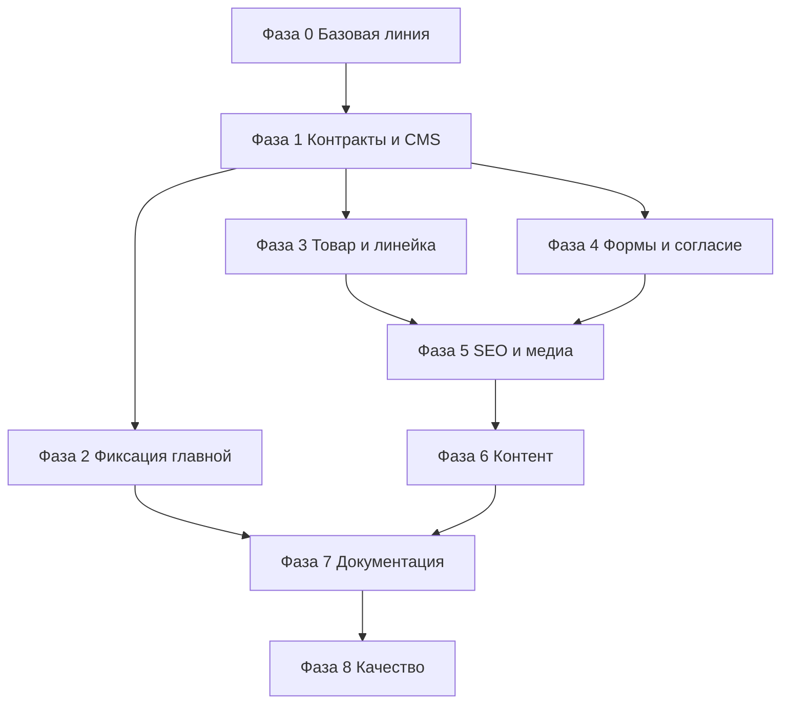

# План рефакторинга v2 — Kiberstol.by

> Заменяет [`plans/refactoring.md`](refactoring.md). Составлен по результатам аудита проекта и документации.
> Цель — привести реализацию, CMS и документацию к единому состоянию; утвержденный контент главной страницы принимается как эталон и не изменяется.

---

## 0. Цели

1. Зафиксировать единый контракт формата контент-блоков и устранить противоречия в документации.
2. Сделать Keystatic CMS рабочей в production (GitHub storage, корректные маршруты).
3. Зафиксировать утвержденный контент главной страницы как эталон и обновить ТЗ/документацию под него.
4. Починить форму заказа, согласие на ПД/рекламу и отзыв согласия.
5. Убрать захардкоженный контент из движка или явно задокументировать исключения.
6. Привести SEO, медиа и JSON-LD к рабочему состоянию.
7. Очистить production-контент от плейсхолдеров, шуток и неверных SEO-заголовков.
8. Добавить проверки качества: `astro check`, сборка, тесты, CI.

## 1. Принципы

- **Один источник правды:** контент — в CMS, UI — в CSS, движок — только структура и логика.
- **Сначала контракты, потом реализация:** формат блоков, схемы, CMS и документация фиксируются до правок страниц.
- **Маленькие проверяемые шаги:** каждая фаза завершается успешной сборкой и обновлением документации.
- **Обратная совместимость контента:** изменения схем не должны ломать существующие `.md`/`.yaml` без миграции.
- **Никаких оценок сроков:** план фиксирует порядок и зависимости, а не длительность.

## 2. Область работ и non-goals

### Входит в рефакторинг

- Критические и важные расхождения из аудита (P0/P1), кроме изменения секций главной.
- Production CMS, формы, согласие, SEO, медиа.
- Фиксация утвержденного контента главной страницы как эталона (без изменения секций).
- Актуализация ТЗ и документации под утвержденный контент.
- Очистка контента товаров и линеек.
- Базовые тесты и CI.

### Не входит

- Редизайн и смена темы.
- Онлайн-оплата, корзина, склад.
- Новые категории товаров (кресла, аксессуары).
- Блог и контент-маркетинг.
- Полная переработка юридических текстов (только проверка и актуализация).
- Изменение состава, порядка и содержимого секций главной страницы.
- Добавление секций `order`/`banners` и моделей в каталог на главной.

### Будущее развитие (вне рефакторинга v2)

Перечисленное ниже не является требованием текущего рефакторинга и не должно
влиявать на утвержденный эталон главной страницы:

- отдельная секция `order` (промежуточный CTA-блок оформления заказа);
- секция `banners` («важные моменты», слайдер);
- вывод моделей внутри секции каталога на главной (сейчас — только линейки);
- новые категории товаров (кресла, аксессуары).

---

## 3. Рабочие потоки

| Поток | Содержание |
|---|---|
| **A. Контракты и документация** | Формат блоков, схемы, ADR, architecture/TZ |
| **B. CMS и контентная модель** | Keystatic storage, обязательные поля, связи, labels |
| **C. Главная — эталон** | Фиксация утвержденных секций и обновление документации без изменения контента |
| **D. Карточка товара и линейки** | CTA, формы, breadcrumbs, JSON-LD |
| **E. Формы и согласие** | Отзыв согласия, серверная валидация, Telegram |
| **F. SEO и медиа** | OG, sitemap, изображения, JSON-LD |
| **G. Контент** | Тексты, SEO-заголовки, плейсхолдеры |
| **H. Качество** | Проверки, тесты, CI, аудит |

---

## 4. Фазы и задачи

### Фаза 0 — Базовая линия и защитные механизмы

| ID | Задача | Результат |
|---|---|---|
| R0-01 | Добавить `typescript`, `astro check`, `sharp`; скрипт `check` в [`package.json`](../package.json:8) | воспроизводимая проверка типов и сборки |
| R0-02 | Создать [`plans/progress.md`](progress.md) и сослаться на него из [`architecture.md`](architecture.md:5) | отслеживание прогресса |
| R0-03 | Зафиксировать формат блоков `{ discriminant, value }` в ADR [`plans/adr-001-content-blocks.md`](adr-001-content-blocks.md) | единый контракт |
| R0-04 | Зафиксировать baseline: `npm run build`, `npm run check`, список предупреждений | точка отсчёта |
| R0-05 | Создать ветку `refactor/v2` и правило «одна фаза — один PR» | безопасный rollout |

**Критерий завершения:** сборка и проверка типов проходят, baseline зафиксирован.

---

### Фаза 1 — Контракты, CMS и контентная модель

| ID | Задача | Файлы |
|---|---|---|
| R1-01 | Оставить `{ discriminant, value }`; убрать лишние `type`-select из блоков или пометить как legacy | [`keystatic.config.ts`](../keystatic.config.ts:96), [`content.config.ts`](../src/content.config.ts:36) |
| R1-02 | Исправить противоречивые комментарии про `{ type, ... }` | [`keystatic.config.ts`](../keystatic.config.ts:84) |
| R1-03 | Пометить [`content-blocks-unification.md`](content-blocks-unification.md:1) как устаревший; не выполнять его | документация |
| R1-04 | Перевести Keystatic на GitHub storage; добавить env-переменные | [`keystatic.config.ts`](../keystatic.config.ts:546), [`.env.example`](../.env.example:1) |
| R1-05 | Проверить маршруты `/keystatic` и `/api/keystatic` при `output: 'static'` + node adapter; при необходимости выбрать server/hybrid | [`astro.config.mjs`](../astro.config.mjs:17) |
| R1-06 | Согласовать обязательные поля `products` между Zod и Keystatic | [`content.config.ts`](../src/content.config.ts:177), [`keystatic.config.ts`](../keystatic.config.ts:345) |
| R1-07 | Зафиксировать FAQ в `sections` variant; убрать `faq`-коллекцию из документации и удалить пустую папку | [`content.config.ts`](../src/content.config.ts:338), [`architecture.md`](architecture.md:140) |
| R1-08 | Заменить свободный текст `line` на relationship к `lines` | [`keystatic.config.ts`](../keystatic.config.ts:342) |
| R1-09 | Добавить `labels`/`ui` в `site` или отдельную коллекцию для микротекстов | [`content.config.ts`](../src/content.config.ts:221), [`keystatic.config.ts`](../keystatic.config.ts:408) |
| R1-10 | Актуализировать `site`: убрать `brandColors`, зафиксировать `viber`/`instagram`/`seo`, перенос оплаты/доставки в `sections` | [`content.config.ts`](../src/content.config.ts:219), [`settings.yaml`](../src/content/site/settings.yaml:1) |

**Критерий завершения:** CMS сохраняет контент в production-режиме; схемы и CMS не расходятся; формат блоков зафиксирован.

---

### Фаза 2 — Фиксация утвержденного контента главной

> Контент главной страницы на текущий момент является последним утвержденным. В рамках рефакторинга он **не изменяется**. Задача фазы — зафиксировать его как эталон и привести документацию к нему.

| ID | Задача | Файлы |
|---|---|---|
| R2-01 | Зафиксировать текущий состав и порядок секций как утвержденный эталон: hero, advantages, catalog, delivery, faq, contacts | `src/content/sections/*.md` |
| R2-02 | Не изменять `src/content/sections/*`, [`HomeSections.astro`](../src/components/sections/HomeSections.astro:1), [`CatalogSection.astro`](../src/components/sections/CatalogSection.astro:1) в рамках рефакторинга | контент и компоненты главной |
| R2-03 | Обновить ТЗ/architecture: убрать требования `order`, `banners` и моделей на главной; зафиксировать фактический порядок | [`kiberstol-tz.md`](../requirements/kiberstol-tz.md:1), [`architecture.md`](architecture.md:1) |
| R2-04 | Проверить, что навигация и якоря соответствуют утвержденным секциям | [`settings.yaml`](../src/content/site/settings.yaml:16), секционные компоненты |
| R2-05 | Задокументировать, что каталог на главной показывает только линейки, как утвержденное решение | [`CatalogSection.astro`](../src/components/sections/CatalogSection.astro:1) |
| R2-06 | Вынести возможные секции `order`/`banners` и модели на главной в раздел будущего развития, не в этот рефакторинг | [`plans/refactoring-v2.md`](refactoring-v2.md:1) |

**Критерий завершения:** утвержденный контент главной не изменен; документация и ТЗ описывают его как эталон.

---

### Фаза 3 — Карточка товара и страница линейки

| ID | Задача | Файлы |
|---|---|---|
| R3-01 | Починить CTA: вести на `/#contacts`; задать `ctaText` | [`products/[slug].astro`](../src/pages/products/[slug].astro:178), контент товаров |
| R3-02 | Вынести breadcrumbs в `Breadcrumbs.astro` | [`products/[slug].astro`](../src/pages/products/[slug].astro:105), [`lines/[slug].astro`](../src/pages/lines/[slug].astro:50) |
| R3-03 | Вынести подписи «Характеристики», «Сведения о товаре», «Другие модели», «Модели линейки» в CMS | [`products/[slug].astro`](../src/pages/products/[slug].astro:194), [`lines/[slug].astro`](../src/pages/lines/[slug].astro:86) |
| R3-04 | Добавить `ItemList` на страницу линейки и `BreadcrumbList` в каталог | [`lines/[slug].astro`](../src/pages/lines/[slug].astro:1), [`products/index.astro`](../src/pages/products/index.astro:1) |
| R3-05 | Улучшить `Product` JSON-LD: `availability`, `sku`, `brand`, `countryOfOrigin` | [`Product.astro`](../src/components/seo/jsonld/Product.astro:1) |
| R3-06 | Убрать неиспользуемый `Image`; убрать дубли `getImage`/`resolveImage` | [`products/[slug].astro`](../src/pages/products/[slug].astro:13), [`lines/[slug].astro`](../src/pages/lines/[slug].astro:59) |
| R3-07 | Проверить canonical/noindex на всех страницах | [`SEO.astro`](../src/components/seo/SEO.astro:1) |

**Критерий завершения:** CTA работает, подписи берутся из CMS, JSON-LD и breadcrumbs корректны.

---

### Фаза 4 — Формы, согласие, аналитика

| ID | Задача | Файлы |
|---|---|---|
| R4-01 | Добавить `clearConsent`/`openConsentBanner` и ссылку «Настройки cookie» в футер | [`consent.ts`](../src/scripts/consent.ts:1), [`cookie-consent.ts`](../src/scripts/cookie-consent.ts:1), [`Footer.astro`](../src/components/layout/Footer.astro:1) |
| R4-02 | При отзыве согласия выгружать аналитику и рекламу | [`analytics.ts`](../src/scripts/analytics.ts:1), [`advertising.ts`](../src/scripts/advertising.ts:1) |
| R4-03 | Серверная проверка `consent-pd`, валидация телефона, экранирование HTML, rate limiting | [`submit.php`](../public/api/submit.php:39) |
| R4-04 | Скрывать cookie-баннер по умолчанию, чтобы не было FOUC | [`BaseLayout.astro`](../src/layouts/BaseLayout.astro:78) |
| R4-05 | Сбрасывать `ts` после `form.reset()`; уточнить time-honeypot | [`form.ts`](../src/scripts/form.ts:94) |
| R4-06 | Добавить `aria-live` для статуса формы | [`form.ts`](../src/scripts/form.ts:41) |

**Критерий завершения:** согласие можно отозвать; сервер не принимает заявку без согласия; трекеры выгружаются.

---

### Фаза 5 — SEO и медиа

| ID | Задача | Файлы |
|---|---|---|
| R5-01 | Добавить `public/assets/og-default.png` или использовать `site.seo.image` | [`SEO.astro`](../src/components/seo/SEO.astro:40) |
| R5-02 | Передавать `site.brand` в `SEO.astro`, убрать хардкод `og:site_name` | [`SEO.astro`](../src/components/seo/SEO.astro:57) |
| R5-03 | Добавить `Organization` logo/sameAs; проверить `Product` availability | [`Organization.astro`](../src/components/seo/jsonld/Organization.astro:1), [`index.astro`](../src/pages/index.astro:51) |
| R5-04 | Очистить `src/assets/uploads/catalog/...`; удалить или задокументировать `public/assets/uploads/.gitkeep` | медиа |
| R5-05 | Проверить `sharp` и responsive-изображения; при необходимости добавить размеры | [`package.json`](../package.json:14), [`image.ts`](../src/lib/image.ts:1) |
| R5-06 | Согласовать sitemap/robots/noindex для юридических страниц | [`astro.config.mjs`](../astro.config.mjs:30), [`robots.txt`](../public/robots.txt:1) |

**Критерий завершения:** OG-превью работает, sitemap/robots согласованы, изображения собираются без ошибок.

---

### Фаза 6 — Очистка контента

| ID | Задача | Файлы |
|---|---|---|
| R6-01 | Заменить ненормативную лексику и шутки в товарах | [`meta-w.md`](../src/content/products/meta-w.md:6), [`meta-ob.md`](../src/content/products/meta-ob.md:6), [`meta-wb.md`](../src/content/products/meta-wb.md:6) |
| R6-02 | Уникальные SEO-заголовки и описания для товаров и линеек | [`meta-w.md`](../src/content/products/meta-w.md:40), [`meta-ob.md`](../src/content/products/meta-ob.md:36), [`meta-wb.md`](../src/content/products/meta-wb.md:36), [`imba.md`](../src/content/lines/imba.md:11), [`tower.md`](../src/content/lines/tower.md:11) |
| R6-03 | Проверить юридические тексты и плейсхолдеры (`authorizedBodyPhone`) | [`settings.yaml`](../src/content/site/settings.yaml:15), [`legal/*.md`](../src/content/legal) |
| R6-04 | Проверить обязательные юр. поля товаров, alt и наличие изображений | контент товаров |
| R6-05 | Добавить `ctaText` товарам | контент товаров |
| R6-06 | Проверить полноту `settings.yaml` | [`settings.yaml`](../src/content/site/settings.yaml:1) |

**Критерий завершения:** контент готов к публикации, SEO-поля уникальны, плейсхолдеры отмечены.

---

### Фаза 7 — Актуализация документации

| ID | Задача | Файлы |
|---|---|---|
| R7-01 | Обновить `architecture.md`: `settings.yaml`, `src/assets/uploads`, отсутствие `keystatic/[...params].astro`, отсутствие `faq`, `discriminant`, отсутствие `brandColors`, оплата/доставка в `sections`, утвержденный состав секций главной (hero, advantages, catalog, delivery, faq, contacts), отсутствие требований `order`/`banners`/моделей на главной | [`architecture.md`](architecture.md:1) |
| R7-02 | Обновить ТЗ: те же расхождения | [`kiberstol-tz.md`](../requirements/kiberstol-tz.md:1) |
| R7-03 | Пометить старый `refactoring.md` как superseded и сослаться на v2 | [`refactoring.md`](refactoring.md:1) |
| R7-04 | Добавить `plans/progress.md` | [`progress.md`](progress.md) |
| R7-05 | Добавить `docs/deployment.md` и `docs/cms.md` | документация |

**Критерий завершения:** документация описывает фактическую реализацию, а не устаревшую.

---

### Фаза 8 — Контроль качества

| ID | Задача | Результат |
|---|---|---|
| R8-01 | Playwright: форма, согласие, навигация, каталог | e2e-тесты |
| R8-02 | Vitest: Zod-схемы, обязательные поля, уникальность SEO | unit-тесты |
| R8-03 | GitHub Actions: install → check → build → test | CI |
| R8-04 | Accessibility audit (axe) | отчёт |
| R8-05 | Lighthouse/performance audit | отчёт |
| R8-06 | Скрипт валидации контента: обязательные поля, уникальные SEO, существование изображений | `scripts/validate-content.ts` |

**Критерий завершения:** CI зелёный, критические сценарии покрыты тестами.

---

## 5. Граф зависимостей

**Правило:** фазы 2–4 можно вести параллельно после фазы 1, но каждая ветка должна завершаться сборкой. Фаза 2 не меняет контент главной — только фиксирует его в документации.

---

## 6. Критерии приёмки рефакторинга

- [ ] `npm run build` и `npm run check` проходят без ошибок.
- [ ] Keystatic сохраняет контент в production-режиме.
- [ ] Формат блоков `{ discriminant, value }` зафиксирован и не противоречит документации.
- [ ] Утвержденный контент главной страницы не изменен.
- [ ] ТЗ и документация описывают утвержденный контент главной как эталон.
- [ ] CTA на карточке товара работает и ведёт к форме.
- [ ] Согласие можно отозвать; сервер не принимает заявку без `consent-pd`.
- [ ] OG-изображение по умолчанию существует; `og:site_name` берётся из CMS.
- [ ] Контент не содержит ненормативной лексики, шуток и неверных SEO-заголовков.
- [ ] Обязательные поля товаров согласованы между Zod и Keystatic.
- [ ] Документация соответствует реализации.
- [ ] Критические сценарии покрыты e2e/unit-тестами.
- [ ] CI зелёный.

---

## 7. Риски и меры

| Риск | Мера |
|---|---|
| Keystatic не работает при `output: 'static'` | Проверить маршруты на staging; при необходимости перейти на server/hybrid |
| Потеря контента при смене storage | Сделать backup `src/content` и `src/assets/uploads`; миграция отдельным PR |
| Изменения схем ломают существующие файлы | Сначала миграция контента, затем ужесточение схем |
| Ошибки оптимизации изображений | Добавить `sharp`, проверить сборку, оставить fallback |
| Юридические неточности | Проверка текстов с заказчиком/юристом |
| Разрастание PR | Одна фаза — один PR; обязательная сборка |
| Случайное изменение утвержденного контента главной | Не менять `src/content/sections/*` и `HomeSections.astro`; только документация |

---

## 8. Стратегия rollout

1. Ветка `refactor/v2`.
2. Один PR на фазу, с описанием изменений и результатами `build`/`check`.
3. После каждой фазы — деплой на staging и smoke-test.
4. Контент-миграции — отдельными PR с backup.
5. Финальный PR — документация и CI.
6. После приёмки — merge в `main` и деплой на production.

---

## 9. Definition of Done

- Все задачи P0 и P1 закрыты.
- Документация и ТЗ актуализированы.
- Утвержденный контент главной страницы не изменен; документация соответствует ему.
- Контент товаров и линеек готов к публикации.
- CMS работает в production.
- Тесты и CI зелёные.
- Staging проверен, заказчик подтвердил приёмку.
