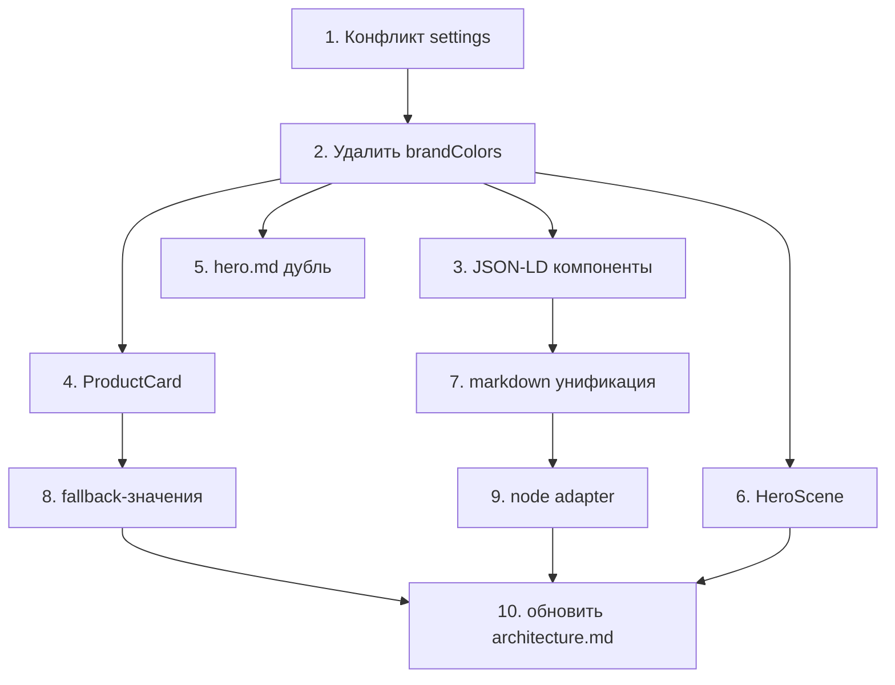

# План рефакторинга — Kiberstol.by

> Составлен по результатам аудита соответствия [`architecture.md`](architecture.md).
> Каждый пункт — самостоятельная, проверяемая задача. Порядок — по приоритету и зависимостям.
>
> **Зафиксированные решения (согласовано с заказчиком):**
> - JSON-LD — задействовать готовые компоненты `src/components/seo/jsonld/*` (не удалять).
> - Markdown — НЕ переводить `richText` на `fields.mdx` (несовместимо с `fields.blocks`); оставить `marked`/`sanitize-html` для `richText`-блоков, `fields.mdx` — для контентных полей верхнего уровня.
> - Keystatic нужен на проде → `@astrojs/node` остаётся, причина документируется.

---

## Приоритет 1 — Критично (блокирует приёмку)

### 1. Устранить конфликт источников настроек `site`

**Проблема:** в [`src/content/site/`](../src/content/site/) два файла — [`settings.md`](../src/content/site/settings.md) (полный, читается Astro) и [`settings.yaml`](../src/content/site/settings.yaml) (пустой, редактируется Keystatic). Изменения в CMS не попадают на сайт.

**Решение (рекомендуемое):** перейти на единый `settings.yaml`, читаемый и Astro, и Keystatic.

- [ ] В [`content.config.ts`](../src/content.config.ts) изменить loader `site` с `glob({ pattern: '**/*.md' })` на `glob({ pattern: '**/*.{md,yaml}' })` (или `**/*.yaml`).
- [ ] Перенести полные данные из `settings.md` в `settings.yaml` (brand, tagline, fullName, unp, registrationDate, tradeRegistryNumber/Date, phone, email, address, workHours, authorizedBody, authorizedBodyPhone, paymentMethods, deliveryMethods, nav, analytics, advertising, seo).
- [ ] Удалить `settings.md`.
- [ ] Убедиться, что `getEntry('site', 'settings')` во всех компонентах/страницах продолжает работать (id `settings` сохраняется).
- [ ] Проверить `astro build` без ошибок.

**Альтернатива:** оставить `.md`, но перевести Keystatic singleton на `format: { data: 'yaml' }` с расширением `.md` — не рекомендуется (смешение форматов).

---

### 2. Удалить мёртвое поле `brandColors`

**Проблема:** поле объявлено в схеме и Keystatic, заполнено в `settings`, но нигде не читается. Цвета заданы в [`cyberpunk.css`](../src/styles/themes/cyberpunk.css). Нарушает принцип «UI не задаётся в контенте».

- [ ] Удалить `brandColors` из схемы `site` в [`content.config.ts`](../src/content.config.ts).
- [ ] Удалить `brandColors` из [`keystatic.config.ts`](../src/keystatic.config.ts).
- [ ] Удалить `brandColors` из `settings.yaml`/`settings.md`.
- [ ] Обновить комментарий в [`cyberpunk.css`](../src/styles/themes/cyberpunk.css:14), убрав ссылку на `site/settings.md brandColors` (цвета — только в CSS).

---

## Приоритет 2 — Важно (дублирование и мёртвый код)

### 3. Устранить дублирование JSON-LD (задействовать компоненты)

**Проблема:** 5 компонентов в [`src/components/seo/jsonld/`](../src/components/seo/jsonld/) (`Product`, `Organization`, `ItemList`, `BreadcrumbList`, `FaqPage`) не используются; JSON-LD собирается вручную в 4 page-файлах.

**Решение (согласовано):** задействовать готовые компоненты, убрав ручную сборку.

- [ ] [`index.astro`](../src/pages/index.astro) — заменить `organizationJsonLd`/`itemListJsonLd`/`faqJsonLd` на `<Organization>`, `<ItemList>`, `<FaqPage>`.
- [ ] [`products/index.astro`](../src/pages/products/index.astro) — заменить `itemListJsonLd` на `<ItemList>`.
- [ ] [`products/[slug].astro`](../src/pages/products/[slug].astro) — заменить `productJsonLd`/`breadcrumbJsonLd` на `<Product>`/`<BreadcrumbList>`.
- [ ] [`lines/[slug].astro`](../src/pages/lines/[slug].astro) — заменить `breadcrumbJsonLd` на `<BreadcrumbList>`.
- [ ] Согласовать интерфейс: компоненты `jsonld/*` рендерят `<script type="application/ld+json">` сами, поэтому их нужно размещать в `<head>` (через слот `BaseLayout`) либо передавать готовые объекты в `SEO.astro`. Выбрать единый способ и применить во всех 4 страницах.
- [ ] Дополнить пропсы компонентов при нехватке полей (например, `Product` не имеет переопределения `availability` — при необходимости добавить).

---

### 4. Вынести `ProductCard.astro`

**Проблема:** разметка карточки товара продублирована в [`CatalogSection.astro`](../src/components/sections/CatalogSection.astro), [`products/index.astro`](../src/pages/products/index.astro) и [`lines/[slug].astro`](../src/pages/lines/[slug].astro).

- [ ] Создать [`src/components/ui/ProductCard.astro`](../src/components/ui/ProductCard.astro) с пропсами `product` (id, title, image, price, badge, shortDescription).
- [ ] Заменить три вхождения на `<ProductCard product={...} />`.
- [ ] Убедиться, что вёрстка/классы идентичны во всех трёх местах.

---

### 5. Убрать дублирование текста в `hero.md`

**Проблема:** [`sections/hero.md`](../src/content/sections/hero.md) содержит один текст в `subheading` и в `body`; `HeroSection` рендерит оба → текст дублируется.

- [ ] Оставить текст только в одном месте (рекомендуется `subheading` для заголовка hero, `body` — для вводного абзаца, но не дублировать).
- [ ] Проверить [`HeroSection.astro`](../src/components/sections/HeroSection.astro) — при необходимости убрать рендер `body` или `subheading`.

---

### 6. Удалить неиспользуемый `HeroScene.astro`

**Проблема:** [`HeroScene.astro`](../src/components/blocks/HeroScene.astro) (~260 строк SVG) нигде не импортируется. [`hero.ts`](../src/scripts/hero.ts) управляет только `.hero-video`, а не сценой.

- [ ] Удалить [`src/components/blocks/HeroScene.astro`](../src/components/blocks/HeroScene.astro).
- [ ] Удалить связанные CSS-правила `.hero-scene` из [`cyberpunk.css`](../src/styles/themes/cyberpunk.css) (строки ~213–240).
- [ ] Проверить, что `hero.ts` по-прежнему нужен (управляет фоновым видео) — оставить, если да.

---

## Приоритет 3 — Желательно (качество и консистентность)

### 7. Задокументировать разделение markdown-рендера (НЕ унифицировать)

**Решение (согласовано):** перевод `richText` на `fields.mdx` **не выполняется** — `fields.mdx` работает только как `contentField` верхнего уровня коллекции и несовместим с вложенными `fields.blocks`. Это не дублирование, а два разных слоя:

| Слой | Механизм | Где |
|---|---|---|
| Контентное поле документа | `fields.mdx` (нативный Keystatic) | `description`, `body`, `answer` |
| Блочный richText внутри `contentBlocks` | `fields.text` + `marked`/`sanitize-html` | `richText`-блоки |

- [ ] Оставить [`src/lib/markdown.ts`](../src/lib/markdown.ts) и зависимости `marked`/`sanitize-html` (используются только `richText`-блоками).
- [ ] Убедиться, что `renderMarkdown` вызывается только из [`RichText.astro`](../src/components/blocks/RichText.astro) (нет других точек входа).
- [ ] Задокументировать это разделение в [`architecture.md`](architecture.md) (§3, гибкие блоки).

---

### 8. Убрать захардкоженные fallback-значения контента

**Проблема:** fallback'и вида `heading ?? 'Kiberstol.by'`, `heading = 'Каталог'`, `brand ?? 'Kiberstol.by'` — это контент в движке, нарушающий принцип «контент только в CMS».

- [ ] Перечислить все fallback-значения в компонентах (`HeroSection`, `CatalogSection`, `AdvantagesSection`, `DeliverySection`, `OrderSection`, `FaqSection`, `ContactSection`, `Logo`, `index.astro`, `products/*`, `lines/*`).
- [ ] Заменить на обязательные пропсы (без дефолтов) либо на значения из CMS.
- [ ] Убедиться, что CMS-контент заполнен, чтобы не было пустых заголовков.

---

### 9. Задокументировать `@astrojs/node` при `output: 'static'`

**Решение (согласовано):** Keystatic нужен на проде, поэтому `@astrojs/node` + `adapter: node({ mode: 'standalone' })` **остаются** — они обслуживают серверные маршруты `/keystatic` и `/api/keystatic`, тогда как контентные страницы остаются статичными.

- [ ] Оставить [`astro.config.mjs`](../astro.config.mjs) без изменений (node-адаптер + `output: 'static'`).
- [ ] Задокументировать в [`architecture.md`](architecture.md) (§0/§1), что node-адаптер нужен только для Keystatic-маршрутов, а не для контентных страниц.
- [ ] Убедиться, что комментарий в [`astro.config.mjs`](../astro.config.mjs:14) точно отражает это (он уже близок — при необходимости уточнить).

---

### 10. Обновить `plans/architecture.md`

- [ ] Обновить путь медиа: `public/assets/uploads` → `src/assets/uploads` (фактическое поведение Keystatic + `astro:assets`).
- [ ] Уточнить формат `site` (singleton, `settings.yaml`).
- [ ] Отразить решение по `brandColors` (удалено) и JSON-LD (компоненты).
- [ ] Обновить список зависимостей, если `marked`/`sanitize-html`/`@astrojs/node` удалены.

---

## Порядок выполнения и зависимости

- **1–2** независимы и критичны — выполнять первыми.
- **3–6** независимы друг от друга, зависят от 1–2 (правки в тех же файлах).
- **7–10** — финальная полировка, зависят от предыдущих.

## Критерии приёмки

- [ ] `astro build` проходит без ошибок.
- [ ] Единственный файл настроек `site`, изменения в Keystatic отражаются на сайте.
- [ ] Нет мёртвых полей в CMS (`brandColors`, неиспользуемые `seo.*`).
- [ ] Нет неиспользуемых компонентов (`HeroScene`, JSON-LD-дубли).
- [ ] Карточка товара рендерится из одного компонента.
- [ ] Контент не хардкодится в движке (нет fallback-текстов).
- [ ] `plans/architecture.md` актуализирован.