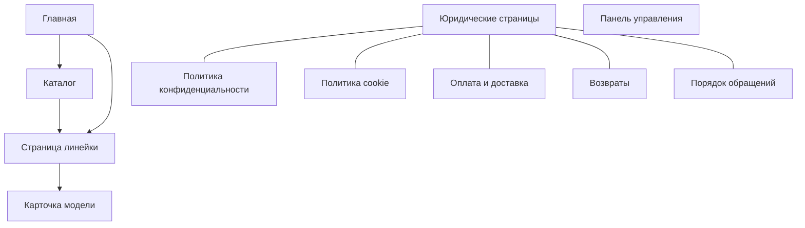

# Техническое задание для заказчика — Kiberstol.by

> Этот документ — «перевод» технического задания на понятный язык. Здесь описано, **что** будет сделано, **как** это будет работать с точки зрения заказчика и **какие решения уже зафиксированы**. Технические детали вынесены в глоссарий в конце документа.

---

## 1. О чём этот документ

Мы делаем сайт-витрину **Kiberstol.by** — интернет-магазин игровых компьютерных столов бюджетного сегмента. Сайт не продаёт товар напрямую (онлайн-оплаты нет), а **собирает заявки** от покупателей: человек оставляет имя и телефон, заявка приходит вам в Telegram.

Сайт полностью соответствует требованиям законодательства Республики Беларусь для продавца-ИП.

---

## 2. Что мы делаем и зачем

| Цель | Что это значит для вас |
|---|---|
| **Продажа через заявки** | Покупатель заполняет форму (имя + телефон), заявка приходит вам в Telegram. Вы сами связываетесь и договариваетесь о продаже. |
| **Соответствие закону РБ** | На сайте есть все обязательные сведения для ИП: реквизиты, торговый реестр, правила возврата, политика персональных данных. |
| **Самостоятельное наполнение** | Вы сами добавляете новые столы, меняете цены, фото и тексты через удобную панель управления — без программиста. |
| **Продвижение в поиске** | Сайт оптимизирован под запросы «купить игровой стол», «компьютерный стол Минск/Беларусь». |
| **Рост ассортимента** | Можно добавлять новые модели и целые линейки, а в будущем — кресла, без переделки сайта. |

---

## 3. Из чего состоит сайт (страницы)

Сайт состоит из следующих страниц:

| Страница | Что на ней |
|---|---|
| **Главная** | Витрина: анимированная «комната геймера», каталог, условия доставки и оплаты, преимущества, вопросы-ответы, форма заказа и обязательные юридические сведения. |
| **Каталог** | Все линейки столов и модели внутри них. |
| **Страница линейки** | Описание конкретной линейки столов + список её моделей. |
| **Карточка модели** | Подробное описание одного стола: фото, характеристики, цена, гарантия, кнопка заказа. |
| **5 юридических страниц** | Политика конфиденциальности, политика cookie, оплата и доставка, возвраты, порядок обращений. |
| **Панель управления** | Закрытый раздел, где вы редактируете контент сайта. |

Схема переходов между страницами:

---

## 4. Главная страница

Секции идут сверху вниз в таком порядке:

1. **«Комната геймера»** — анимированная сцена в полумультяшном стиле (как заставки GTA): «заводится» компьютер, загораются кулеры и подсветка. Здесь логотип, бренд KiberStol, телефон, слоган «Катай с Kiberstol» / «Доступное качество» и кнопка «Смотреть столы».
2. **Каталог** — линейки столов, внутри каждой — модели с ценами.
3. **Доставка и оплата** — способы оплаты и доставки со сроками.
4. **Заказ** — блок, ведущий к форме заявки.
5. **Баннеры «важные моменты»** — листаемые карточки с ключевыми преимуществами и условиями.
6. **FAQ** — частые вопросы (раскрывающийся список).
7. **Форма заказа** — имя + телефон + галочки согласия.
8. **Подвал (футер)** — обязательные юридические сведения ИП.

### Обязательные сведения на главной (требование закона)

В самом низу главной страницы обязательно размещаются:

- ФИО ИП (место жительства **не указывается**);
- сведения о госрегистрации ИП (УНП, дата);
- телефон и электронная почта;
- уполномоченный по обращениям покупателей;
- телефоны администрации Первомайского района г. Витебска;
- режим работы;
- способы оплаты и доставки;
- дата регистрации в торговом реестре (№ 765426 от 30.12.2025).

---

## 5. Карточка товара

Каждая карточка стола содержит всё, что требует закон, плюс продающие элементы:

**Обязательно (по закону):**

- наименование товара;
- изготовитель и его местонахождение;
- поставщик и его местонахождение;
- страна происхождения;
- гарантийный срок (если установлен);
- цена в белорусских рублях (BYN);
- отметка, был ли товар б/у или конфискован (по умолчанию — нет).

**Продающие элементы:**

- фото и галерея (с увеличением по клику);
- характеристики;
- бейдж («Хит», «Новинка»);
- кнопка заказа.

---

## 6. Управление контентом (панель управления)

Сайт построен так, что **весь контент вы меняете сами**, без программиста:

- **Тексты, цены, фото, реквизиты, вопросы-ответы** — редактируются в удобной панели управления (CMS).
- **Внешний вид (цвета, шрифты, отступы)** — задаётся отдельно в стилях и не зависит от контента.
- **Структура и логика сайта** — код, который вы не трогаете.

Это значит: чтобы добавить новый стол или поменять цену, не нужно править код — достаточно заполнить форму в панели управления.

### Гибкие блоки контента

Страницы линеек и моделей собираются из готовых «кирпичиков» (блоков), которые можно переставлять и переиспользовать:

- заголовок-баннер;
- обычный текст с форматированием;
- одиночное изображение;
- карусель (слайдер) изображений;
- видео;
- видео в режиме «gif» (без звука, зациклено);
- галерея с увеличением;
- кнопка-призыв;
- вопросы-ответы;
- таблица характеристик;
- промо-баннер;
- многоколоночный блок;
- цитата;
- разделитель.

---

## 7. Дизайн и фирменный стиль

- **Тема:** тёмная «cyberpunk/gaming» с неоновыми акцентами, но **в меру** — соответствует позиционированию «игровые столы».
- **Фирменные цвета:** голубой, фиолетовый, белый; допускаются контрастные дополнительные. Точные коды цветов и логотип вы предоставите позже.
- **Ключевой визуальный акцент** — «комната геймера»: уютная игровая комната с подставкой под наушники, ковриками, микрофоном, лампами, постерами, 2–3 мониторами, игровой консолью.
- **Одна фиксированная тема** — без переключателя оформления.
- Шрифты и изображения — с открытой лицензией (без проблем с авторскими правами).
- Фотографии товаров — ваши реальные фото/рендеры.

---

## 8. Заявки и связь с покупателями

- Покупатель заполняет форму: **имя + телефон** + галочки согласия на обработку персональных данных и на рекламу.
- Заявка отправляется **вам в Telegram**.
- Форма защищена от спам-ботов (скрытые поля-ловушки).
- Секретные ключи Telegram-бота хранятся **только на сервере** и не видны посетителям.

---

## 9. Аналитика и реклама

Сайт подключает системы аналитики и рекламы от **Яндекса** и **Google**:

| Система | Зачем |
|---|---|
| Google Analytics 4 | Статистика посещаемости и поведения |
| Яндекс.Метрика | Статистика, вебвизор, цели |
| Google Ads | Отслеживание конверсий рекламы |
| Яндекс.Директ | Отслеживание конверсий рекламы |

**Важно:** все эти системы включаются **только после согласия посетителя** (через баннер cookie), как требует закон о персональных данных. Посетитель может отдельно согласиться на аналитику и отдельно на рекламу, а также отозвать согласие.

---

## 10. Юридические требования РБ (важно для ИП)

| Требование | Как реализовано |
|---|---|
| Домен `.BY` и регистрация в БелГИЭ | Регистрация после делегирования домена; сайт размещается на белорусском хостинге. |
| Торговый реестр | Номер и дата выводятся на главной и в разметке для поисковиков. |
| Обязательные сведения на главной | Отдельный блок в футере (ФИО, УНП, телефон, email, режим работы, оплата/доставка, дата реестра, уполномоченный, телефоны исполкома). |
| Персональные данные | Баннер cookie, политика конфиденциальности, отдельная галочка согласия в форме. |
| Реклама | Отдельная галочка согласия на рекламу. |
| Возвраты надлежащего качества | Мебельные гарнитуры/наборы обмену и возврату **не подлежат** (Постановление №778, ГОСТ 20400-80). |
| Возвраты ненадлежащего качества | Замена до 1 месяца, безвозмездное устранение, проверка качества продавцом. |
| Книга замечаний и предложений | Адрес, часы выдачи, телефон/email — на странице обращений. |

---

## 11. Продвижение в поиске (SEO)

- У каждой страницы корректные заголовки и описания для поисковиков.
- Специальная разметка, чтобы поисковики правильно понимали: это организация (ИП), товар с ценой в BYN, список товаров, вопросы-ответы.
- Автоматическая карта сайта (sitemap) и файл robots.txt.
- Один главный заголовок на страницу, подписи у всех изображений.

---

## 12. Что нужно от вас (данные)

Часть данных вы предоставляете позже — они не мешают начать разработку. Пока они стоят как «заглушки» и заменяются по мере получения:

| Данные | Куда пойдут |
|---|---|
| Названия, описания, цены, фото столов и линеек | Каталог |
| Логотип | Шапка и футер сайта |
| Точные коды фирменных цветов | Оформление |
| Гарантийный срок производителя | Карточка товара |
| ID аналитики (GA4, Яндекс.Метрика) | Настройки аналитики |
| ID рекламы (Google Ads, Яндекс.Директ) | Настройки рекламы |
| Токен и chat_id Telegram-бота | Сервер (приём заявок) |
| Телефоны исполкома (Первомайский р-н Витебска) | Юридический блок |

---

## 13. Зафиксированные решения (сводка)

| Вопрос | Решение |
|---|---|
| Панель управления | Keystatic — удобная система, где вы сами редактируете контент; изменения сохраняются в файлах и не требуют программиста. |
| Оформление | Одна фиксированная тема «cyberpunk», адаптированная под ваш бренд. |
| Заявки | Форма отправляет заявку в Telegram; ключи бота хранятся только на сервере. |
| Тип сайта | Статический — страницы собираются заранее и быстро загружаются. |
| Оплата | Только при доставке (наличными/картой); онлайн-оплаты на сайте нет. |
| Доставка | По Минску — от 1 часа до 2 дней; по РБ через Белпочту — 3–5 дней. |
| Режим работы | Заказы принимаются с 9:00 до 21:00 без выходных. |
| Уполномоченный | ИП Суворов Александр Владимирович. |
| Исполком | Администрация Первомайского района г. Витебска. |

---

## 14. Когда сайт считается готовым (критерии приёмки)

1. Все обязательные сведения (разделы 4, 5, 10) выведены и берутся из контента, а не «зашиты» в код.
2. Форма отправляет заявку в Telegram; защита от ботов работает; согласие на персональные данные и рекламу обязательно.
3. Баннер cookie блокирует аналитику до согласия; отзыв согласия работает.
4. Карточка товара содержит все обязательные поля; цена в BYN.
5. Все 5 юридических страниц и карта сайта на месте.
6. Сайт собирается без ошибок и разворачивается на белорусском хостинге с доменом `.BY`.
7. Поисковая разметка корректна, по одному главному заголовку на страницу, подписи у изображений.
8. Контент меняется только в панели управления, оформление — только в стилях; в коде нет «зашитых» текстов и цен.

---

## Приложение. Технический глоссарий

> Этот раздел — для технических специалистов. Здесь термины из основного документа раскрыты точнее.

| Термин (понятным языком) | Техническая реализация |
|---|---|
| Технология сборки сайта | **Astro** (SSG, `output: 'static'`), Content Layer API с `loader: glob(...)` |
| Панель управления | **Keystatic CMS** (git-based, GitHub OAuth), конфиг `keystatic.config.ts`, маршрут `/keystatic` |
| Структурированный контент | Content Collections: `products`, `lines`, `site`, `legal`, `sections`, `faq` |
| Проверка данных | `astro/zod` (схемы валидации) |
| Оформление | **Tailwind CSS v4** (`@tailwindcss/vite`) + CSS-переменные, тема `cyberpunk.css` |
| Гибкие блоки | `fields.blocks` в Keystatic → компонент `ContentBlocks.astro` + блоки в `src/components/blocks/` |
| Единая разметка | `BaseLayout.astro` + `Header`/`Nav`/`Footer`/`LegalBlock`/`SEO` |
| Форма заявки | `form.ts` → `POST /api/submit.php` → Telegram Bot API; honeypot + time-honeypot; токен через `getenv` |
| Баннер cookie | `consent.ts` + `cookie-consent.ts` (гранулярное согласие) |
| Аналитика/реклама | `analytics.ts` + `advertising.ts` (gated-загрузка после согласия) |
| Интерактив | Vanilla JS/TS, без сторонних библиотек |
| Поисковая разметка | JSON-LD: `Organization`, `Product + Offer` (BYN), `ItemList`, `BreadcrumbList`, `FAQPage`; `@astrojs/sitemap` |
| Медиа | `storage` → `public/assets/uploads` (WebP, quality 80, ≤ 2000px) |
