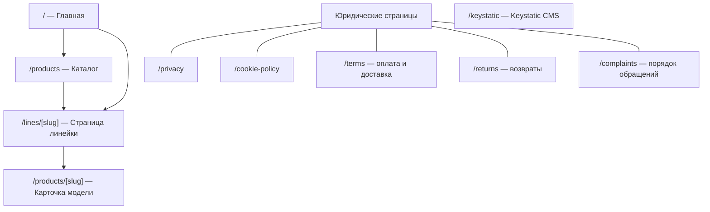
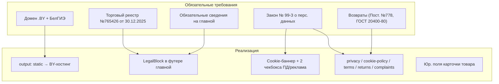
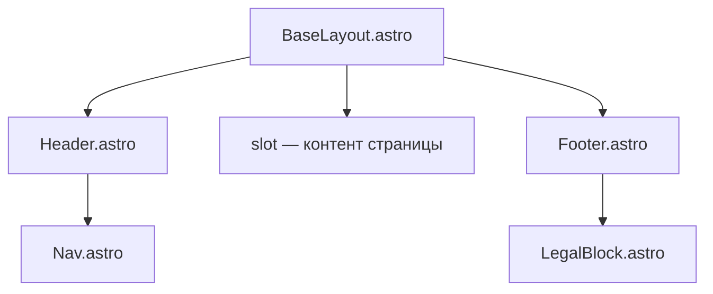
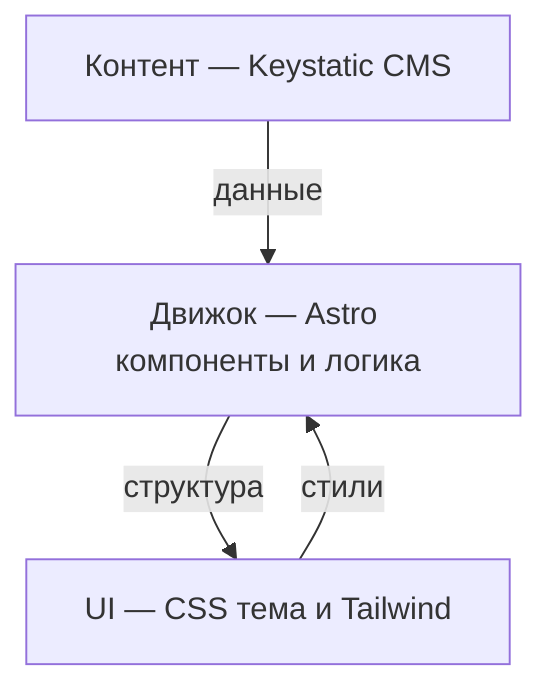

# Техническое задание — Kiberstol.by

Лендинг по продаже игровых компьютерных столов бюджетного сегмента.

> **Основа:** типовой проект FastPage ([`architecture.md`](E:/WORK/Projects/Sites/FastPage/plans/architecture.md)) — Astro SSG + Content Collections + Tailwind + Keystatic CMS. ТЗ описывает дельту относительно шаблона: что меняется и добавляется для интернет-магазина мебели (ИП, торговый реестр РБ).

> **Внешние данные:** все внешние данные (названия/цены/фото товаров, логотип, color codes, гарантийные сроки, ID аналитики/рекламы, токены Telegram-бота, телефоны исполкома) предоставляются заказчиком. В ТЗ и контенте они фиксируются как **плейсхолдеры** и **не блокируют** архитектурные решения и разработку (см. §12).

> **Архитектурные решения (зафиксировано):** CMS — **Keystatic** (git-based, GitHub OAuth, `fields.blocks`); тема — **одна фиксированная cyberpunk** (без свитчера), адаптированная под бренд. Детальные архитектурные документы — отдельным этапом (позже).

---

## 1. Общие сведения

| Параметр | Значение |
|---|---|
| **Проект** | Kiberstol.by — лендинг + каталог товаров |
| **Товар** | Компьютерные геймерские письменные столы, бюджетный сегмент |
| **Ассортимент** | Линейки столов (старт — 3, с перспективой расширения количества линеек и моделей внутри); в перспективе — кресла |
| **Заказчик** | ИП Суворов Александр Владимирович |
| **Слоган** | «Катай с Kiberstol» · «Доступное качество» |
| **ЦА** | 80–90 % мужчины: родители (ребёнку) и взрослые (себе), 13–50 лет, ядро 20–35 |
| **Интеграции** | Без сторонних интеграций (только форма → Telegram) |
| **Домен** | `.BY`, регистрация в БелГИЭ |
| **Тип сайта** | Статический (`output: 'static'`), деплой на BY-хостинг |

---

## 2. Цели и задачи

1. Продажа столов через заявки (лидогенерация) — форма заказа/обратной связи.
2. Полное соответствие обязательным требованиям законодательства РБ для ИП-продавца (торговый реестр, реквизиты, ПД, возвраты).
3. Быстрое наполнение ассортимента без правки кода (через Keystatic CMS).
4. SEO-продвижение по запросам «купить игровой стол», «компьютерный стол Минск/Беларусь».
5. Масштабируемость: добавление товаров внутри линеек и новых категорий (кресла) без рефакторинга.

---

## 3. Карта страниц



| Маршрут | Назначение | Источник |
|---|---|---|
| `/` | Главная (секции + обязательный юр. блок) | `site`, `lines`, `sections` |
| `/products` | Каталог: линейки → модели (вложенность) | `lines`, `products` |
| `/products/[slug]` | Карточка модели (юр. обязательные поля + гибкие блоки) | `products` |
| `/lines/[slug]` | Страница линейки (гибкие блоки + список моделей) | `lines`, `products` |
| `/privacy` | Политика конфиденциальности | `legal/privacy.md` |
| `/cookie-policy` | Политика обработки файлов cookie | `legal/cookie-policy.md` |
| `/terms` | Порядок оформления заказа + условия оплаты и доставки | `legal/terms.md` |
| `/returns` | Возвраты надлежащего/ненадлежащего качества | `legal/returns.md` |
| `/complaints` | Порядок подачи обращения о нарушении прав | `legal/complaints.md` |
| `/keystatic` | Keystatic CMS (git-based, GitHub OAuth) | `keystatic.config.ts`; маршруты инжектит `@keystatic/astro` |

> Шаблон [`index.astro`](src/pages/index.astro) переиспользуется; добавляются страницы `/products`, `/products/[slug]`, `/lines/[slug]` и 5 юридических. Страницы `/lines/[slug]` и `/products/[slug]` — generic: рендерятся из массива гибких блоков контента (см. §6.6). Все страницы оборачиваются в единый [`BaseLayout.astro`](src/layouts/BaseLayout.astro) с общими `Header`/`Nav`/`Footer` (см. §8.1).

---

## 4. Требования к главной странице

### 4.1. Порядок секций (утвержденный эталон)

> Состав и порядок секций зафиксированы по текущему утвержденному контенту
> главной страницы. В рамках рефакторинга v2 они **не изменяются**.
> Секции `order` и `banners`, а также вывод моделей на главной в текущий
> эталон **не входят** (см. §4.3 «Будущее развитие»).

```
Hero (комната геймера) → Преимущества → Каталог (только линейки)
→ Доставка и оплата → FAQ → Контакты (форма заказа)
→ Footer (обязательный юридический блок)
```

| # | Секция | Назначение | Источник |
|---|---|---|---|
| 1 | **Hero — комната геймера** | Полумультяшная игровая комната (стиль заставок GTA): «заводится» компьютер, загораются кулеры и подсветка. В комнате размещены логотип, бренд **KiberStol**, телефон для заказа, слоган «Катай с Kiberstol» / «Доступное качество», CTA «Выбрать» | `sections/hero.md` + анимированная сцена |
| 2 | **Преимущества** | Текст о бренде и преимуществах + CTA «Смотреть линейки» | `sections/advantages.md` |
| 3 | **Каталог** | Только линейки (баннеры → `/lines/[slug]`). Модели на главной не выводятся — они показываются на странице линейки | `lines` |
| 4 | **Доставка и оплата** | Способы оплаты (только при доставке, онлайн-оплаты нет) и доставки + сроки (юр. требование) | `sections/delivery.md` |
| 5 | **FAQ** | Частые вопросы (аккордеон) | `sections/faq.md` (variant `faq`) |
| 6 | **Контакты / форма заказа** | Имя + телефон (+ чекбоксы ПД/реклама) → Telegram, контактные ссылки | `sections/contacts.md` + `form.ts` |
| — | **Footer** | Обязательный юридический блок ИП (см. §4.2) — в самом низу страницы | `site.settings` |

> **Якоря навигации:** `#advantages`, `#catalog`, `#delivery`, `#faq`, `#contacts`
> соответствуют утвержденным секциям. Пункты меню задаются в
> `site/settings.yaml` (`nav`).

### 4.2. Обязательная информация на главной (закон)

На главной странице в обязательном порядке размещаются:

- ФИО ИП (место жительства **не указывается**);
- сведения о госрегистрации ИП (УНП, дата);
- номер телефона, электронная почта;
- уполномоченный рассматривать обращения покупателей о нарушении прав потребителей;
- номера телефонов работников исполкома по месту госрегистрации ИП — **администрация Первомайского района г. Витебска** (как на сайте Kingstyl);
- режим работы;
- способы оплаты товаров и их доставки;
- дата регистрации в торговом реестре (рег. № 765426 от 30.12.2025).

Реализация — единый компонент `LegalBlock.astro` в футере (самый низ страницы) + данные из [`site/settings.yaml`](src/content/site/settings.yaml).

### 4.3. Будущее развитие (не входит в рефакторинг v2)

Следующие возможности вынесены за рамки текущего рефакторинга и не должны
считаться требованиями к утвержденному эталону главной:

- отдельная секция `order` (промежуточный CTA-блок оформления заказа);
- секция `banners` («важные моменты», слайдер);
- вывод моделей внутри секции каталога на главной (сейчас — только линейки);
- новые категории товаров (кресла, аксессуары).

---

## 5. Требования к карточке товара

Каждая карточка обязана содержать (закон):

| Поле | Zod | Примечание |
|---|---|---|
| Наименование товара | `title` | обязательное |
| Наименование, местонахождение изготовителя | `manufacturer`, `manufacturerLocation` | обязательное |
| Наименование и местонахождение поставщика | `supplier` | обязательное |
| Страна происхождения | `countryOfOrigin` | обязательное |
| Гарантийный срок (если установлен) | `warranty` | опционально |
| Цена в белорусских рублях (BYN) | `price` | обязательное |
| Был ли товар б/у или конфискован | `used` | `boolean`, default `false` |

Плюс продающие поля: фото, галерея (лайтбокс), характеристики, бейдж («Хит», «Новинка»), кнопка заказа.

---

## 6. Контентная модель (Astro 7, Content Layer API)

> Все коллекции — через `loader: glob(...)` (см. предупреждение в [`architecture.md`](plans/architecture.md:333)). Валидация — `astro/zod`.

### 6.1. `products` — товары (модели)

```ts
const products = defineCollection({
  loader: glob({ pattern: '**/*.md', base: './src/content/products' }),
  schema: z.object({
    title: z.string(),               // наименование товара
    line: z.string(),                // id линейки (родитель); в Keystatic — relationship → lines
    price: z.number(),               // цена, BYN
    oldPrice: z.number().optional(),
    shortDescription: z.string(),
    description: z.string(),

    // Юридически обязательные поля карточки
    manufacturer: z.string(),        // наименование изготовителя
    manufacturerLocation: z.string(),// местонахождение изготовителя
    supplier: z.string(),            // наименование + местонахождение поставщика
    countryOfOrigin: z.string(),     // страна происхождения
    warranty: z.string().optional(), // гарантийный срок
    used: z.boolean().default(false),// б/у или конфискован

    specs: z.array(z.object({ name: z.string(), value: z.string() })).optional(),
    image: z.string(),
    gallery: z.array(z.string()).optional(),
    badge: z.string().optional(),
    ctaText: z.string().optional(),
    order: z.number().default(0),
    content: contentBlocks,          // гибкие блоки контента (см. §6.6)
    seo: seoSchema,
  }),
});
```

### 6.2. `lines` — линейки (старт — 3, с перспективой расширения)

```ts
const lines = defineCollection({
  loader: glob({ pattern: '**/*.md', base: './src/content/lines' }),
  schema: z.object({
    title: z.string(),
    description: z.string(),
    image: z.string(),
    features: z.array(z.string()).optional(),
    order: z.number().default(0),
    content: contentBlocks,          // гибкие блоки контента (см. §6.6)
    seo: seoSchema.optional(),
  }),
});
```

### 6.3. `site` — обязательные реквизиты (единый источник правды)

```ts
const site = defineCollection({
  // Единственный источник — settings.yaml (singleton `site` в Keystatic).
  loader: glob({ pattern: '**/*.{md,yaml}', base: './src/content/site' }),
  schema: z.object({
    brand: z.string(),
    tagline: z.string(),
    fullName: z.string(),            // ИП Суворов Александр Владимирович
    unp: z.string(),                 // 391946770
    registrationDate: z.string(),    // 14.04.2025 (госрегистрация ИП)
    tradeRegistryNumber: z.string(), // 765426
    tradeRegistryDate: z.string(),   // 30.12.2025 (торговый реестр)
    phone: z.string(),               // +375 29 637-76-63
    email: z.string(),               // kiberstol.by@gmail.com
    viber: z.string().optional(),    // ссылка Viber
    instagram: z.string().optional(),// ссылка Instagram
    address: z.string(),             // г. Минск, ул. Грушевская 17-14 (книга замечаний)
    workHours: z.string(),           // «заказы принимаются с 9:00 до 21:00 без выходных»
    authorizedBody: z.string(),      // уполномоченный по обращениям покупателей — ИП Суворов Александр Владимирович
    authorizedBodyPhone: z.string(), // телефоны администрации Первомайского района г. Витебска
    labels: z.object({               // подписи интерфейса (микротексты)
      specs: z.string(),
      productInfo: z.string(),
      relatedProducts: z.string(),
      lineModels: z.string(),
      catalogTitle: z.string(),
      catalogDescription: z.string(),
      breadcrumbsHome: z.string(),
      breadcrumbsCatalog: z.string(),
      cookieSettings: z.string(),
    }).optional(),
    nav: z.array(z.object({ label: z.string(), href: z.string() })),

    // Аналитика и реклама (Яндекс + Google)
    analytics: z.object({
      ga4Id: z.string().optional(),        // Google Analytics 4 (Measurement ID)
      yandexMetrikaId: z.string().optional(), // Яндекс.Метрика (счётчик)
    }).optional(),
    advertising: z.object({
      googleAdsId: z.string().optional(),  // Google Ads (конверсии)
      yandexDirectId: z.string().optional(), // Яндекс.Директ (конверсии)
    }).optional(),
    seo: seoSchema,
  }),
});
```

> **Удалено из `site`:** `brandColors` (цвета — только в CSS-теме),
> `paymentMethods`/`deliveryMethods` (перенесены в `sections/delivery.md`,
> `variant.delivery`). Файл `settings.md` не используется — только `settings.yaml`.

### 6.4. `legal` — юридические документы

```ts
const legal = defineCollection({
  loader: glob({ pattern: '**/*.md', base: './src/content/legal' }),
  schema: z.object({
    title: z.string(),
    updatedAt: z.coerce.date(),
    seo: seoSchema.optional(),
  }),
});
```

Файлы: `privacy.md`, `cookie-policy.md`, `terms.md`, `returns.md`, `complaints.md`.

### 6.5. Переиспользуемые коллекции шаблона

- `sections` — тексты секций главной; FAQ хранится в `variant` секции `faq`.

> **Исключено из разработки:** `testimonials` (отзывы) — не используется.
> Отдельная коллекция `faq` не используется: вопросы-ответы редактируются в секции `faq`.

### 6.6. Гибкие блоки контента (`contentBlocks`)

Generic-страницы линеек (`/lines/[slug]`) и моделей (`/products/[slug]`) строятся из переиспользуемых блоков контента. Блоки задаются через `fields.blocks` в Keystatic и рендерятся единым компонентом `ContentBlocks.astro`, который маппит тип блока на соответствующий Astro-компонент. Блоки можно переиспользовать в любом месте сайта (главная, линейка, карточка товара, юридические страницы).

| Блок | Назначение | Поля |
|---|---|---|
| `hero` | Hero-баннер страницы | заголовок, подзаголовок, фоновое изображение/видео, CTA |
| `richText` | WYSIWYG-текст | `fields.document` (заголовки, списки, ссылки, жирный/курсив) |
| `image` | Одиночное inline-изображение | изображение, alt, подпись, выравнивание |
| `imageCarousel` | Карусель изображений | массив изображений (alt + подпись), автопрокрутка |
| `video` | Inline-видео | URL/файл, постер, контролы, автовоспроизведение |
| `videoGif` | Видео в режиме «gif» | URL/файл, без звука, зациклено, без контролов |
| `gallery` | Сетка/лайтбокс изображений | массив изображений |
| `cta` | Кнопка/призыв к действию | текст, ссылка, стиль |
| `faq` | Аккордеон вопросов-ответов | массив {вопрос, ответ} |
| `specs` | Таблица характеристик | массив {название, значение} |
| `banner` | Промо-баннер «важный момент» | изображение, заголовок, текст, ссылка |
| `columns` | Многоколоночный блок | массив колонок (каждая — вложенные блоки) |
| `quote` | Цитата/отзыв-вставка | текст, автор |
| `divider` | Разделитель/спейсер | стиль, отступ |

> **Принцип:** каждый блок — отдельный Astro-компонент в `src/components/blocks/`; `ContentBlocks.astro` рендерит массив блоков в заданном порядке. Новые блоки добавляются без рефакторинга существующих страниц.

---

## 7. Юридический контур РБ



| Требование | Реализация |
|---|---|
| Домен `.BY`, БелГИЭ | Регистрация после делегирования; деплой только на BY-хостинг |
| Торговый реестр | Дата и номер в `site.settings` → главная + JSON-LD `Organization` |
| Обязательные сведения на главной | Компонент `LegalBlock` (ФИО, УНП, телефон, email, режим работы, оплата/доставка, дата реестра, уполномоченный, телефоны исполкома). Место жительства ИП **не указывается** |
| Персональные данные | Cookie-баннер (гранулярно), `privacy.md`, `cookie-policy.md`, отдельный чекбокс согласия в форме |
| Реклама | Отдельный чекбокс `marketing` + категория в consent (Google Ads + Яндекс.Директ) |
| Возвраты надлежащего качества | `returns.md` — мебельные гарнитуры/наборы обмену и возврату **не подлежат** (Постановление №778 от 14.06.2002, ГОСТ 20400-80) |
| Возвраты ненадлежащего качества | Замена ≤ 1 месяца, безвозмездное устранение, проверка качества продавцом |
| Книга замечаний и предложений | Адрес, часы выдачи (10:00–17:00, рабочие дни), телефон/email — в `complaints.md` |

---

## 8. Функциональные модули

| Модуль | Назначение | Реализация |
|---|---|---|
| Форма заказа | Имя + телефон + чекбоксы ПД/реклама | [`form.ts`](src/scripts/form.ts) — honeypot + time-honeypot + маска `+375 XX XXX-XX-XX` → `POST /api/submit.php` → Telegram-бот. Секретные ключи бота и чата хранятся **только на сервере** в PHP-скрипте |
| Cookie-баннер | Гранулярное согласие (аналитика/маркетинг) | [`consent.ts`](src/scripts/consent.ts) + [`cookie-consent.ts`](src/scripts/cookie-consent.ts) |
| Аналитика | GA4 + Яндекс.Метрика (gated, после согласия) | [`analytics.ts`](src/scripts/analytics.ts) |
| Реклама | Google Ads + Яндекс.Директ (gated, после согласия) | [`advertising.ts`](src/scripts/advertising.ts) |
| Каталог/галерея | Слайдер + лайтбокс фото товаров | [`carousel.ts`](src/scripts/carousel.ts) + [`lightbox.ts`](src/scripts/lightbox.ts) |
| Гибкие блоки контента | Рендер массива блоков (hero, richText, image, carousel, video, videoGif и др.) | [`ContentBlocks.astro`](src/components/blocks/ContentBlocks.astro) + компоненты в `src/components/blocks/` |
| FAQ | Аккордеон | [`faq.ts`](src/scripts/faq.ts) |
| Анимации | Reveal-on-scroll (`prefers-reduced-motion`) | [`reveal.ts`](src/scripts/reveal.ts) |
| Мобильное меню | Бургер-навигация | [`menu.ts`](src/scripts/menu.ts) |

### 8.1. Базовая разметка и переиспользуемые компоненты

Все страницы сайта используют единый базовый layout, чтобы меню, навигация и футер были одинаковыми на каждой странице. Это достигается через переиспользуемые Astro-компоненты, а не дублирование разметки.

| Компонент | Назначение | Путь |
|---|---|---|
| **BaseLayout** | Корневой layout: `<html>`, `<head>` (SEO, шрифты, стили), `<body>`, слоты для контента | [`BaseLayout.astro`](src/layouts/BaseLayout.astro) |
| **Header** | Шапка: логотип, бренд KiberStol, телефон, основная навигация | [`Header.astro`](src/components/layout/Header.astro) |
| **Nav** | Главное меню (Каталог, Линейки, Доставка, FAQ, Контакты) | [`Nav.astro`](src/components/layout/Nav.astro) |
| **Footer** | Подвал: обязательный юридический блок (`LegalBlock`) + навигация + контакты | [`Footer.astro`](src/components/layout/Footer.astro) |
| **LegalBlock** | Обязательные сведения ИП (см. §4.2) — встраивается в `Footer` | [`LegalBlock.astro`](src/components/layout/LegalBlock.astro) |
| **SEO** | Мета-теги, JSON-LD, canonical | [`SEO.astro`](src/components/seo/SEO.astro) |
| **ContentBlocks** | Рендер массива гибких блоков контента (см. §6.6) | [`ContentBlocks.astro`](src/components/blocks/ContentBlocks.astro) |

**Принцип единой разметки:**



- Каждая страница (`index.astro`, `/products`, `/lines/[slug]`, `/products/[slug]`, юридические) оборачивается в `BaseLayout` и передаёт контент через `<slot />`.
- `Header` (с `Nav`) и `Footer` (с `LegalBlock`) подключаются **один раз** в `BaseLayout` — они автоматически присутствуют на всех страницах.
- Навигация и реквизиты берутся из `site.settings` (единый источник правды), поэтому изменения в CMS применяются сразу на всём сайте.
- Мобильное меню (`menu.ts`) управляет `Nav` на всех страницах одинаково.

### 8.2. Аналитика и реклама (Яндекс + Google)

Сайт подключает системы аналитики и рекламы от **Яндекса** и **Google**. Все трекеры загружаются **только после явного согласия** пользователя (gated через cookie-баннер), в соответствии с Законом РБ № 99-З о персональных данных.

| Система | Тип | Назначение | Идентификатор |
|---|---|---|---|
| **Google Analytics 4** | Аналитика | Посещаемость, поведение, конверсии | `site.analytics.ga4Id` |
| **Яндекс.Метрика** | Аналитика | Посещаемость, вебвизор, цели | `site.analytics.yandexMetrikaId` |
| **Google Ads** | Реклама | Отслеживание конверсий рекламных кампаний | `site.advertising.googleAdsId` |
| **Яндекс.Директ** | Реклама | Отслеживание конверсий рекламных кампаний | `site.advertising.yandexDirectId` |

**Принципы:**

- **Gated-загрузка:** скрипты аналитики и рекламы не выполняются до согласия пользователя. Согласие гранулярное: отдельные категории `analytics` и `marketing` в cookie-баннере.
- **Отзыв согласия:** при отзыве согласия трекеры отключаются, ранее установленные cookie удаляются.
- **Единая точка:** идентификаторы хранятся в `site.settings` (единый источник правды) и подставляются в [`analytics.ts`](src/scripts/analytics.ts) и [`advertising.ts`](src/scripts/advertising.ts).
- **Без сторонних интеграций на сервере:** всё выполняется на клиенте после согласия; данные не передаются до согласия.

### 8.3. Разделение контента, движка и UI

Архитектурный принцип проекта — строгое разделение трёх слоёв, чтобы контент настраивался **только в CMS**, а внешний вид — **только в CSS**. Движок (Astro-компоненты и логика) не содержит ни контента, ни стилей.

| Слой | Что содержит | Где настраивается | Пример |
|---|---|---|---|
| **Контент** | Тексты, изображения, цены, реквизиты, блоки, FAQ, SEO-поля | **Только Keystatic CMS** (`src/content/*`) | `site.settings`, `lines`, `products`, `sections`, `faq`, `legal` |
| **Движок** | Структура, логика, рендер, маршруты, скрипты | **Только код** (`src/components`, `src/layouts`, `src/pages`, `src/scripts`) | `BaseLayout`, `ContentBlocks`, `form.ts` |
| **UI** | Цвета, шрифты, отступы, анимации, адаптивность | **Только CSS** (`src/styles/*`) | `cyberpunk.css`, Tailwind-утилиты |

**Правила:**

- **Контент не хардкодится** в компонентах: все тексты, цены, реквизиты, изображения и блоки берутся из CMS-коллекций. Изменение контента в CMS не требует правки кода.
- **UI не задаётся в контенте:** CMS не управляет цветами, шрифтами, отступами и анимациями. Визуальное оформление определяется только CSS-темой и Tailwind-классами в компонентах.
- **Движок не содержит стилей и контента:** Astro-компоненты описывают структуру и логику, но не встраивают inline-стили и не дублируют тексты.
- **Единый источник правды:** реквизиты, навигация, аналитика/реклама — в `site.settings`; тексты секций — в `sections`; товары/линейки — в `products`/`lines`.
- **Смена темы = смена CSS:** ребрендинг (цвета, шрифты) выполняется правкой CSS-темы без изменения контента и движка.



---

## 9. SEO-требования

| Артефакт | Реализация |
|---|---|
| Мета-теги | Единый [`SEO.astro`](src/components/seo/SEO.astro) |
| JSON-LD | `Organization` (ИП + торговый реестр), `Product + Offer` (карточки, валюта **BYN**, цена), `ItemList` (каталог/линейки), `BreadcrumbList`, `FAQPage` |
| Sitemap / robots | `@astrojs/sitemap` (исключить `/keystatic`, юридические) + [`public/robots.txt`](public/robots.txt) |
| Семантика | Один `h1`, `header/main/footer/section`, `alt` у всех фото |

> **Важно:** `Product.astro` адаптирован под физический товар: валюта BYN,
> обязательны `price` + `priceCurrency: BYN`; дополнительно выводятся `sku`,
> `brand`, `countryOfOrigin`, `itemCondition` и `offers.url`. `gtin` не используется.

---

## 10. Дизайн-требования

- **Тема:** тёмная «cyberpunk/gaming» с неоновыми акцентами, но **в меру** (не перегружать неоном) — соответствует позиционированию «игровые столы».
- **Фирменные цвета:** основные — **голубой**, **фиолетовый**, **белый**; допускаются контрастные дополнительные цвета. Точные color codes будут предоставлены заказчиком позже (логотип также позже).
- **Ключевой визуальный акцент — комната геймера:** уютная игровая комната в полумультяшном стиле (заставки GTA) с геймерскими аксессуарами — подставка под наушники, коврики под клавиатуру/мышь, микрофон, свет (лампы), постеры, 2–3 монитора, игровая консоль (плойка/хвох) и т.д. На главной — анимированная сцена: «заводится» компьютер, загораются кулеры и подсветка.
- Использовать существующую тему [`cyberpunk.css`](src/styles/themes/cyberpunk.css) как базовую, при необходимости адаптировать акцентные цвета под бренд.
- **Без свитчера тем:** одна фиксированная cyberpunk-тема (в отличие от FastPage, где есть переключатель business/cyberpunk/minimal).
- Self-host шрифты (Fontsource, OFL, кириллица), CC0-изображения.
- Фотографии товаров — реальные рендеры/фото заказчика (медиа через Keystatic: WebP, ресайз до 2000px).

---

## 11. CMS и медиа-слой

- `/keystatic` — Keystatic CMS, авторизация GitHub OAuth (git-based), конфиг [`keystatic.config.ts`](keystatic.config.ts).
- Медиа: `storage` (local/github) → `src/assets/uploads` (WebP/AVIF, ресайз ≤ 2000px через `astro:assets`). `public/assets/uploads` — legacy-заглушка.
- Коллекции `lines` и `products` — с `entryLayout: 'content'` и автогенерацией новых записей.
- Гибкие блоки контента — через `fields.blocks` (см. §6.6).

---

## 12. Внешние данные (плейсхолдеры) и архитектурные решения

> **Принцип:** все внешние данные предоставляются заказчиком и фиксируются как **плейсхолдеры** — они не блокируют архитектурные решения и разработку. Плейсхолдеры заменяются реальными данными по мере их получения от заказчика.

### 12.1. Плейсхолдеры внешних данных

| # | Данные | Куда пойдёт | Плейсхолдер |
|---|---|---|---|
| 1 | Названия, описания, цены, фото линеек и моделей | `lines`, `products` | `TODO: <название>` / `0` / `placeholder.webp` |
| 2 | Логотип | `public/assets` | `logo-placeholder.svg` |
| 3 | Точные color codes фирменных цветов | тема `cyberpunk.css` (не CMS) | `--color-primary` (голубой), `--color-secondary` (фиолетовый) — коды уточнить |
| 4 | Гарантийный срок производителя | `products.warranty` | `TODO` (опционально) |
| 5 | ID аналитики (GA4, Яндекс.Метрика) | `site.analytics` | `G-XXXXXXXXXX` / `XXXXXXXX` |
| 6 | ID рекламы (Google Ads, Яндекс.Директ) | `site.advertising` | `AW-XXXXXXXXX` / `XXXXXXXX` |
| 7 | Токен и chat_id Telegram-бота | серверный PHP-скрипт | `getenv('TG_BOT_TOKEN')` / `getenv('TG_CHAT_ID')` |
| 8 | Телефоны исполкома (Первомайский р-н Витебска) | `site.authorizedBodyPhone` | `TODO: +375 212 XX-XX-XX` |

### 12.2. Решённые вопросы

- **Оплата и доставка:** редактируются в `sections/delivery.md` (`variant.delivery`), не в `site`.
  - Оплата: **только при доставке** (на сайте оплаты нет — только сбор заявок). Наличными и картой; при доставке через Белпочту — наложенный платёж.
  - Сроки: по Минску (при наличии) — от 1 часа до 2 дней; по РБ через Белпочту — 3–5 дней.
- **Режим работы:** «Заказы принимаются с 9:00 до 21:00 без выходных».
- **Уполномоченный:** тот же ИП Суворов Александр Владимирович.
- **Исполком:** администрация Первомайского района г. Витебска (телефон — как на сайте Kingstyl).
- **Цвета:** основные — голубой, фиолетовый, белый; допускаются контрастные дополнительные. Точные color codes и логотип заказчик предоставит позже.

### 12.3. Архитектурные решения (зафиксировано)

| Вопрос | Решение | Источник |
|---|---|---|
| CMS | **Keystatic** (git-based, GitHub OAuth, `fields.blocks`) | ТЗ §11 |
| Тема | **Одна фиксированная cyberpunk** (без свитчера), адаптированная под бренд | уточнено |
| Форма → Telegram | `POST /api/submit.php` → Telegram Bot API, токен через `getenv` | FastPage |
| Сборка | `output: 'static'`, Astro 7 Content Layer API (`loader: glob()`) | FastPage |
| Стилизация | Tailwind v4 (`@tailwindcss/vite`) + CSS-переменные | FastPage |
| Интерактив | Vanilla JS/TS, без сторонних библиотек | FastPage |
| Защита форм | Honeypot + time-based honeypot | FastPage |

---

## 13. Критерии приёмки

1. Все обязательные сведения (§4.2, §5, §7) выведены и берутся из контента (не захардкожены в компонентах).
2. Форма отправляет заявку в Telegram; honeypot блокирует ботов; согласие ПД/реклама обязательны.
3. Cookie-баннер блокирует аналитику до согласия; отзыв согласия работает.
4. Карточка товара содержит все юридически обязательные поля; цена в BYN.
5. Все 5 юридических страниц + `robots.txt`/`sitemap.xml` на месте; sitemap исключает служебные страницы.
6. Сборка `output: 'static'` проходит без ошибок; сайт разворачивается на BY-хостинге, домен `.BY`.
7. SEO: корректные JSON-LD `Product`/`Organization`/`FAQPage`, один `h1` на страницу, `alt` у изображений.
8. Разделение слоёв (§8.3): контент настраивается только в CMS, UI — только в CSS; в компонентах нет захардкоженных текстов/цен и inline-стилей.